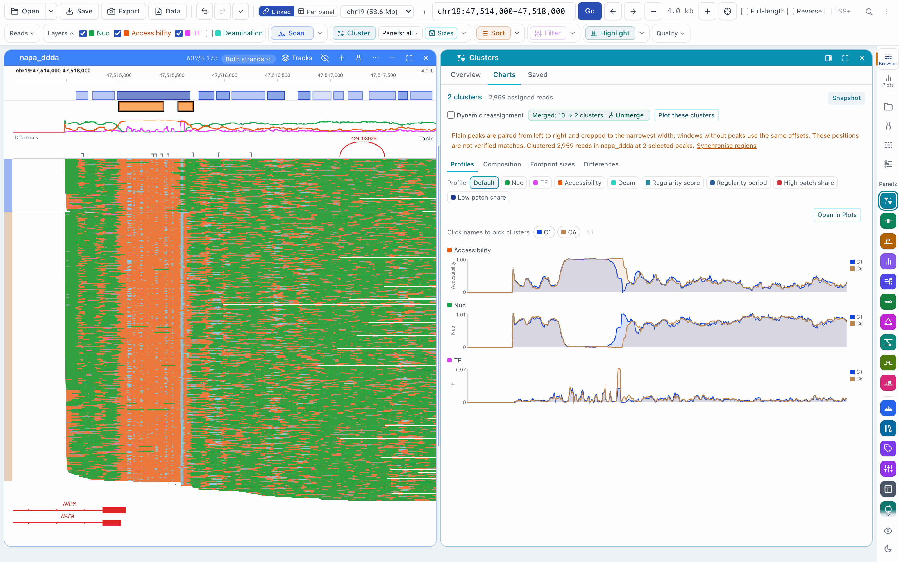

# FiberBrowser



An interactive genome browser for Fiber-seq and DAF-seq data at single-molecule
resolution. Each row is one DNA molecule, drawn with its nucleosomes,
transcription-factor footprints, accessible patches and base modifications.
You can cluster, sort and filter molecules by their footprints, measure how
often a footprint is occupied and which footprints occur together, split reads
by haplotype or structural-variant allele, and export figures and the data
behind them.

FiberBrowser shows the footprints called by
[FiberHMM](https://github.com/fiberseq/FiberHMM). FiberBrowser 3.1 needs
FiberHMM 3.2.2 or later (`fiberhmm[consensus]>=3.2.2,<4`) and installs it.

> **Mac app on 3.0.0 to 3.1.0? Download 3.1.1 by hand.** Those Mac apps can't
> check for updates, so they will never offer 3.1.1 themselves. They looked for
> HTTPS certificates in a folder that exists only on the computer that built
> them, so on other Macs most internet features fail with a certificate error.
> That covers the app and FiberHMM update checks, genome and annotation
> downloads (the run wizard's too), remote `https://` BAMs, UCSC tracks, ENCODE
> search, track hubs and share links, and Dfam TE downloads. Local files, runs,
> BLAST and primers, graph mode, exports, `s3://` BAMs and remote bigWigs keep
> working. Get `FiberBrowser-3.1.1-arm64.dmg` from
> [Releases](https://github.com/fiberseq/FiberBrowser/releases/latest); from
> 3.1.1 on, updates work again. Pip installs are not affected, and the Windows
> app is not known to be.

**Documentation:** [docs/index.md](https://github.com/fiberseq/FiberBrowser/blob/main/docs/index.md)
· [User guide](https://github.com/fiberseq/FiberBrowser/blob/main/docs/guide.md)
· [Tutorial](https://github.com/fiberseq/FiberBrowser/blob/main/docs/tutorial.md)
· [Reference](https://github.com/fiberseq/FiberBrowser/blob/main/docs/reference.md)
· [Changelog](https://github.com/fiberseq/FiberBrowser/blob/main/CHANGELOG.md)

## Install

| You want | Do this |
|----------|---------|
| The Mac app (Apple silicon, macOS 14+) | Download `FiberBrowser-<version>-arm64.dmg` from [Releases](https://github.com/fiberseq/FiberBrowser/releases) and drag it to Applications. It bundles Python, FiberHMM 3.2, minimap2 and BLAST+. |
| The Windows app (Windows 10 2004+ or 11, x64) | Run `FiberBrowser-<version>-Setup.exe` from [Releases](https://github.com/fiberseq/FiberBrowser/releases). It runs in WSL 2 and opens in its own window. |
| The `fiberbrowser` command (macOS, Linux, or WSL; Python 3.10+) | `pipx install "fiberbrowser[app]"` (or `python3 -m pip install "fiberbrowser[app]"`). This installs FiberHMM 3.2.2 or later from PyPI. |
| A source checkout | `git clone https://github.com/fiberseq/FiberBrowser && cd FiberBrowser`, then `bash scripts/install.sh` and `.venv/bin/python browser.py` (or, in a Python you manage yourself, `python3 -m pip install -r requirements.txt` and `python browser.py`). |
| A read-only server for reviewers | The Docker image `ghcr.io/fiberseq/fiberbrowser:<version>` (runs `--public`). |

Extras for the pip install: `app` (its own window), `copilot` (local Copilot on
Apple silicon), `primers` (primer3-py, seqfold), `contact-maps` (cooler, h5py),
`umap`, `plots`, `pipeline` (mappy, for DAF-seq runs without minimap2), or
`all`. `graph` adds the helper for graph mode (Apple silicon Macs for now; not
part of `all`). Details, conda, the Windows app and Docker:
[Installing FiberBrowser](https://github.com/fiberseq/FiberBrowser/blob/main/docs/install.md).

## Quick start

```bash
fiberbrowser                                          # empty browser; open files from the UI
fiberbrowser -b sample.bam -g genes.gtf -f genome.fa  # a BAM with gene annotations and a reference
fiberbrowser --app -b sample.bam                      # the same, in its own window
fiberbrowser --help                                   # every option
```

From a source checkout, `python browser.py` takes the same options. The server
listens on this computer only (port 8000, or the next free port) and opens its
access link, `http://localhost:8000/?token=...`, in your web browser. Every
launch has a new access token, so other users of the machine or network can't
use your browser.

New to FiberBrowser? Click **Take the tour** on the welcome screen. The tour
opens in a separate sandbox tab, loads two small bundled demos (DddA-seq reads
at the *NAPA* promoter, and H1 Fiber-seq reads around a 7.5 kb insertion) and
walks through the main tools in 58 steps. It never changes your own work. The
[tutorial](https://github.com/fiberseq/FiberBrowser/blob/main/docs/tutorial.md)
follows the same path in text, and the
[user guide](https://github.com/fiberseq/FiberBrowser/blob/main/docs/guide.md)
has a screenshot of every step.

QC-fail reads (`0x200`), including FiberHMM DAF strand-swap chimeras, are
excluded from read panels and analyses by default. **Quality → Show QC-fail
reads (incl. FiberHMM chimeras)** includes them for inspection; the choice is
saved in sessions. See [Quality filters](docs/guide.md#34-quality-filters).

## Bring your own annotations (MA tags)

FiberBrowser draws any per-read intervals you write into the BAM, not only
FiberHMM's calls. Add a group such as `;promoter.:845-201` to a read's `MA` tag
(the fiberseq Molecular-annotation spec that FiberHMM and fibertools use) and
it appears as its own layer, with a toggle, a colour, a metaprofile line, and a
place in Plots, peaks, rules and colour rules. The format, a short pysam
example and the coordinate rules are in
[Your own annotations](https://github.com/fiberseq/FiberBrowser/blob/main/docs/guide.md#your-own-annotations-ma-tags).

## What you can do

**Molecule panels.** One read panel per dataset, with the layers each file
carries (nucleosomes, TF footprints, accessibility, m6A, 5mC, deamination, and
any custom Molecular-annotation layer), a metaprofile track, peaks, genes and
the reference sequence. Panels can be linked, merged, copied, stacked, shown
side by side, or moved independently (**Linked / Per panel**), and each panel
can be on its own genome.

**Clustering, sorting and filtering.** Select peaks and cluster the molecules by
their footprints there (K-means, Neighbourhoods on the t-SNE graph,
hierarchical, HDBSCAN, combinatorial), merge similar clusters, focus one,
compare their profiles, composition and footprint size plots (also without
clustering), and see every read on a t-SNE,
UMAP or PCA map. Sort reads within clusters and filter them with reusable
rules.

**Plots.** Press **P** for a full-window plotting workspace that follows the
browser: metaprofiles (also split by footprint size), footprint size
enrichment, V-plots, size histograms, heatmaps over BED regions and
co-accessibility, pooled or by dataset, cluster, class or split panel, with
A − B and log2 comparisons and summaries with bootstrap intervals. Every
random step is seeded. **Keep** saves a plot to the Gallery with the browser
state it was made in. The default metaprofile track follows the layers you
switch on.

**Meta-locus (Preview).** Open a BED file (every promoter, every CTCF site) as
one virtual locus that pools the reads from all its sites, and browse, cluster
and plot a seeded working set of them. Refill clusters from the pool and count
how often a pattern occurs across all sites.

**Footprints and co-occupancy.** Cmd/Ctrl+click a footprint to see the sizes of
the footprints at that spot, save a size range as a definition, and look at its
sequence with JASPAR motif matches and a V-plot. **Co-occupancy** tests whether
saved footprints occur together on the same molecules (odds ratios, Fisher
exact tests with Benjamini–Hochberg correction), and can cluster the reads by
which ones they carry.

**Footprint classes (Preview).** **Find footprint classes** runs FiberHMM's
lattice recaller over every read in view, groups recurring footprints into
classes and gives each class's prevalence on each strand or chemistry. Saved
classes join co-occupancy, filtering and clustering.

**Variants: haplotypes and alleles.** The **Variants** panel finds the SNPs and
small indels in the reads in view, groups the reads by the alleles they carry,
and splits them into one panel per allele or per haplotype (from HP tags or
local allele patterns).

**Structural variants and inserts.** Deletions and insertions are drawn on the
reads and in the Differences row; any SV can split the reads into carriers and reference
reads. The **Insertion lens** shows the chromatin inside a large insertion, and
**Identify** reports candidate transposable-element families and genome copies
of the insert. **Open carriers with the insert expanded** (Preview) re-aligns
the carriers onto the alternate allele so the reads inside the insert can be
clustered and analysed like any region.

**Live lift and graph mode (Preview).** Draw reads aligned to a sample's own
assembly on the genome you browse, without realigning; see assembly
differences and their read evidence; view a dataset on pangenome graph lanes,
one per haplotype, and pop haplotypes out side by side. Graph mode needs the
graph helper (Apple silicon Macs for now).

**Nucleosomes.** Score how regular each molecule's nucleosome array is, call
regular and irregular patches, and find the patch geometries datasets share.

**Feature hub and scans.** Classes, NFRs, nucleosome patches, peaks, SNPs and
SVs in one list, compared across datasets and haplotypes, from the view, a BED
file, genes or genome-wide FiberHMM scans.

**Find a sequence.** Paste DNA into the locus box to find where it occurs in
the genome.

**NFRs.** The NFRs panel runs FiberHMM's `fiberhmm-nfr` on the view: NFR
variants with their prevalence, which NFRs open together, and motifs at each
NFR.

**Sessions.** **Save** writes a session file that reopens the exact view,
datasets, clusters, rules and settings. Work is kept as you go; the next launch
offers to reopen it. Every change can be undone, and a timeline jumps back to
any step. **New Independent Workspace** opens a separate session on the same
server.

**Export.** **Export** makes a figure (PNG, or SVG and PDF with editable
vector text and tracks). **Data** (Cmd/Ctrl+Shift+E) exports read names, read
tables, a BAM of chosen reads, peaks and regions as BED, cluster assignments,
class and co-occupancy tables, and the session. Every chart saves its plotted
values as TSV.

**Python API.** `browser_client.py` drives a running browser from Jupyter, or
starts a headless server for scripted figures and analyses:

```python
from browser_client import BrowserClient

with BrowserClient.headless(bam="footprints.bam", gtf="genes.gtf", fasta="genome.fa") as client:
    client.goto_gene("NAPA")
    reads = client.get_reads()           # a DataFrame, one row per read
    client.save_view("napa.pdf")         # the figure the browser would draw
```

**Primer design.** The **Primers** panel designs PCR primers around selected
peaks (or for 3C and 4C), checks them with BLAST against the genome, and
exports an order list for common vendors. It needs the reference FASTA.

**The Library.** Every BAM, BigBed and plasmid map you open, your DAF-seq runs
and watched folders, in one searchable list with chemistry, genome, QC verdicts
and FiberHMM re-run advisories. **New DAF-seq run** aligns and calls raw reads
(FASTQ, or Nanopore POD5) from the app.

**Connect to cluster.** Open BAMs, BigBeds, FASTAs and plasmid maps that stay
on a cluster, over your own SSH connection. S3 and HTTPS URLs open directly.

**Tracks.** bigWig, bigBed and BED tracks, JASPAR or custom motif tracks,
UCSC, ENCODE and ChIP-Atlas hubs, and contact maps (`.cool`/`.mcool`).

**Copilot (optional).** The Tutorial panel's Copilot tab answers "how do I…?"
questions by opening the right panels and pointing at the controls, like the
tour. It runs a small model on your computer: MLX on Apple silicon Macs (one
click downloads it), or a model you run with Ollama elsewhere. Nothing runs until
you set it up. FiberBrowser.app leaves it out. See
[Local Copilot](https://github.com/fiberseq/FiberBrowser/blob/main/docs/copilot.md).

What is supported and what is Preview in 3.1:
[What 3.1 includes](https://github.com/fiberseq/FiberBrowser/blob/main/docs/release-scope.md).
Upgrading from 3.0:
[What's new in 3.1](https://github.com/fiberseq/FiberBrowser/blob/main/docs/whats-new.md).

## Documentation

| Page | What it covers |
|------|----------------|
| [What's new in 3.1](https://github.com/fiberseq/FiberBrowser/blob/main/docs/whats-new.md) | Plots, the meta-locus, live lift and graph mode, nucleosomes, and what changed since 3.0. |
| [User guide](https://github.com/fiberseq/FiberBrowser/blob/main/docs/guide.md) | Every step of the guided tour with a screenshot, then footprint classes, haplotypes, figures, data export, sessions and workspaces. |
| [Tutorial](https://github.com/fiberseq/FiberBrowser/blob/main/docs/tutorial.md) | A written walkthrough of the tour on the bundled demos. |
| [Reference](https://github.com/fiberseq/FiberBrowser/blob/main/docs/reference.md) | Command-line options, environment variables, the access token, file formats, BAM tags and layers, the dataset catalog, panels, keyboard shortcuts. |
| [Installing FiberBrowser](https://github.com/fiberseq/FiberBrowser/blob/main/docs/install.md) | The Mac and Windows apps, pip and extras, conda, Docker, a source checkout. |
| [Workflows](https://github.com/fiberseq/FiberBrowser/blob/main/docs/index.md#workflows) | Plots, the meta-locus, DAF-seq runs, the Library, data on a cluster or S3, plasmids, clustering and transcription states, haplotypes, live lift, linked panels, differences and structural variants, graph mode, nucleosomes, the Feature hub, sequence search. |
| [Jupyter / Python API](https://github.com/fiberseq/FiberBrowser/blob/main/docs/jupyter-api.md) | `browser_client.py`: connecting, headless servers, figures, every method. |
| [Analysis methods and statistics](https://github.com/fiberseq/FiberBrowser/blob/main/docs/analysis_methods_and_statistics.md) | How each analysis is computed and tested. |
| [Deploying on a server](https://github.com/fiberseq/FiberBrowser/blob/main/docs/deployment/index.md) | Personal, lab and public servers; Open OnDemand. |
| [Plugins](https://github.com/fiberseq/FiberBrowser/blob/main/docs/plugins.md) | Adding an analysis panel with a Python plugin. |

## How to cite

If you use FiberBrowser or [FiberHMM](https://github.com/fiberseq/FiberHMM),
which calls the footprints FiberBrowser shows, please cite our preprint:

> Tullius, T. W., Catalano, C., Ranchalis, J., Hu, J., Vollger, M. R.,
> Stergachis, A. B., & Levine, M. S. (2026). FiberBrowser: a unified framework
> for single-molecule genomics. *bioRxiv*.
> https://doi.org/10.64898/2026.10.29.762797

```bibtex
@article{tullius2026fiberbrowser,
  title   = {{FiberBrowser}: a unified framework for single-molecule genomics},
  author  = {Tullius, Thomas W. and Catalano, Christopher and Ranchalis, Jane and
             Hu, Jie and Vollger, Mitchell R. and Stergachis, Andrew B. and
             Levine, Michael S.},
  journal = {bioRxiv},
  year    = {2026},
  doi     = {10.64898/2026.10.29.762797}
}
```

Please also give the FiberBrowser version you used. The reference with its version is in
[CITATION.cff](https://github.com/fiberseq/FiberBrowser/blob/main/CITATION.cff)
(GitHub's *Cite this repository*); see
[How to cite](https://github.com/fiberseq/FiberBrowser/blob/main/docs/citing.md).
In the app, **About FiberBrowser** and **⋮ → How to cite** give the citation,
and exported figures carry a citation line (on by default).

## License

MIT. See [LICENSE](https://github.com/fiberseq/FiberBrowser/blob/main/LICENSE).
