# FiberBrowser user guide

[← Docs index](index.md) · [← README](../README.md)

This guide follows FiberBrowser's guided tour step by step, with a screenshot
of each step. After the tour it covers the features the tour only mentions.
The screenshots show the two demos that ship with FiberBrowser: DddA-seq
(DAF-seq) reads at the *NAPA* promoter on human chromosome 19 (hg38,
`chr19:47,514,000-47,518,000`), and, for the [Variants](#variants) steps,
PacBio Fiber-seq reads from H1 cells around a 7,471-bp insertion on
chromosome 1. The steps work the same way on your own data.

Upgrading from 3.0.1? [What's new](whats-new.md) introduces live lift,
Differences, graph mode, the Feature hub and Nucleosomes. Each has a separate
workflow page with its controls and limits.

In each screenshot the dark box is the tour's popover. It gives the step's
title, one or two sentences about it, and (in green) how to do it yourself.
The control the step is about has a green ring. **Next** moves on, and many
steps also do the thing for you when you click it. **End tour** stops at any
time.

## Contents

- [Starting the tour](#starting-the-tour)
- [Getting started](#getting-started): [1](#1-welcome) welcome · [2](#2-loading-data) loading data · [3](#3-going-somewhere) going somewhere · [4](#4-pan-and-zoom) pan and zoom · [5](#5-search-commands-and-settings) ⌘K search · [6](#6-analysis-panels) analysis panels
- [Reads](#reads): [7](#7-reads) reads · [8](#8-acting-on-reads-right-click) right-click · [9](#9-selecting-reads-shiftclick) selecting reads · [10](#10-read-stats) Read Stats · [11](#11-toolbar-groups) toolbar groups · [12](#12-layers) layers
- [Peaks and clustering](#peaks-and-clustering): [13](#13-peaks) peaks · [14](#14-selecting-peaks) selecting peaks · [15](#15-clustering) clustering · [16](#16-merging-similar-clusters) merging · [17](#17-the-clusters-panel) Clusters panel · [18](#18-profiles-and-other-views) profiles · [19](#19-the-read-map) the read map · [20](#20-sort-and-filter) sort and filter
- [Footprints](#footprints): [21](#21-analysing-a-spot-cmdclick) Cmd+click · [22](#22-saving-a-footprint) saving a footprint · [23](#23-saved-footprints) Saved · [24](#24-footprint-classes) footprint classes · [25](#25-the-class-table) class table · [26](#26-saving-a-class) saving a class · [27](#27-saved-classes-and-their-prevalence) saved classes · [28](#28-co-occupancy) co-occupancy · [29](#29-compare-strands) compare strands
- [Regions and highlights](#regions-and-highlights): [30](#30-highlight) highlight · [31](#31-regions) regions · [32](#32-comparing-haplotypes) haplotypes
- [Labeling and rules](#labeling-and-rules): [33](#33-labeling) labeling · [34](#34-quality-filters) quality · [35](#35-rules) rules
- [Tracks](#tracks): [36](#36-adding-a-track) adding a track · [37](#37-track-hubs) track hubs
- [Other analyses](#other-analyses): [38](#38-co-accessibility) co-accessibility · [39](#39-primers) primers
- [Panels and layout](#panels-and-layout): [40](#40-linking-and-merging-datasets) linking · [41](#41-genomes-and-navigation) genomes · [42](#42-panel-actions) panel actions · [43](#43-layout) layout
- [Variants](#variants): [44](#44-a-structural-variant-demo) the SV demo · [45](#45-the-variants-panel) Variants panel · [46](#46-snps-in-view) SNPs · [47](#47-reads-split-by-haplotype) split by haplotype · [48](#48-structural-variants) SVs · [49](#49-insertions-on-the-reads) the Differences row · [50](#50-the-insert-expanded) insert expanded · [51](#51-inside-the-insert-a-ctcf-site) a CTCF site
- [Around the browser](#around-the-browser): [52](#52-undo) undo · [53](#53-save) save · [54](#54-export-a-figure) figure · [55](#55-export-data) data · [56](#56-the-tutorial-panel) Tutorial panel · [57](#57-copilot) Copilot · [58](#58-thats-the-tour) the end
- [Beyond the tour](#beyond-the-tour): [the read menu](#the-read-menu) · [the command palette](#the-command-palette) · [regions and highlights](#regions-and-highlights-in-depth) · [genomes and panels](#genomes-and-panels) · [side panels](#side-panels-and-the-drawer) · [opening files](#opening-files-and-the-library) · [POD5 runs](#run-everything-from-the-app-pod5) · [read filters](#read-filters) · [footprint classes](#footprint-classes-in-depth) · [DAF-seq strands](#daf-seq-strands-side-by-side) · [haplotypes](#haplotype-comparison) · [figures](#figure-export) · [data](#data-export) · [undo history](#undo-history) · [sessions](#sessions-and-workspaces) · [Jupyter](#jupyter-and-python) · [your own data](#your-own-data)

## Starting the tour

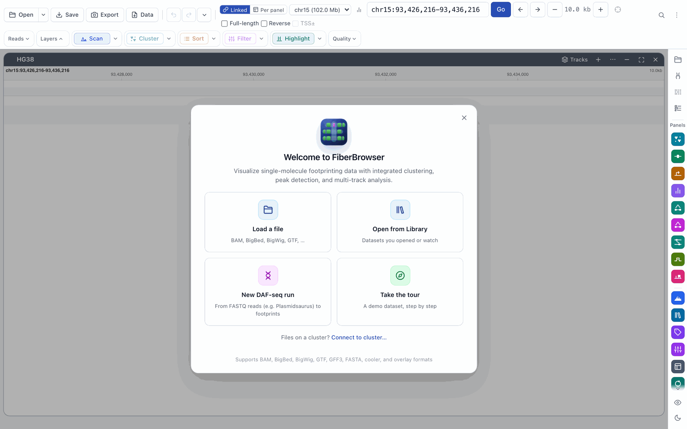

With nothing loaded, the browser shows a welcome card with three tiles:
**Load a file**, **New DAF-seq run** and **Take the tour**. Below them are
**Connect to cluster…** and a link to the **Library**. After a normal quit,
**Reopen last session** comes first. You can start the tour
in either of these ways:

- **Take the tour** on the welcome card.
- **Tutorial** (its tile in the rail at the right edge), tab **Guided tour**. Use **Start from the
  beginning**, or click any step to start there. The tour first sets up what
  that step needs: the demo, peaks, clusters, a saved footprint, the
  footprint classes, or the structural-variant demo and its SNP scan.

The tour opens in a **new browser tab with its own server session** (a
sandbox). A banner at the top says *nothing here changes your work*. The tab
starts empty, loads the demo, and can never change what is loaded in your own
tab. Close it with **Close tab** in the banner when you are done. A tour tab
you stop using expires after a while.

A sandbox tab hides the controls that act on your computer (**Open**,
**Save**, **Primers**, **Copilot**). The tour still explains them and says
that they appear in your own FiberBrowser tab.

> If the browser blocks the new tab, the tour runs in your current tab. At the
> end, **Reset the browser** puts everything back as it was and removes the
> demo; the undo timeline also keeps a "Before the guided tour" step. A
> `--public` server does not offer the demo, so there the tour runs on the
> data already loaded.

## Getting started

### 1. Welcome

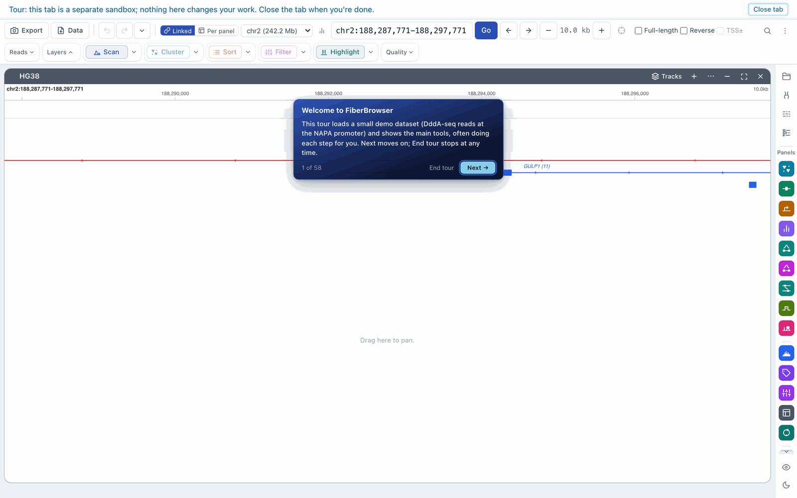

**Next** loads the demo dataset and moves to the *NAPA* promoter. The reads
appear in a panel named **NAPA demo (DddA-seq)**.

### 2. Loading data

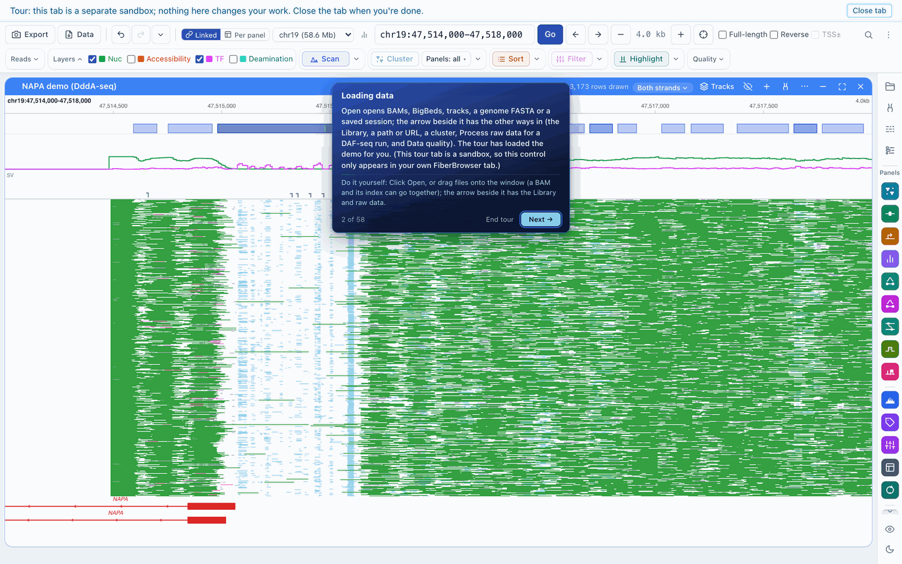

**Open** is at the top left of your own tab (the tour tab does not show
it). It opens fiber-seq or DAF-seq BAMs, FiberHMM BigBeds, BigWig and BED
tracks, gene annotations, a genome FASTA, plasmid maps, or a saved session.
You can also drag files onto the window. The arrow beside **Open** lists the
other ways in (the desktop app's **File** menu has the same items, and the
command palette finds them by these names):

- **Open from Library**: everything you have opened; see
  [Opening files and the Library](#opening-files-and-the-library).
- **Load by path / URL…**: a path on the server, or an `s3://` or `https://`
  URL (with an S3-compatible endpoint), in **Data & Sessions**.
- **Connect to cluster…** opens files that stay on a cluster; see
  [Data on a cluster](workflows/remote-cluster-data.md).
- **Process raw data (New DAF-seq run)…** aligns and calls raw DAF-seq reads,
  or basecalls raw Nanopore POD5 first (DAF-seq or Hia5 Fiber-seq); see
  [A DAF-seq run, from raw reads](workflows/daf-seq-quick-run.md) and
  [Run everything from the app (POD5)](#run-everything-from-the-app-pod5).
- **Data quality (QC a dataset)…** runs fiberhmm-qc on a loaded BAM, or on a
  BAM from the Library or a file without loading it.

In this menu, items that are not available here say why (for example, a lab
server without runs).

### 3. Going somewhere

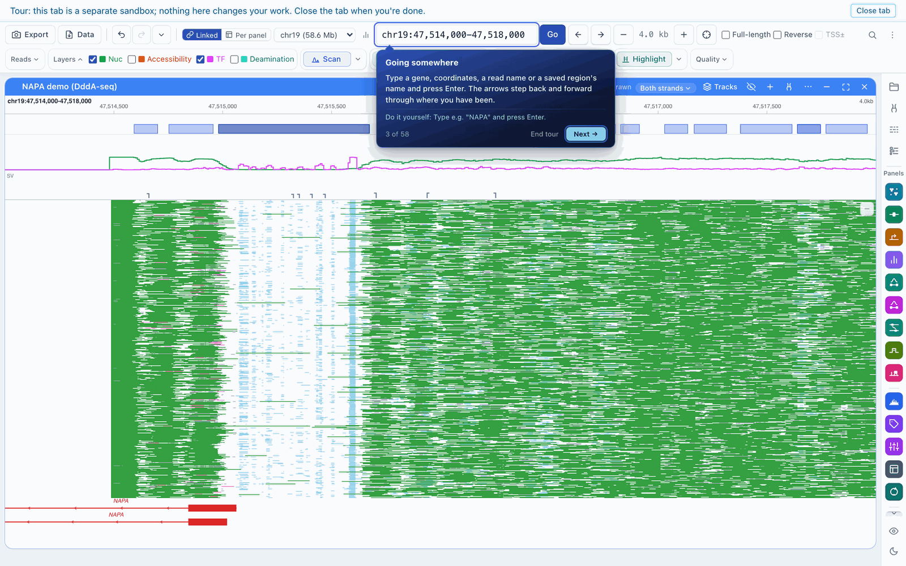

The location box takes any of these; press Enter (or **Go**) to go there:

- a gene name (`NAPA`);
- coordinates (`chr19:47,514,000-47,518,000`);
- a read name, or several separated by commas: the view goes to the read and
  highlights it;
- the name of a saved region or a region category (see
  [Regions](#31-regions)).

As you type, the box suggests matches under **Genes**, **Regions** and
**Reads**. The ← and → buttons step back and forward through where you have
been.

### 4. Pan and zoom

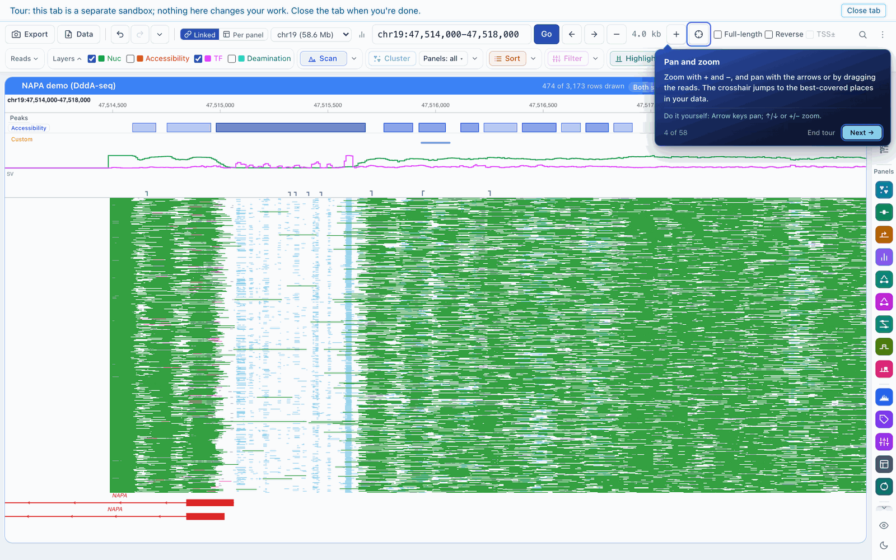

To zoom, use the **+** and **−** buttons, the ↑/↓ keys or the +/− keys. To
pan, use the arrow keys or drag the reads. The crosshair (*Go to the next
best-covered locus*) jumps to the best-covered places in your data, deepest
first.

### 5. Search commands and settings


**Cmd/Ctrl+K**, or the magnifier at the right of the top bar, opens the
**command palette**. It finds any action, analysis panel, setting or keyboard
shortcut, and goes to a locus, gene, saved region or read name. See
[The command palette](#the-command-palette).

### 6. Analysis panels

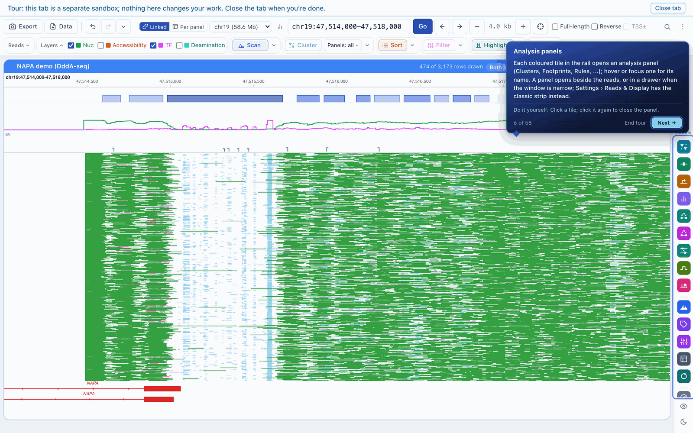

The coloured tiles in the rail at the right edge open the analysis panels
(Clusters, Footprints, Variants, Rules and the rest); hover or focus a tile
for its name, and click it again to close the panel. A panel opens beside the
reads, or in a drawer over them when the window is narrow. **Settings ›
Reads & Display** offers the classic strip of buttons above the reads
instead of the rail.

## Reads

### 7. Reads

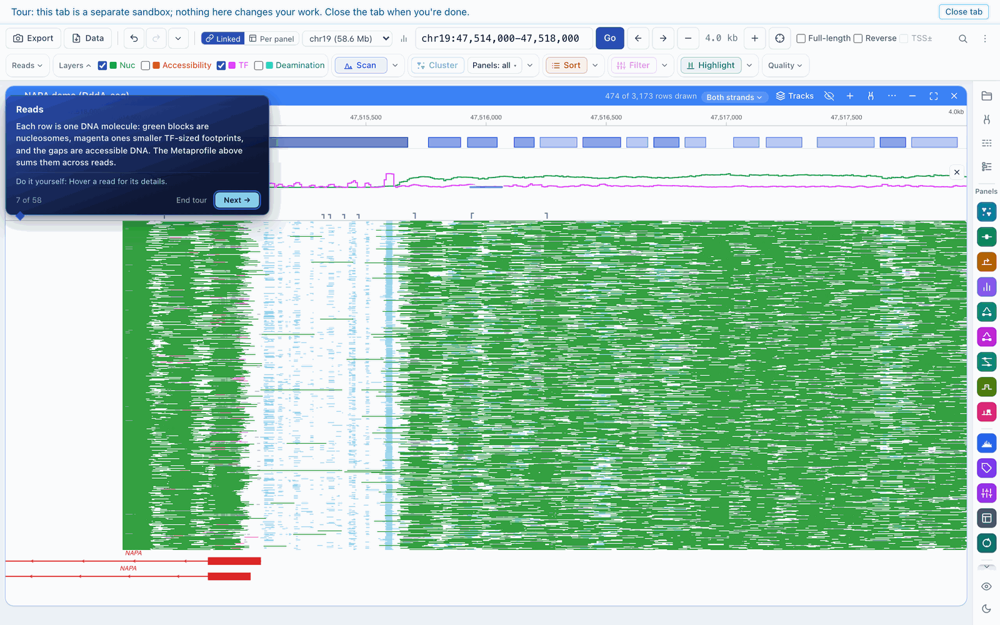

Each row is one DNA molecule:

- green blocks are nucleosome-sized footprints;
- magenta blocks are smaller, TF-sized footprints;
- the DNA between them is accessible.

The **Layers** checkboxes above the reads name each colour. The
**Metaprofile** track sums the layers across all reads. Hover a read for its
details.

The dataset's header shows its name, how many reads are shown, the strand
(for DAF-seq) and a **⋯** menu. Track labels such as Peaks, Metaprofile and
Footprint classes appear only while you point at the track.

### 8. Acting on reads: right-click

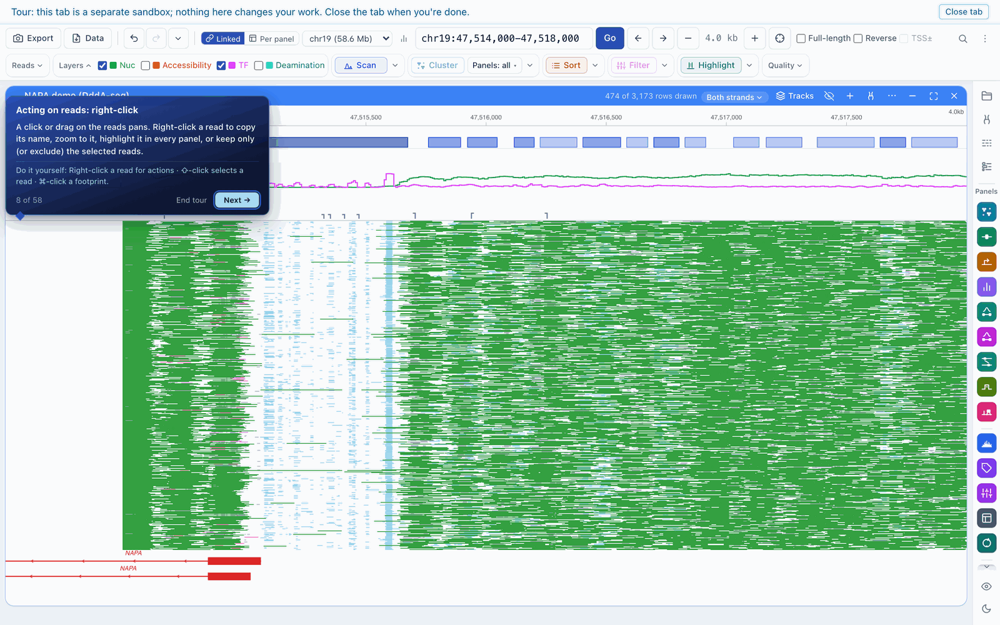

A click or drag on the reads always pans. Each other action has its own
gesture:

- **Shift+click** selects a read.
- **Cmd/Ctrl+click** selects a footprint.
- **Right-click** (Ctrl+click on a Mac) opens the **read menu**, with actions
  for that read: copy its name, zoom to it, highlight it in every panel, or
  keep only (or exclude) the selected reads.

See [The read menu](#the-read-menu). FiberBrowser no longer has click modes or
the V key.

### 9. Selecting reads: Shift+click

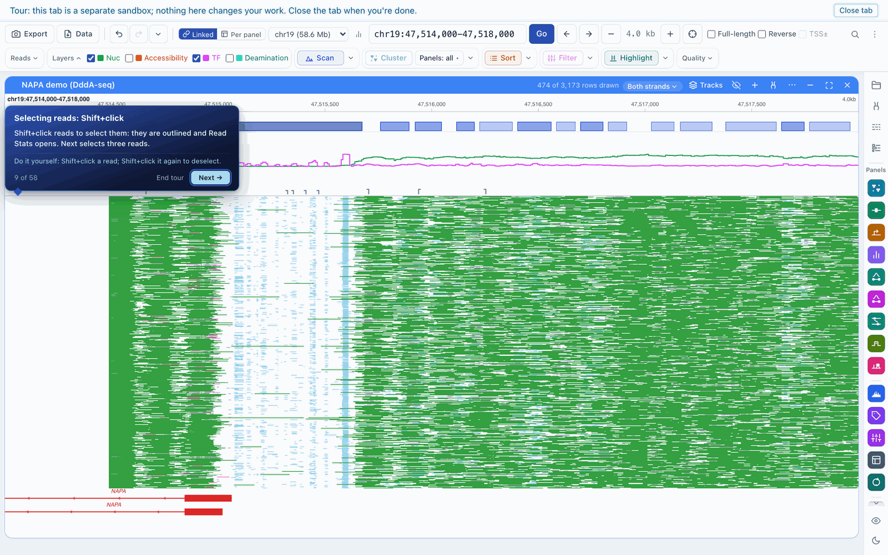

Shift+click a read to select it, and Shift+click it again to deselect it.
Selected reads are outlined and **Read Stats** opens. **Next** selects three
reads.

### 10. Read Stats

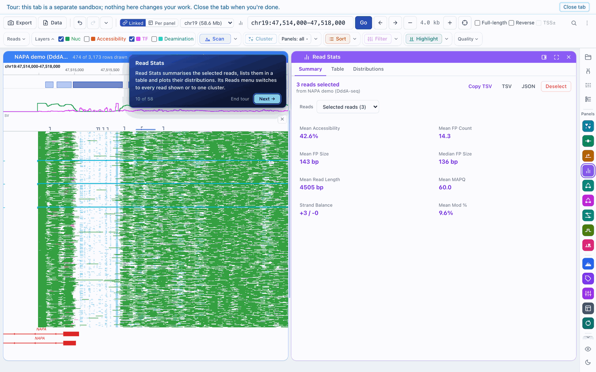

**Read Stats** has three tabs for the selected reads: **Summary**, **Table**
(one row per read: span, footprints, accessibility, MAPQ) and
**Distributions**. Its **Reads** menu switches to every read shown, or to one
cluster. **Deselect** clears the selection.

### 11. Toolbar groups

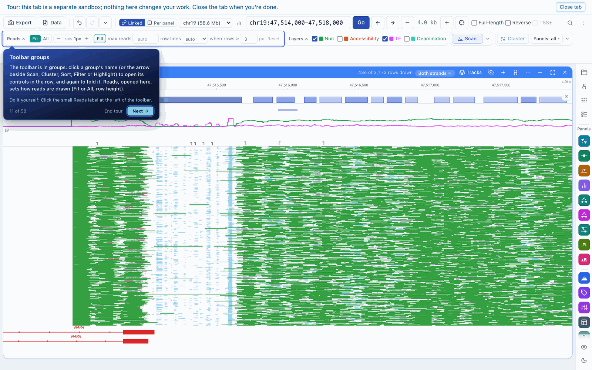

The operations toolbar is in groups: **Reads**, **Layers**, **Scan** (peaks),
**Cluster**, **Sort**, **Filter**, **Highlight** and **Quality**. Each action
keeps its own colour.

- Click a group's name, or the arrow beside its button, to open all its
  controls inline in the row.
- The group stays open, even after a reload, until you click it again to fold
  it.
- Only **Layers** starts open. Open groups that don't fit wrap onto a second
  line, and groups that don't fit the window even folded go to **More** at
  the end of the row.
- The reads always keep at least half the window. While the open groups would
  leave them less (a small window or a large UI size), the least used show
  folded until there is room again; they stay open, and clicking one shows it
  and folds another instead. At very large UI sizes the top bar and toolbar
  are also drawn smaller (never below 100%).

**Reads**, opened here, sets how reads are drawn:

- **Fit** squeezes every read into the panel, and **All** shows each read at
  full height.
- **−** and **+** set the row height.

### 12. Layers

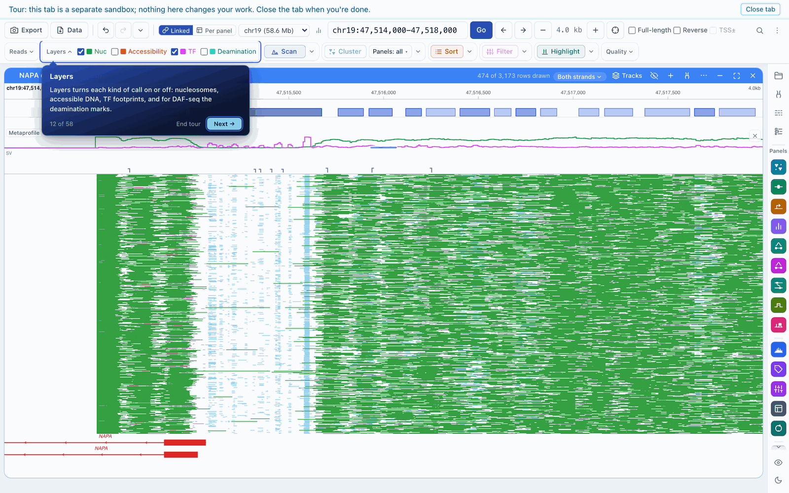

**Layers** turns each kind of call on or off: nucleosomes (**Nuc**),
**Accessibility**, TF footprints (**TF**), and for DAF-seq the individual
deamination marks (**Deamination**). After a class run, **Footprint classes**
appears here too. The full list is in the
[reference](reference.md#bam-tags-and-layers).

## Peaks and clustering

### 13. Peaks

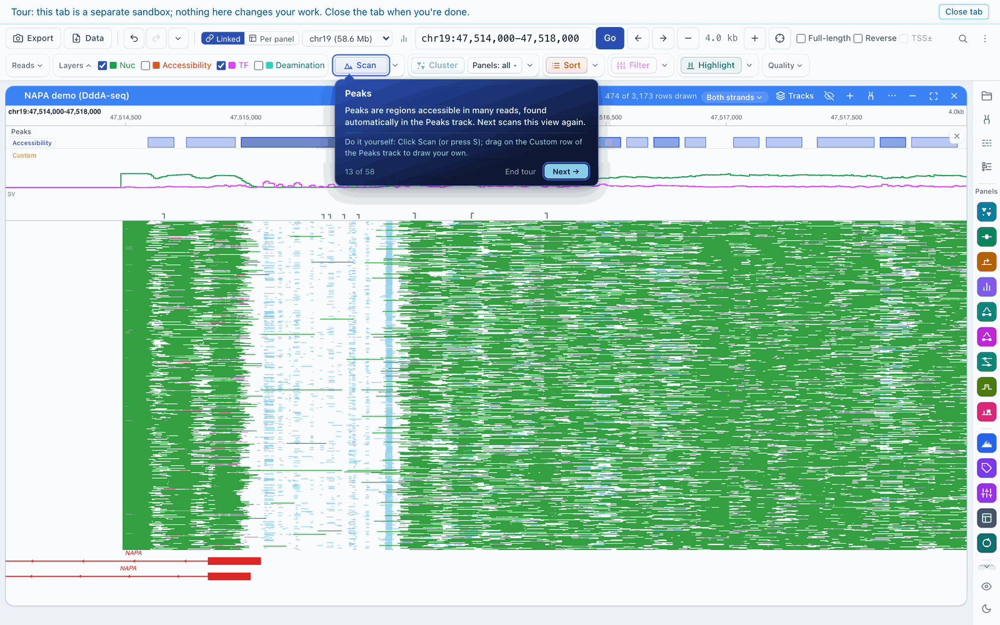

Peaks are regions accessible in many reads. FiberBrowser finds them
automatically in the **Peaks** track. **Scan** (or the S key) scans the view
again, and dragging on the **Custom** row of the Peaks track draws your own
peak. **Next** scans this view.

### 14. Selecting peaks

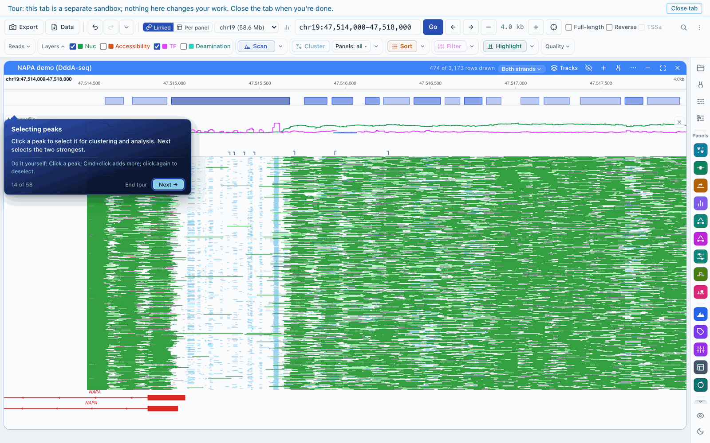

Click a peak to select it for clustering and analysis. Cmd/Ctrl+click adds
more, and clicking a selected peak deselects it. **Next** selects the two
strongest peaks.

### 15. Clustering

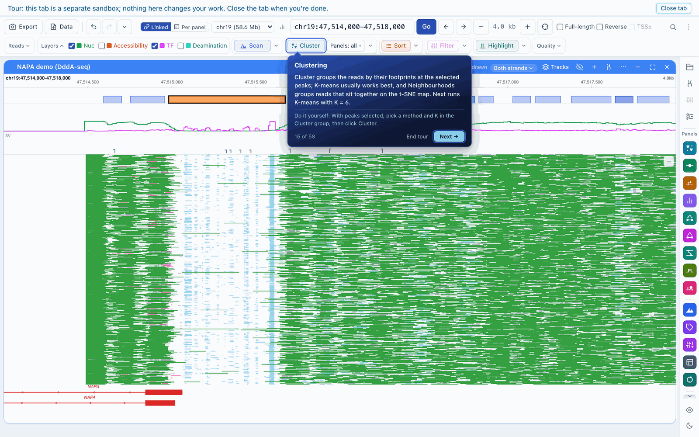

**Cluster** groups the reads by their footprints at the selected peaks. The
method and **K** are in the opened **Cluster** group. The methods are:

- **K-means (exact)** and **K-means (fast)**: K-means usually works best.
- **Neighbourhoods (t-SNE graph)**: groups reads that sit together on the
  [projection](#19-the-read-map) map. Its **Resolution** sets how many groups
  you get (higher gives more, smaller groups).
- **Hierarchical**, **HDBSCAN** and **Combinatorial**.

**Next** runs K-means with K = 6.

### 16. Merging similar clusters

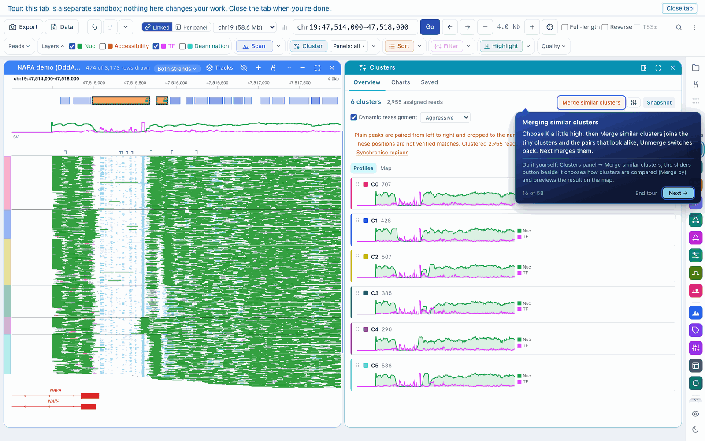

A good habit is to choose K a little high, then tidy up. **Merge similar
clusters** (in the **Clusters** panel) merges clusters with fewer than 5% of
the reads, then the smaller of any two clusters that look alike. Each read
goes to the nearest remaining cluster. The sliders button beside it opens
**Merge settings** on the read map: **Merge by** chooses how two clusters are
compared (profile similarity, the default; *no position differs*, a test at
each position; neighbours on the map; profile distance; correlation), each
with one threshold, and **After merge** previews the result. **Next** merges
them.

Merges are never final: **Merged: 12 → 8 clusters · Unmerge** switches back
to the clusters before merging, and **Merge again** forward, without
recomputing (each switch is an undo step). A cluster card lists the clusters
merged into it, each with **Split back**.

### 17. The Clusters panel

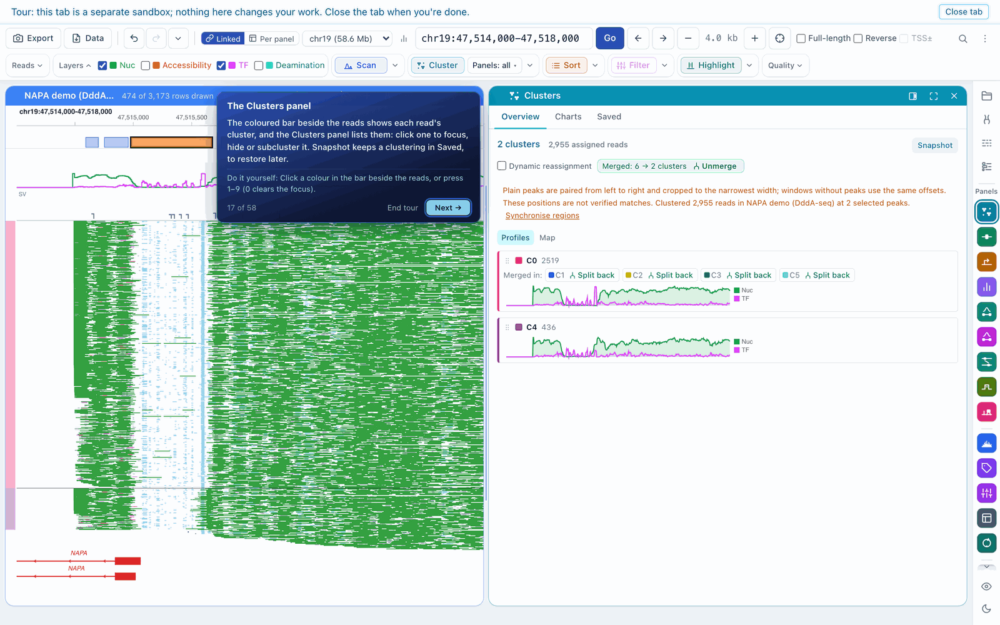

The coloured bar to the left of the reads shows each read's cluster. The
**Clusters** panel lists the clusters with their read counts and average
profiles:

- Click a cluster to select it, then hide it, merge it or subcluster it into
  a branch.
- Keys **1**–**9** focus a cluster and **0** clears the focus. The analysis
  panels then use only the focused reads.
- **Snapshot** keeps the clustering in the **Saved** tab, so you can compare
  it with another or restore it later, even at another locus.

### 18. Profiles and other views

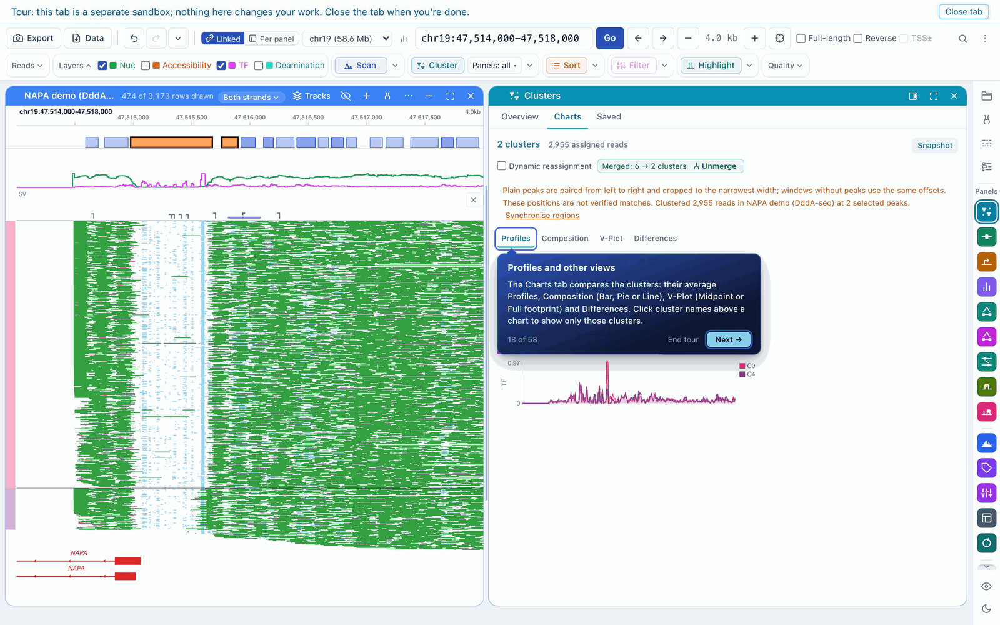

The **Charts** tab compares the clusters:

- **Profiles** overlays the clusters' average profiles, one plot per layer.
- **Composition** shows each dataset's share of reads in each cluster, as
  **Bar**, **Pie** or **Line** (Line joins datasets, so it needs two).
- **V-Plot** plots footprint size against position. **Midpoint** is the
  traditional V-plot (each footprint counted at its centre); **Full footprint**
  adds each footprint to every position it covers, so each row shows where
  footprints of that size sit. **Per size row** (in the settings) colours each
  row by its enrichment over that size's average across the window.
- **Differences** (once labeling rules are defined) shows what sets each
  cluster apart: for each rule, how much more or less common a matching
  footprint is in the cluster's reads than in all the other clusters.

Click cluster names above a chart to show only those clusters; **All** shows
them all again. A cluster picked in the read panel or on the Overview is picked
in the charts too.

### 19. The read map

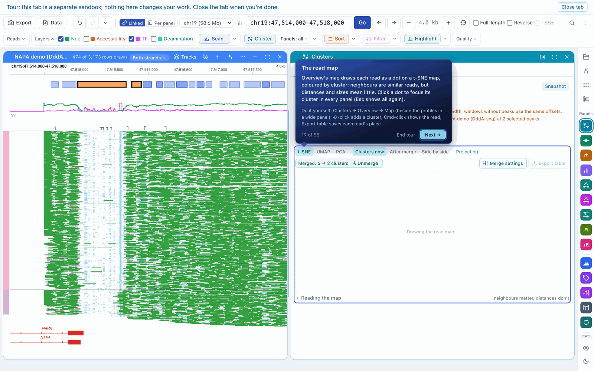

The read map in **Clusters → Overview** draws every read as a dot, coloured
by cluster. Choose **Map** (or, in a wide panel, **Profiles + map** to see it
beside the cluster profiles). It opens on **t-SNE** (UMAP and PCA are offered
too).

- How to read it: on t-SNE, neighbours are similar reads, but distances
  between groups and the sizes of groups mean little. **Reading the map**
  explains this.
- Hover a dot to see its read, cluster, dataset and strand. Click a dot, or a
  cluster under the map, to focus that cluster: the read panel and the charts
  show only it. **⇧**-click adds clusters; click it again or press **Esc** to
  show all. **⌘**-click (Ctrl-click) a dot, or **Show read**, outlines that
  read in every panel.
- **Export table** downloads one row per read: name, dataset, strand,
  cluster, and x/y on the map.
- **Sort → By projection (t-SNE)** orders the reads by their place on the
  map, and the **Neighbourhoods** cluster method groups them by it.

### 20. Sort and filter

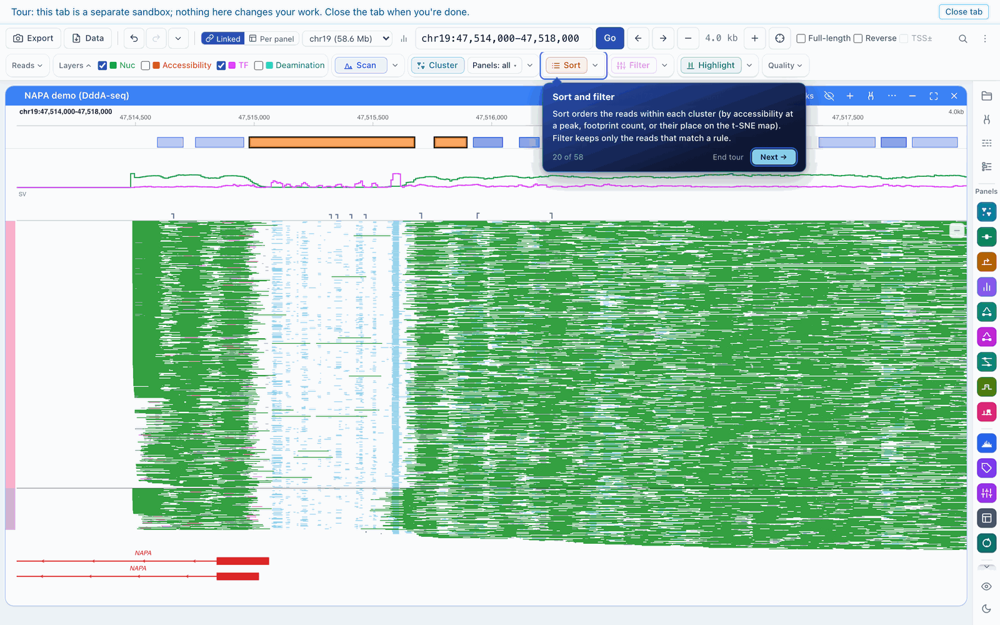

**Sort** orders the reads within each cluster: for example by accessibility
at a peak, by footprint count, or **By projection (t-SNE)**. **Filter** keeps
only the reads that match a rule. Rules are made in the **Rules** panel
([step 35](#35-rules)).

## Footprints

### 21. Analysing a spot: Cmd+click

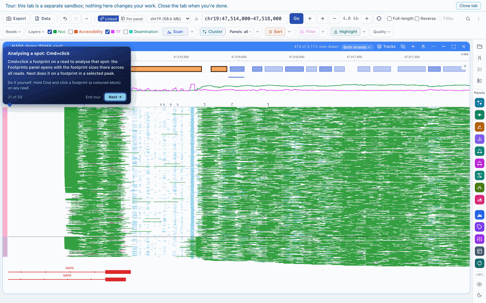

Cmd+click a footprint on a read (Ctrl+click on Windows and Linux) to analyse
that spot. The **Footprints** panel opens with the sizes of the footprints
there across all reads. Cmd/Ctrl+click more footprints to add them. **Next**
does this on a footprint inside one of the selected peaks.

### 22. Saving a footprint

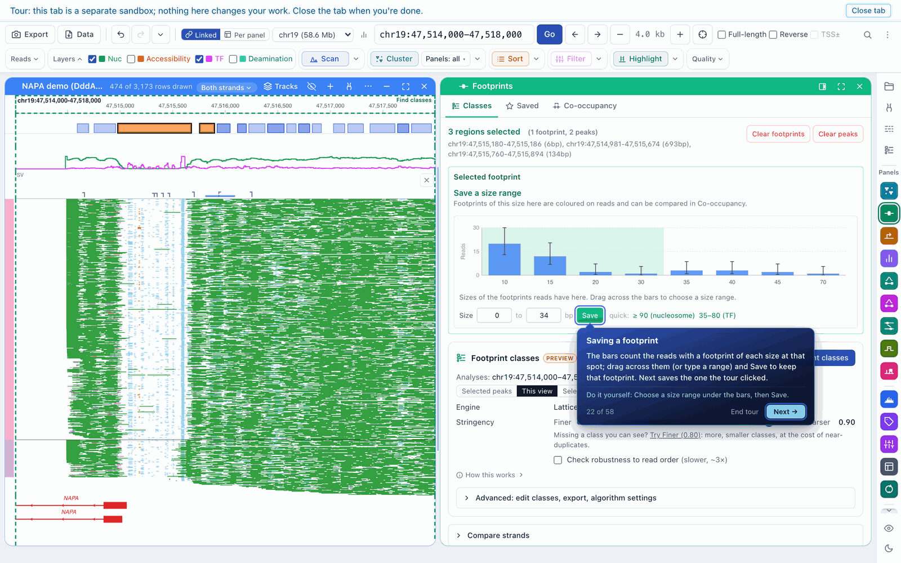

The **Classes** tab starts with the spot you clicked (**Selected
footprint**). Its bars count the reads with a footprint of each size there.
To keep the footprint:

1. Pick a size range: drag across the bars, type a range in **Size … to …
   bp**, or choose a quick range (**≥ 90 (nucleosome)**, **35–80 (TF)**).
2. Click **Save**.

The saved footprint is a definition: that size range at that spot. It is
coloured on the reads, listed in **Saved**, and can be compared in
**Co-occupancy**. **Clear footprints** and **Clear peaks** deselect what you
picked. **Next** saves the footprint the tour clicked.

### 23. Saved footprints

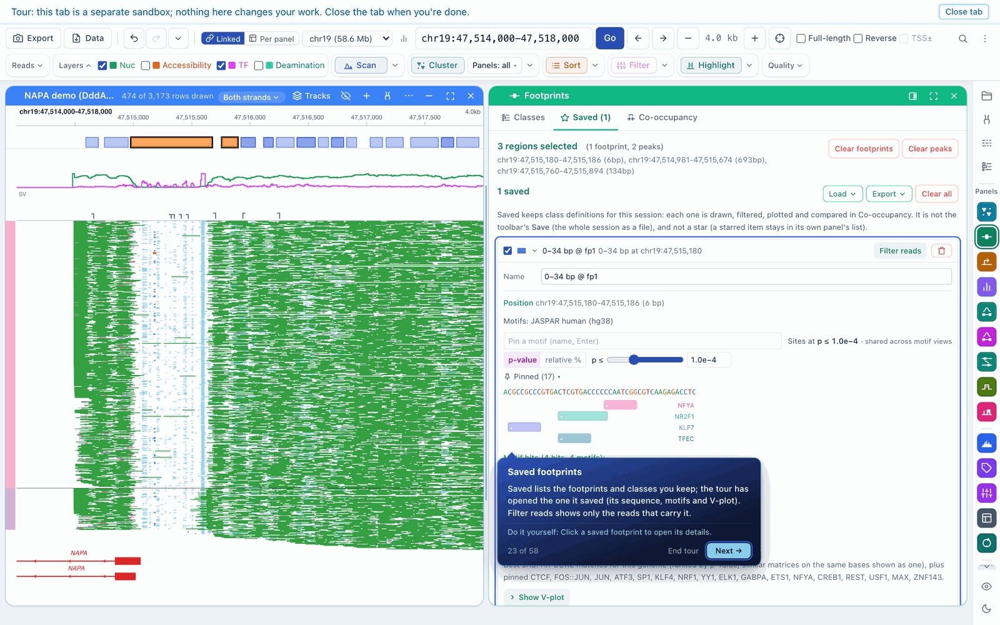

**Saved** lists what you keep: size ranges at a spot, and footprint classes.
The tour has opened the footprint it saved. Its details show:

- the sequence at that position, with the JASPAR motifs under it;
- motif scoring: **p-value** (the default; a match passes when its score is
  this unlikely by chance for its own matrix, so short and long motifs are
  comparable; set it on the log slider or type it, e.g. 3.2e-5) or
  **relative %** (the older share of each matrix's best score). Hits are
  ranked by p-value and similar matrices on the same bases are shown as one;
  the setting is shared with the other motif views and kept in the session;
- **Pin**, the key factors always reported (shared with the other motif views,
  per species; the species' defaults until you edit it);
- a V-plot.

In the entry's header, the tick shows the footprint on the reads and includes
it in Co-occupancy. **Filter reads** shows only the reads that carry it, and
**×** removes it. **Load** and **Export** share saved footprints: definitions
as JSON, their sequences as FASTA, or the matched calls.

### 24. Footprint classes

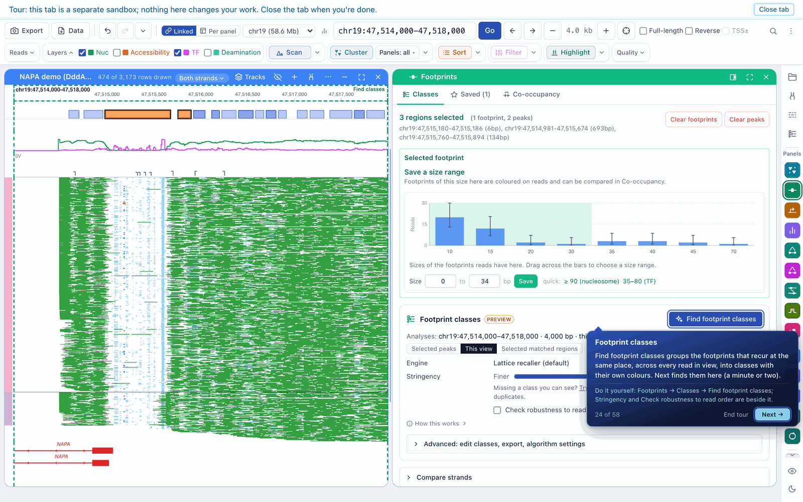

**Find footprint classes** looks at every read in the view for footprints that
recur in the same place. It groups them into classes, each with its own
colour. Footprint classes are a **Preview** feature in 3.0: the section's
heading carries the PREVIEW badge, and it is there whether or not **Show
preview features** is on. The card says which region the run analyses ("Analyses: … · this
view") and outlines it on the panels; choose **Selected peaks**, **This view**
(the default) or a **Saved region** at this locus.

- **Engine**: **Lattice recaller (default)**.
- **Stringency** goes from **Finer** (more, smaller classes) to **Coarser**
  (fewer classes). The default is 0.90. Missing a class you can see? Try
  **Finer (0.80)**: the hint under the slider sets it in one click. It finds
  more, smaller classes at the cost of near-duplicates.
- **Check robustness to read order (slower, ~3×)** is off by default. It
  repeats the search with the reads in two other orders. Each class is then
  marked **robust** (found every time) or **varies**, with a summary such as
  "12 of 19 classes are robust to read order". The classes themselves do not
  change.

The run takes a minute or two for a 4 kb view like the demo's. Afterwards the
button reads **Find again**; use it after you move. The run needs each
dataset's assay (DddA or DddB DAF-seq, or Hia5 fiber-seq). If one is missing,
the panel asks for it under **Dataset assay types**.

### 25. The class table

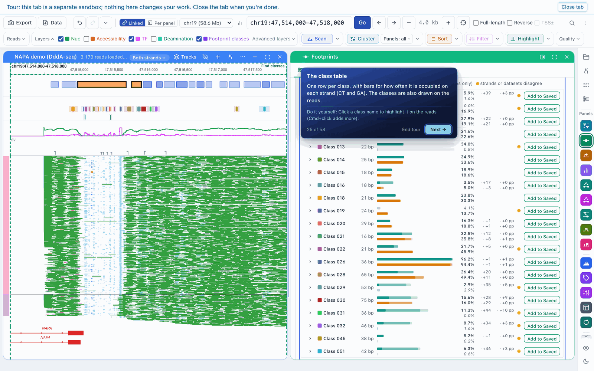

The table has one row per class (**Class 1**, **Class 2**, …) with its size.
Bars show the class's prevalence, meaning how often it is occupied, on each
strand. For DAF-seq the strands are **CT** and **GA**, colour-keyed above the
table.

- Solid bars are strict calls. Lighter bars are where only one edge or an
  overlap matches. Gray marks a strand that cannot support the class.
- A dot flags a strand or assay discrepancy.

The classes are also drawn on the reads, as the **Footprint classes** layer
and track. Click a class name to highlight it on the reads; Cmd/Ctrl+click
adds more.

### 26. Saving a class

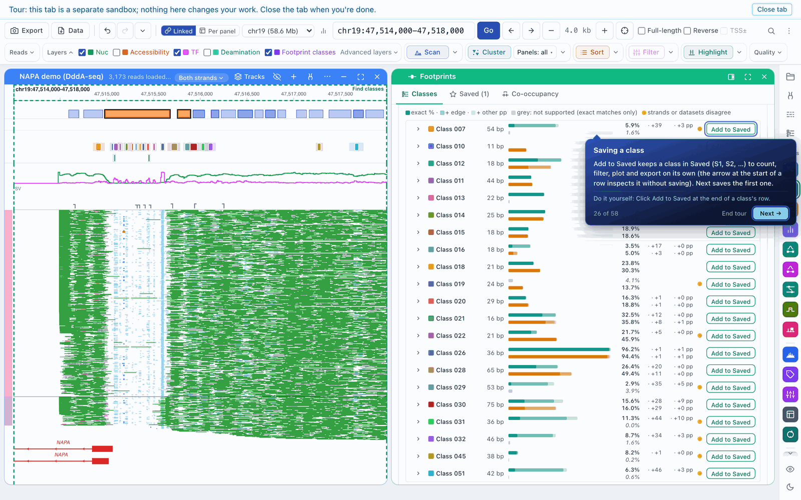

**Add to Saved** at the end of a row keeps that class in **Saved** as S1, S2,
…, together with the run it came from (the arrow at the start of a row
inspects a class without saving it). A saved class can be counted, filtered,
plotted and exported on its own, and it joins Co-occupancy and clustering.
**Next** saves the first class.

### 27. Saved classes and their prevalence

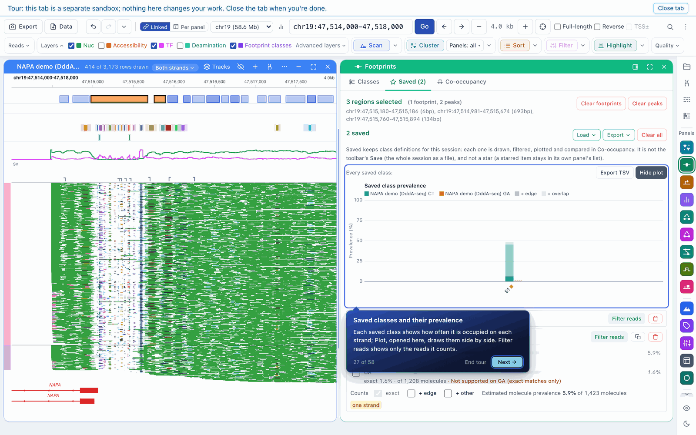

In **Saved**, each class shows its prevalence on each strand. In its card:

- Choose which strands it counts by clicking a strand's bar.
- Under **Counts**, choose what counts as the class:
  - **strict**: both edges fit;
  - **edge**: a clean core with one edge lined up with the class edge;
  - **overlap**: a clean core under other protection.
- **Filter reads** shows only the reads it counts.

**Plot**, opened here, draws the saved classes' prevalence side by side.
**Export TSV** saves every class and strand with its numbers.

### 28. Co-occupancy

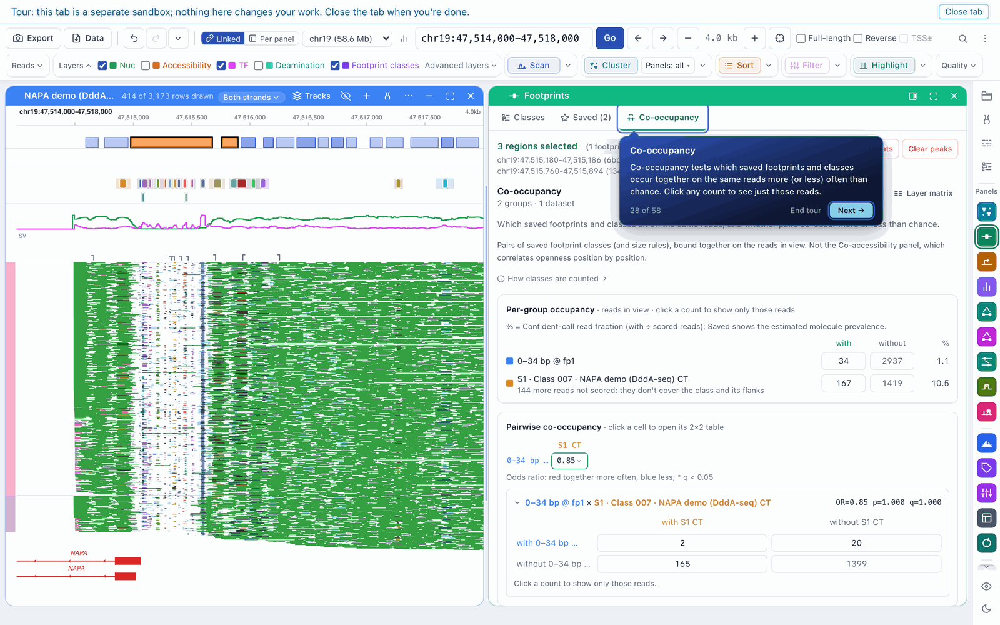

**Co-occupancy** tests whether the ticked saved footprints and classes occur
together on the same reads more (or less) often than chance.

- **Per-group occupancy** lists how many reads carry each one, with and
  without.
- The pairwise matrix shows odds ratios: red means together more often, blue
  less often. Significance uses Fisher exact tests with Benjamini–Hochberg
  correction.
- Every count is a button that shows only those reads. Each cell marked ▸
  opens that pair's 2×2 table.
- **Cluster reads by N footprints** clusters the reads by which of the ticked
  footprints they carry (choose them under **Cluster by**).

### 29. Compare strands

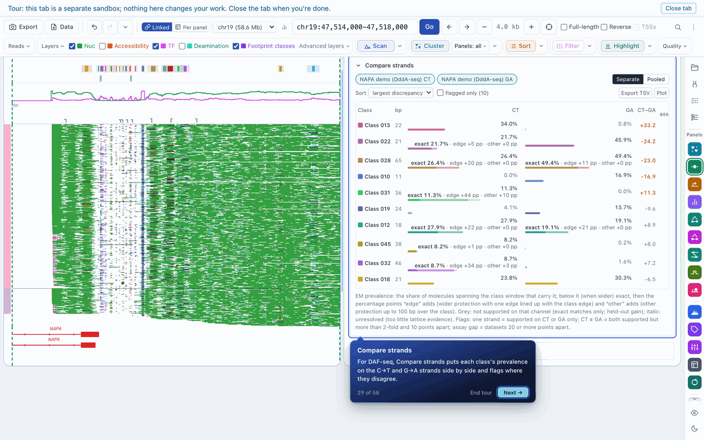

For DAF-seq, **Compare strands** (under the class table) puts each class's
prevalence on the C→T and G→A strands side by side.

- Choose **Separate** or **Pooled**, sort by **largest discrepancy**, or show
  **flagged only**.
- The flags are *one strand*, *CT ≠ GA* and *unresolved*.
- **Plot** draws the comparison, and **Export TSV** saves it.

## Regions and highlights

### 30. Highlight

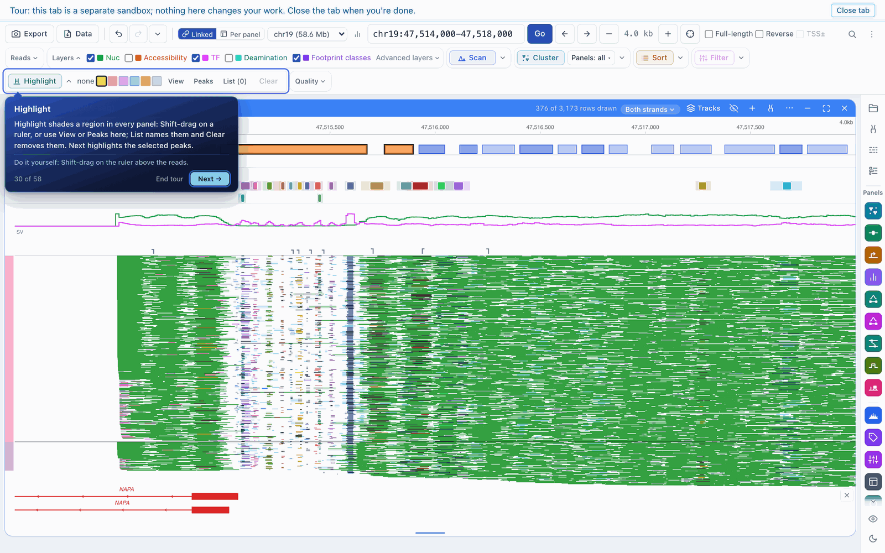

**Highlight** shades a region in every panel on its genome, in the genome map
and in exported figures. There are several ways to make one:

- Shift-drag on a ruler, at any time.
- Turn **Highlight** on: a plain drag on a ruler then highlights instead of
  zooming. Esc or a second click turns it off.
- Click **View** (the current view) or **Peaks** (the selected peaks).

The colour swatches set the colour of the next highlight. **List** names,
recolours and removes highlights, and **Clear** removes them all. **Next**
highlights the selected peaks. Read highlights are separate: they come from
the [read menu](#the-read-menu).

### 31. Regions

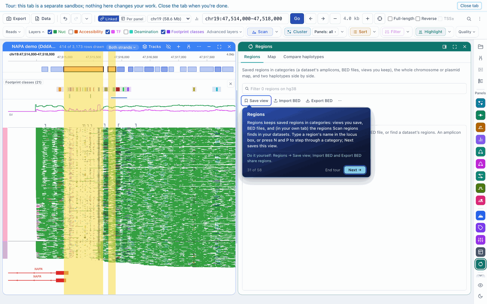

The **Regions** panel's **Regions** tab keeps saved regions in categories.

**Adding regions**

- **Save view** keeps the current view, named after its nearest gene, in
  *Saved regions* or a category you choose. **Next** does this (the tour tab
  keeps it for its session only, named by its coordinates).
- **Scan regions** (in your own tab, not the tour's) scans every open BAM for
  its regions: amplicons, read clusters, or a targeted run's loci (found from
  its BAM index, without reading every read). Each open dataset gets a status
  line, *scanned: N regions* or why it was skipped (*whole-genome*, *wrong
  reference*), with **This view**, the chromosome, and **Scan anyway (slow)**.
  Each region is named after its nearest gene; a dataset's latest scan
  replaces its earlier one.
- **Import BED** adds a BED file as a category.

**Using them**

- **Export BED** saves the ticked regions (or all of them).
- Click a region to go there. Tick several to highlight them, open them side
  by side, or move them to another category.
- **N** and **P** (or the ‹ › stepper) go to the next and previous region of
  the current category.
- Type a region's or category's name, or its nearest gene, in a location box.

The **Map** tab shows where you are on the whole chromosome, or on a circular
plasmid map (**Load plasmid map…**, **Open plasmid dataset…**); see
[Plasmids](workflows/plasmids.md). Bookmarks from earlier versions moved here,
into a *Bookmarks* category. See also
[Regions and highlights in depth](#regions-and-highlights-in-depth).

### 32. Comparing haplotypes

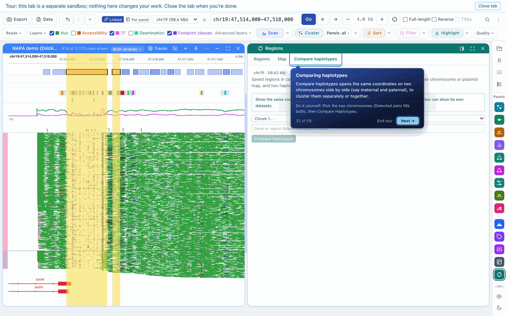

The **Compare haplotypes** tab opens the same coordinates on two chromosomes
side by side, for example the maternal and paternal copies of a locus. Each
dataset panel's ⋯ menu also has **Compare haplotypes…**.

To use it, pick the two chromosomes (**Detected pairs** fills both for names
such as `chr1_mat`/`chr1_pat`), optionally a gene or region, then **Compare
Haplotypes**. The demo has one haplotype, so the tour only shows the form; see
[Haplotype comparison](#haplotype-comparison).

## Labeling and rules

### 33. Labeling

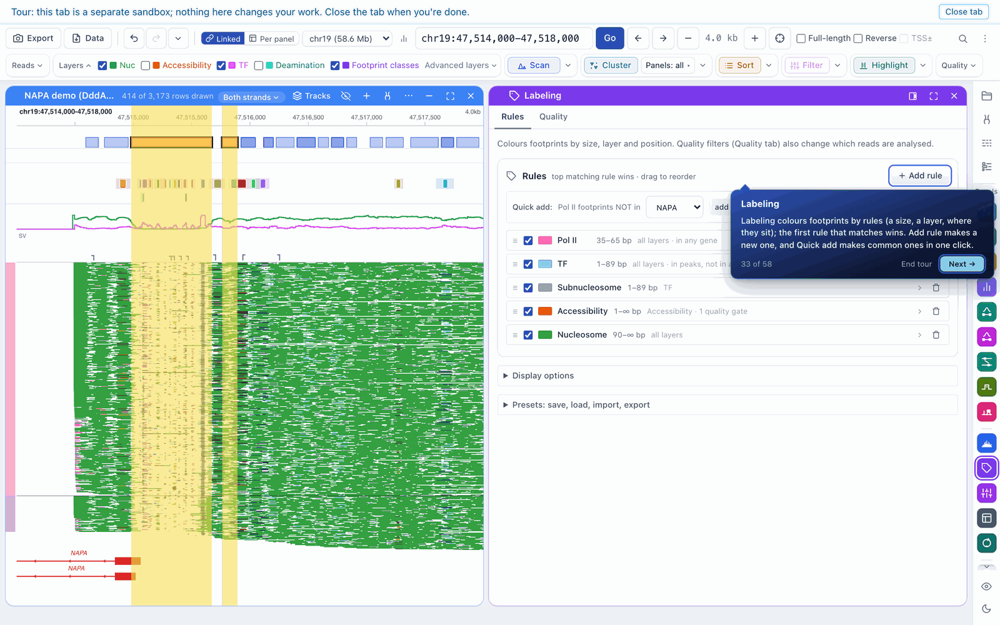

**Labeling** colours footprints by rules: a size range, a layer, and where
the footprint is (in a gene, a peak, a motif). The first rule that matches
wins. Drag the ≡ handle to reorder rules, and untick a rule to turn it off.

**Add rule** adds a rule. **Quick add** makes common ones in one click, for
example *Pol II footprints NOT in* a gene. **Display options** and **Presets**
are below the list.

### 34. Quality filters

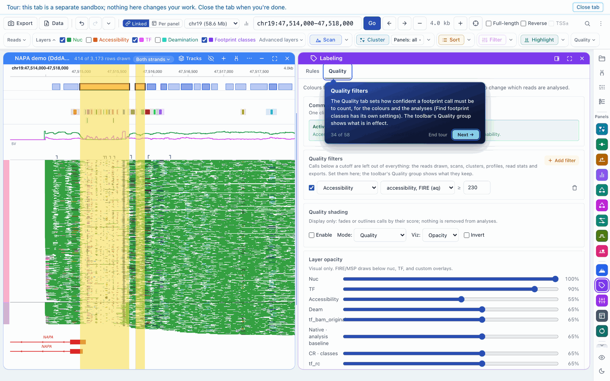

The **Quality** tab sets which footprint calls count, by their confidence
scores. It changes what the analyses use, not only the colours (Find
footprint classes reads the calls with its own settings). The toolbar's
**Quality** group shows the cutoffs in effect, and its **Edit
filters** opens this tab.

### 35. Rules

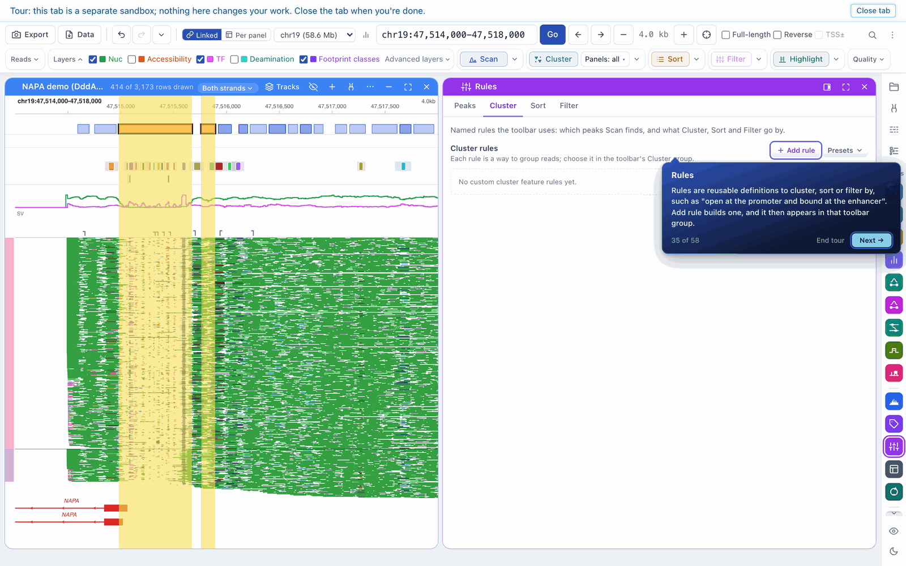

**Rules** holds reusable definitions to cluster, sort or filter by, for
example "open at the promoter and bound at the enhancer". Each tab
(**Peaks**, **Cluster**, **Sort**, **Filter**) holds one kind, and a rule
then appears in that toolbar group.

- **Add rule** builds a rule from terms: a region, a layer, a footprint class.
- **Presets** saves and loads sets of rules, and exports or imports them to
  share.

## Tracks

### 36. Adding a track

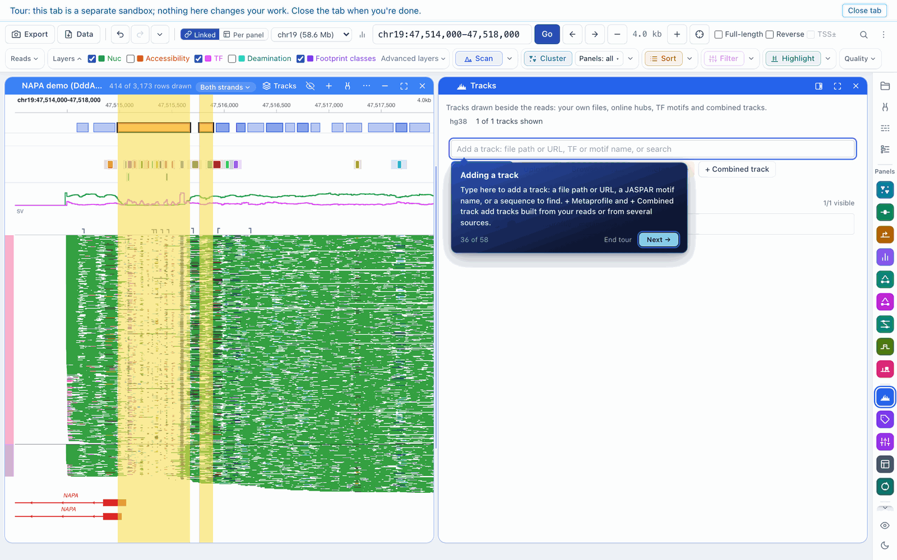

In **Tracks**, type in the add box: a file path or URL (BigWig, BigBed, BED),
a JASPAR motif name, or a sequence to find. **Browse files…** and **Upload…**
open your own files. **+ Metaprofile** adds a track that averages your reads'
layers or label rules, and **+ Combined track** overlays several sources in
one track.

### 37. Track hubs

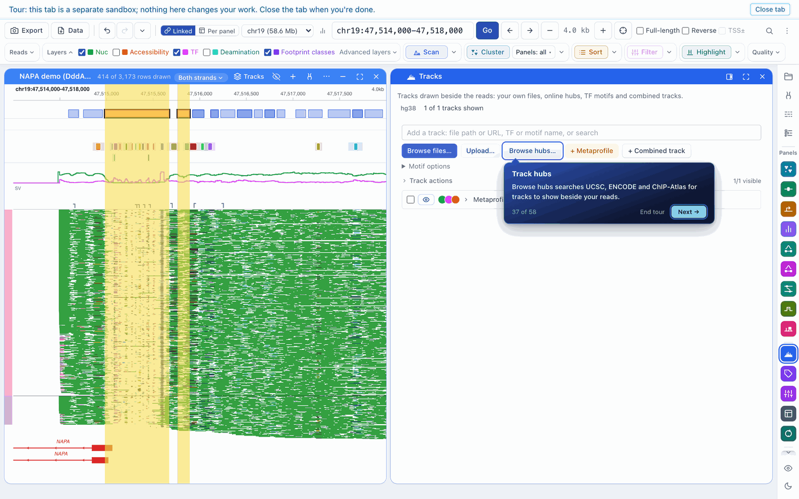

**Browse hubs…** searches the UCSC, ENCODE and ChIP-Atlas catalogues for
tracks to show beside your reads. You can filter by assay, target or cell
type.

## Other analyses

### 38. Co-accessibility

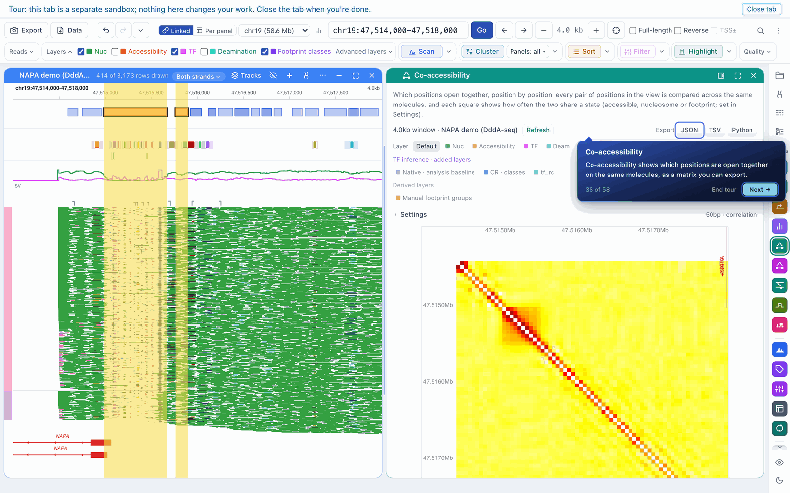

**Co-accessibility** shows which positions are open together on the same
molecules, as a matrix, for any layer. **JSON**, **TSV** and **Python** export
the matrix and its settings.

### 39. Primers

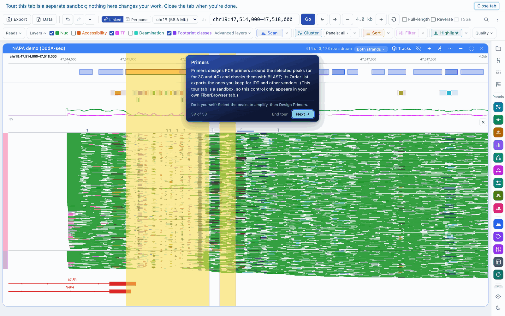

**Primers** is only in your own tab. It designs PCR primers around the
selected peaks (**Standard**), for two loci (**3C**) or from a viewpoint
(**4C**), and checks them against the genome with BLAST once you **Build
DB**. It needs the genome FASTA. Its **Order list** tab collects the primers
you keep and exports them for IDT, Azenta/GENEWIZ, Eurofins or Sigma, or as
CSV or FASTA.

## Panels and layout

### 40. Linking and merging datasets

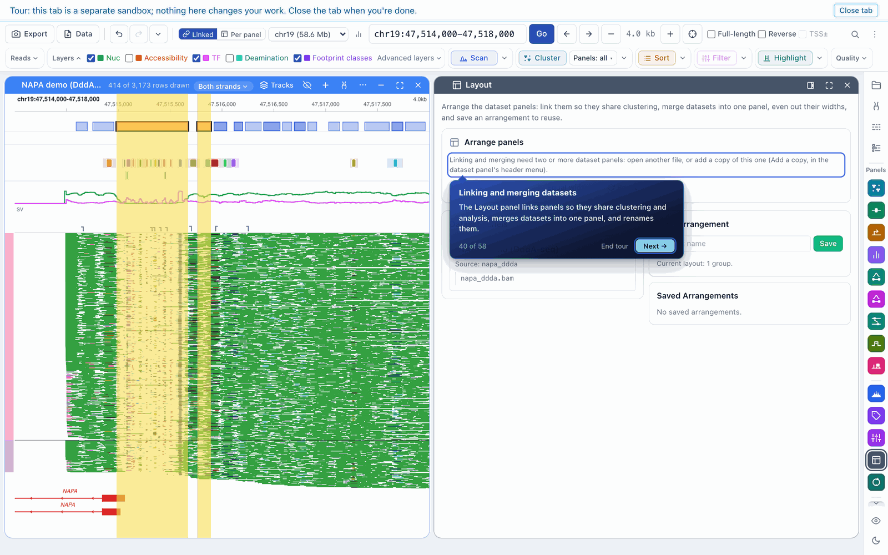

The **Layout** panel manages dataset panels. Tick panels, then:

- **Link** makes them share clustering and analysis.
- **Merge** pools their datasets into one panel.
- **Unlink** and **Unmerge** undo these.

You can rename each dataset here, and **Save** keeps an arrangement to reuse.

### 41. Genomes and navigation

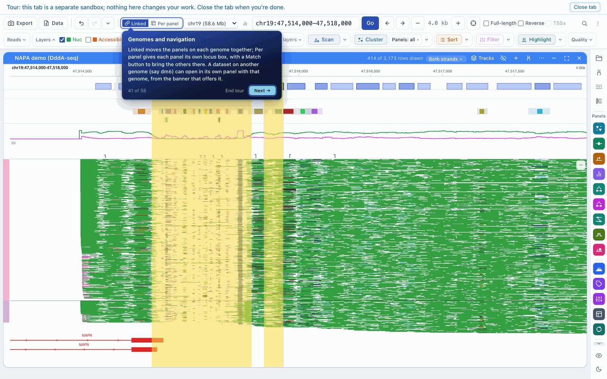

**Linked / Per panel**, left of the chromosome selector, chooses how panels
move:

- **Linked**: all the panels on one genome move together.
- **Per panel**: each panel has its own location box. A panel's **Match**
  button brings the other panels on its genome to its locus, without linking
  them.

A dataset on another genome (for example a dm6 BAM next to hg38 data) can
open in its own panel with its own genome; see
[Genomes and panels](#genomes-and-panels).

### 42. Panel actions

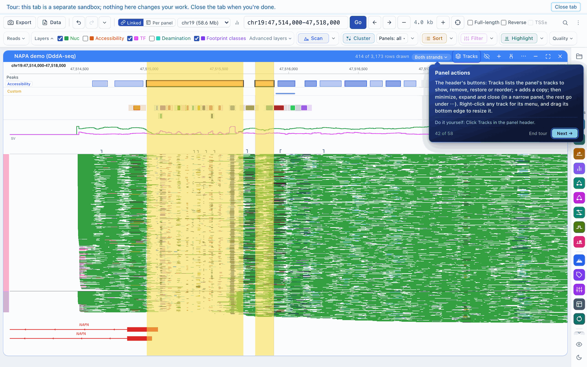

A dataset panel's header has its actions as buttons: **Tracks** lists the
panel's tracks to show, remove, restore or reorder; the eye is **Clean view**;
**+** adds a copy; then minimize, expand and close. In a narrow panel the rest
go under **⋯**. Right-click any track for its menu, and drag its bottom edge to
resize it.

- **Add a copy** (**+**) adds a copy of the panel. It follows the view until you
  unlink it (**Unlink** in its location bar); then it can show another locus,
  chromosome or haplotype, and you can still cluster the two together.
- **Stack below …** or **Side by side** sets where the panel sits. New
  datasets and copies open side by side.
- **Minimize** sends the panel to a round tile at the bottom of the rail (or a
  button in the classic strip), still loaded. Click it to bring the panel back.
- **Close dataset** (or **Close panel** for a copy) closes it. Undo reopens a
  closed dataset from its file.

You can also drag a panel by the ⋮⋮ grip at the left of its header, beside or
above another panel.

### 43. Layout

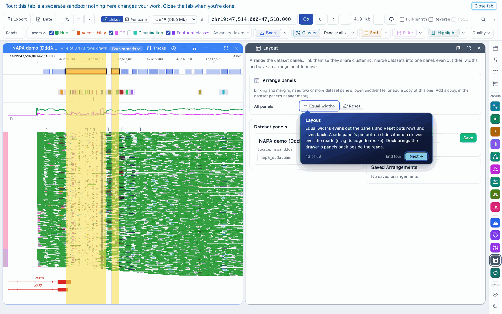

The **Layout** panel also arranges all the panels at once: **Equal widths**
evens out their widths and **Reset** puts rows and sizes back. The eye icon under
the rail's tiles (**Panels** at the right end of the classic strip) chooses
which panels it shows. Side panels
can sit beside the reads or in a drawer over them; see
[Side panels and the drawer](#side-panels-and-the-drawer).

## Variants

The **Variants** panel is a released feature in FiberBrowser 3.0. This part
of the tour loads a second demo that ships with FiberBrowser: PacBio
Fiber-seq reads from H1 cells (Hia5, FiberHMM 3.0 calls, HP-tagged) around a
heterozygous 7,471-bp insertion at `chr1:23,277,272` (hg38). The inserted
sequence carries a nucleosome-free region with a footprint over a CTCF motif
at its centre, so it shows what a structural variant can add to a locus.

### 44. A structural-variant demo

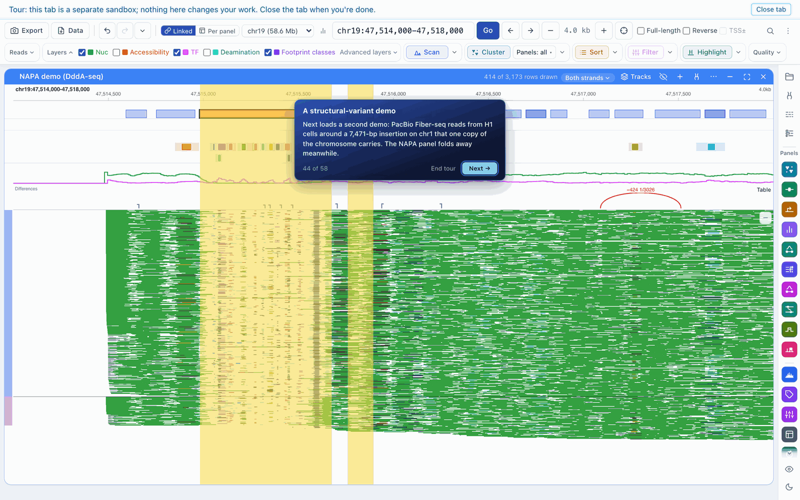

**Next** loads the demo in a panel named **H1 insertion demo (Fiber-seq)** and
moves to `chr1:23,273,500-23,281,000`. The NAPA panel folds away meanwhile.
The reads stop at the breakpoint where the carriers' alignments are clipped,
and the **Differences** row above the reads (the SV row in FiberBrowser 3.0)
flags the insertion.

### 45. The Variants panel

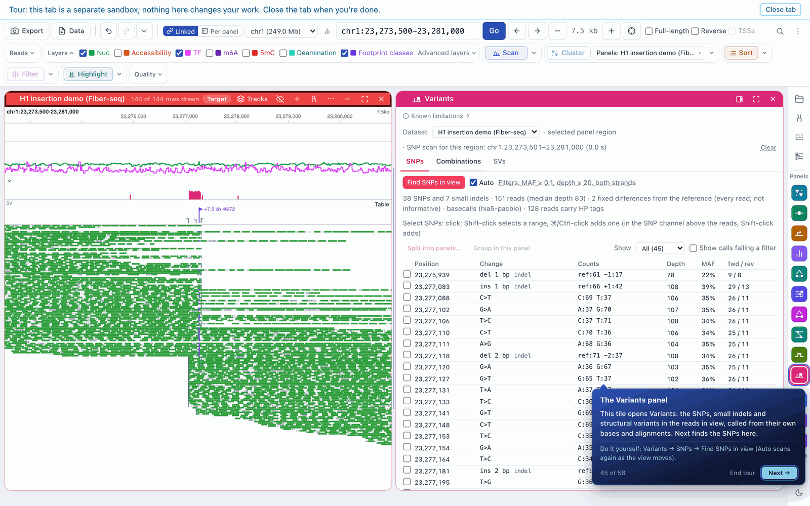

The **Variants** tile in the rail (a sequence bar with a substituted base and
an inserted block) opens the panel. It works on the reads in view of the
selected dataset panel (**Dataset** chooses another) and has three tabs:
**SNPs**, **Combinations** and **SVs**. Its calls come from the reads' own
bases and alignments, with no population prior. **Known limitations** at the
top says what the calls and allele patterns are and are not.

### 46. SNPs in view

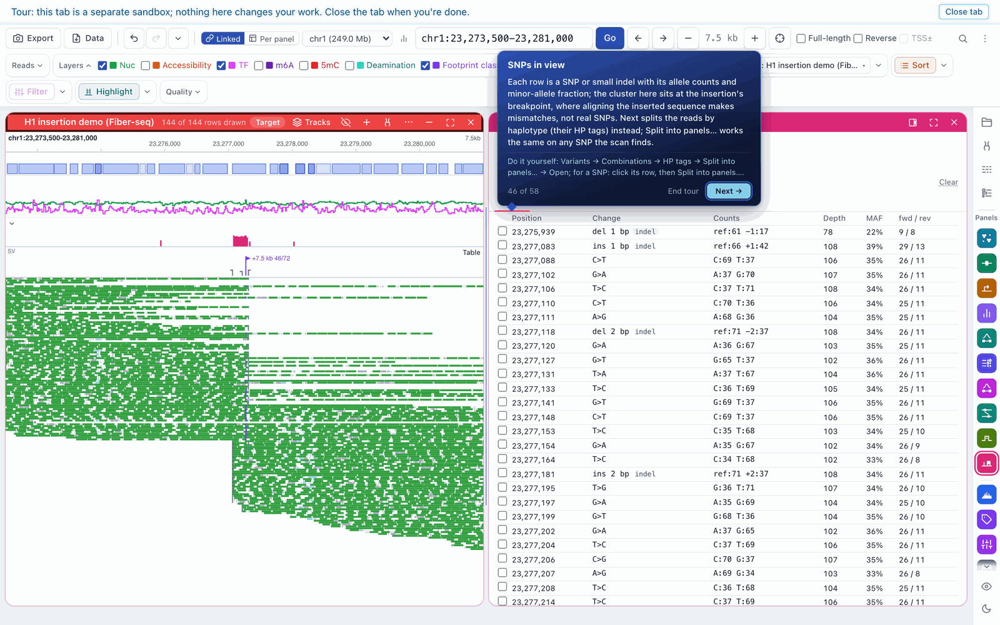

**Find SNPs in view** lists the SNPs and small indels in the view (**Auto**
scans again when the view moves). Each row gives the position, the change,
the reads with each allele, the depth, the minor-allele fraction and the
minor allele on each strand. **Filters** sets the minimum minor-allele
fraction and depth, base and mapping quality, and whether both strands must
show the minor allele. On DAF-seq data, C>T and G>A changes must show on both
conversion directions to count (**DAF-safe**). The same SNPs are ticks in the
**SNP channel** above the reads.

Here the SNPs pile up within about 200 bp of the insertion's
breakpoint. They come from aligning reads that hold the inserted sequence, not
from real variants, so the tour splits the reads by haplotype instead.
Elsewhere, click a row to select a SNP (Shift-click selects a range,
Cmd/Ctrl-click adds one), then:

- **Split into panels…** opens one read panel per allele (one SNP), or per
  combination of alleles (several SNPs);
- **Group in this panel** colours the reads by allele in their own panel;
- **Combinations** groups the reads by the alleles they carry at the
  selected SNPs.

A panel split by a SNP's allele draws the split SNP in its SNP channel as a
pill in the allele's colour, with a dashed guide through the reads (the
channel's header shows or hides the guide).

**Next** groups the reads by their **HP tags** (Combinations → **HP tags**,
the haplotypes phased upstream), then **Split into panels…** and **Open**.

### 47. Reads split by haplotype

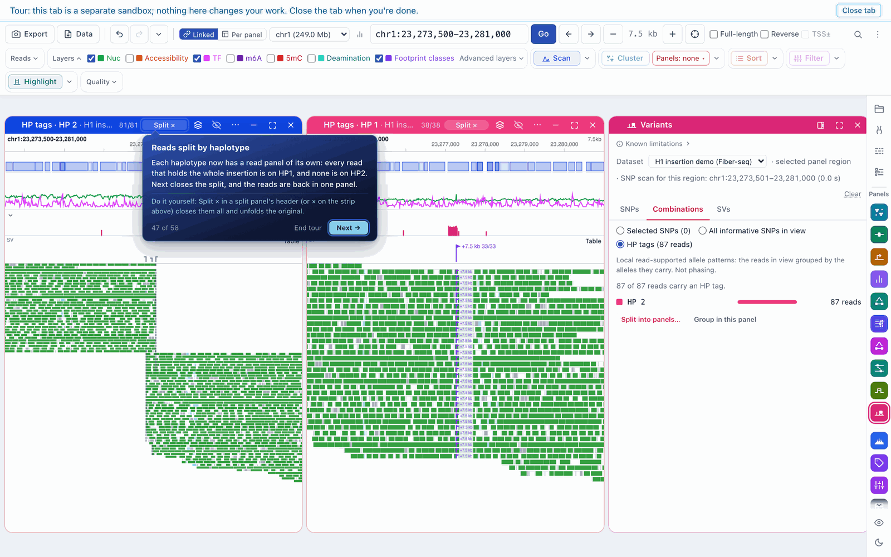

Each haplotype now has a read panel of its own (**HP tags · HP 1**, **HP tags ·
HP 2**). Every read that holds the whole insertion is on HP1, each with the
**+7.5 kb** insertion mark at the breakpoint; none of the HP2 reads holds
it. The panel they came from folds away until the split
closes: **Split ×** in a split panel's header closes all of them. **Next**
closes the split.

### 48. Structural variants

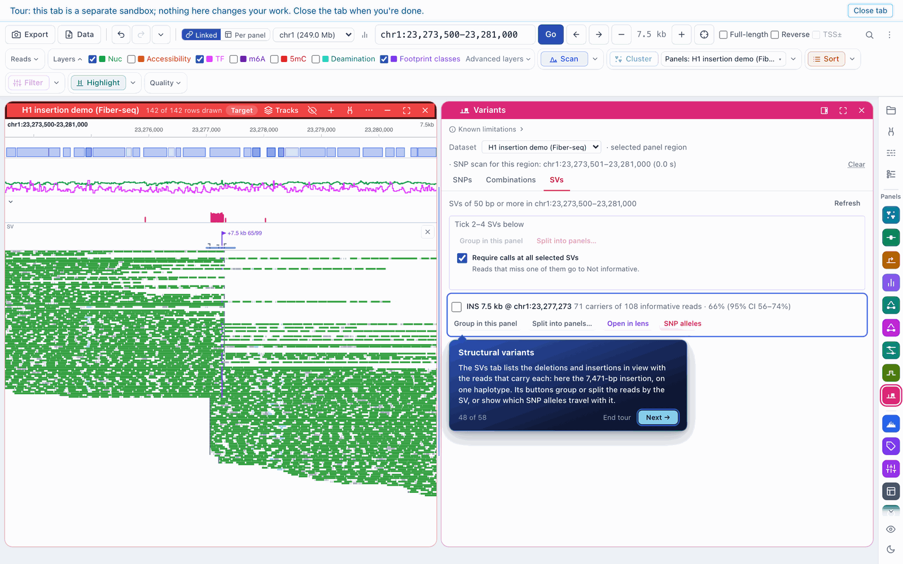

The **SVs** tab lists the deletions and insertions in view (50 bp or more),
with how many informative reads carry each: here **INS 7.5 kb @
chr1:23,277,273**, with its confirmed carriers out of the informative reads,
then the putative, conflicting and ambiguous reads. A *confirmed* carrier's
alignment holds the insertion or is split across it; a *putative* one is only
clipped there. Checkboxes above the list choose which of them count as
carriers (confirmed and putative by default); see
[Structural variants](workflows/structural-variants.md#evidence-levels). Each
row can:

- **Group in this panel** or **Split into panels…**: the reads by the SV's
  allele (carriers, reference, not informative);
- **Open in lens**: the insertion lens (the inserted bases of each carrier);
- **SNP alleles**: which SNP alleles the carriers have and the reference
  reads do not, and **Select the linked SNPs** to split by them;
- **Inspect difference**: the inspector, with each read's observed bases and
  chromatin (see [Differences](workflows/differences.md#the-inspector)).

Tick two to four SVs to group or split the reads by their combined genotype.

### 49. Insertions on the reads

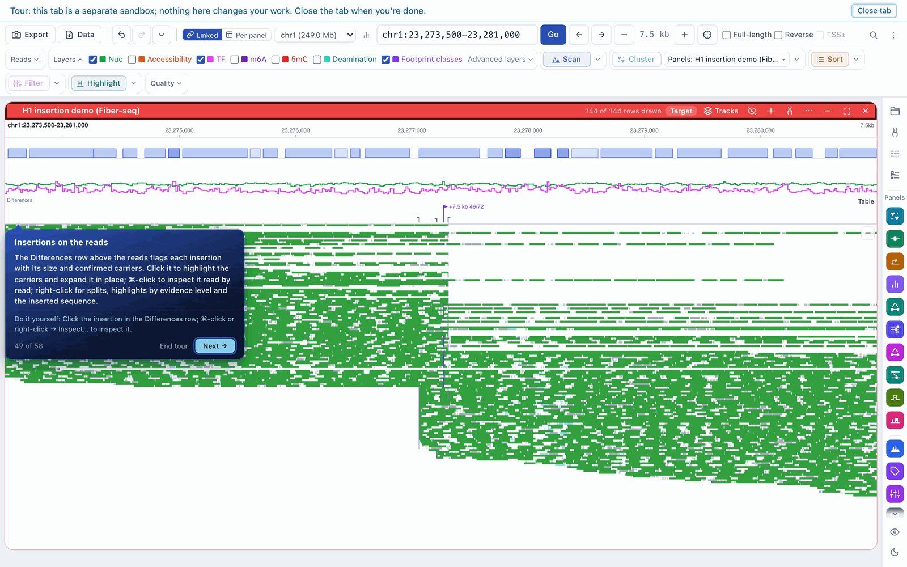

The **Differences** row above the reads flags each insertion (with its size,
then its confirmed carriers over the informative reads) and draws
each deletion as a bar. Hover a flag for its carriers at each evidence level.

- **Click** a flag to highlight its carriers; on an insertion of 50 bp to
  50 kb, the click also expands the insertion in place, with each carrier's
  inserted bases in a column of their own (click again to collapse it). See
  [Differences](workflows/differences.md#expanding-an-insertion).
- **⌘-click** (Ctrl-click) opens the inspector.
- **Right-click** for **Inspect…**, **Expand insertion**, the same group and
  split actions as the SVs tab, highlights by evidence level (**Highlight
  carriers (confirmed + putative)**, **Highlight confirmed only**, and the
  putative, conflicting and ambiguous reads), **Open carriers with the insert
  expanded** and **Open this insertion in the lens**:

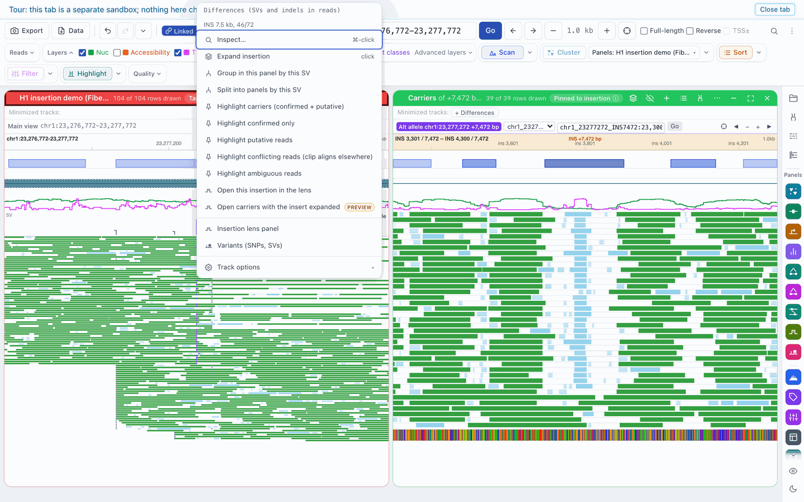

### 50. The insert, expanded


**Open carriers with the insert expanded** (in the Differences row's menu, or
**Show insert expanded** in a panel's ⋯ menu) re-aligns the insertion's carriers
onto its alternate allele: the reference flank, the consensus of the inserted
sequence, and the other flank. The reads inside the insert can then be
clustered, sorted, filtered and analysed like any region. The ruler counts
positions inside the insert (**ins 3,800**) and the panel's **Pinned to
insertion ⓘ** pill says how many carriers it placed; **Show on reference**
goes back. Insert-expanded panels are a **Preview** feature (Settings › Show
preview features).

### 51. Inside the insert: a CTCF site


The panel shows insert positions 3,300–4,300, with its Differences row hidden
(the per-read insertion marks only clutter the insert). **Next** on the previous
step also sorted the carriers by accessibility over the insert's
nucleosome-free region (insert ~3,723–3,879): most carriers are open there (at
the top), and most of those have a footprint at its centre (insert ~3,771–3,804) over a
CTCF motif (JASPAR MA0139.2, on the minus strand). The reference genome has no
such element here: it comes with the insertion, on HP1.

To compare carriers with the reads without the insertion, **Split into
panels…** on the insertion's row of the SVs tab opens the carriers (with the
insert expanded) and the reference reads side by side. The SVs tab then lists
the SVs of all the reads the split was made from, so the insertion stays
listed with all its carriers:


## Around the browser

### 52. Undo


Changes can be undone (**Undo**, Cmd/Ctrl+Z) and redone (**Redo**). The ▾
next to them opens a timeline to jump back to any step
([picture](#undo-history)). Saved regions are the exception: edits in the
Regions catalog are saved at once and are not undo steps. **Reset view** (R, or in the ⋮ menu) clears
clustering, filters, excluded reads and selections in one go, and it can be
undone too.

### 53. Save


**Save** is only in your own tab. It downloads a session file with your data,
view, clusters and settings, which you open again with **Open**. Your
work is also kept as you go. After you quit, the next launch offers to reopen
it (see [Sessions and workspaces](#sessions-and-workspaces)).

### 54. Export a figure


**Export** makes a figure (PNG, SVG or PDF) of what you see. With **Match UI
size** on, the default, text and rows are as large as on screen. See
[Figure export](#figure-export).

### 55. Export data


**Data** (Cmd/Ctrl+Shift+E) opens **Export data**, which holds every data
export in one place, grouped by topic. See [Data export](#data-export).

### 56. The Tutorial panel


**Tutorial** (its tile in the rail) lists every step of this tour by section.
Search the list, or click a step to go straight there; the tour first sets up
what that step needs.

### 57. Copilot


The Tutorial panel's **Copilot** tab is optional and runs on your computer.
It answers plain questions such as "how do I cluster the reads at the TSS?"
by pointing at the controls to click, step by step, like this tour. **Set up
Copilot** downloads its model the first time. Copilot appears in your own
tab, not in the tour's sandbox; see [Local Copilot](copilot.md).
FiberBrowser.app leaves the Copilot out, and the tour skips this step there.

### 58. That's the tour


In the tour tab, **Keep exploring** leaves everything as it is, and **Close
this tab** ends the tour and closes the tab. To shut FiberBrowser down, use
**More** (⋮) at the top right of your own tab → **Quit FiberBrowser**, which
offers to save your session first. You can also close the terminal window it runs in, or
press Ctrl+C there.

## Beyond the tour

Most pictures in this part were taken in the tour tab after **Keep
exploring**, back at the NAPA demo. Its clusters, the saved footprint, the
class run, the saved class S1, the highlight and the saved region are
therefore still there.
The strand pictures come from a fresh tour tab, and the session pictures from
the main tab.

### The read menu


Right-click a read (Ctrl+click on a Mac, or the Menu key) for its menu:

- **Select read** (Shift+click) and **Select footprint** (Cmd/Ctrl+click);
- **Open in Read Stats**;
- **Copy read name** and **Copy locus of read**;
- **Highlight read in all panels**;
- **Zoom to read**;
- for the selected reads: **Copy names of selected reads**, **Keep only
  selected reads** and **Exclude selected reads**.

Right-click empty track space for **Go to a read by name…**, zoom and copy
the locus.

When reads are excluded, a badge (*N excluded · Show*) brings them back.
**Reset view** does too. A copied read name pasted into a location box goes
back to that read. Reads you highlight stay in the display sample even when
it is downsampled.

### The command palette


**Cmd/Ctrl+K**, the magnifier, or **View → Search Commands and Settings…** in
the app opens one search over everything:

- actions (open, save, export, scan, cluster, sort, filter, reset, undo, UI
  size…), each with its keyboard shortcut;
- the analysis panels;
- every setting, by its name or a word for it (*terminal gaps*, *row height*,
  *read-end footprints*, *dark mode*);
- **Go to** a locus, gene, saved region (or a whole category) or read name.

Arrows move, **Enter** chooses and **Esc** closes. With nothing typed, the
palette shows **Recent** and **Suggested** items. Choosing a setting opens it
where it lives and highlights it. An on/off setting can be switched right in
the list (**Turn on / Turn off**, or **Cmd/Ctrl+Enter**).

The settings sidebar has the same search in **Search settings** at its top.
It filters the sections as you type; when nothing matches, it offers the
palette.

### Regions and highlights in depth


Each reference has its own catalog of regions, kept on the server and shared
by your windows. The genome picker at the top of the tab switches between
references.

- **Categories** come from:
  - your saved views (*Saved regions*);
  - BED files you import;
  - **Scan regions** (*Amplicons · dataset*, *Regions · dataset*, *Top regions · dataset*);
  - bookmarks from earlier versions (*Bookmarks*).
- **Category menu** (⋯ on a category): rename it, add a subheading, export it
  as BED, open its regions side by side, **Name from a BED file…** (name a
  dataset's amplicons from a BED file of gene names), or delete it.
- **Region rows**: each has **Highlight** and **Rename**, and a ⋯ menu with
  **Edit coordinates**, **Open beside** and **Delete**.


The Highlight group's **List** names each highlight. Each row has **Go
there**, its colour and a remove button. Highlights are saved in sessions and
drawn in exported figures.

### Genomes and panels

Each dataset panel can show a different genome. When a file does not match
the loaded genome, a **Genome mismatch** banner offers:

- **Open with dm6 in its own panel**: that dataset gets its own genome, and
  navigation switches to **Per panel**. With several such files, **Open all n
  dm6 datasets with dm6** opens them as one linked group on dm6.
- **Switch to dm6**: replaces the genome for every panel.
- **Other reference**: a FASTA or annotation of your own for that panel.

In **Linked** mode, the panels on each genome move together, and a link mark
by a panel's genome chip shows its group. Switching from Per panel back to
Linked takes each genome's panels to the one moved last. **Match** in a
panel's location bar moves the other panels on that genome to its locus
without linking them. Analyses, figures and undo work per panel genome.

### Side panels and the drawer

Analysis panels open beside the reads. A side panel's pin button controls
where it sits:

- **Pin to the side** turns the panel into a drawer that slides over the
  reads, so the reads keep the whole width. Its arrow tucks the drawer away
  and brings it back.
- With several panels in the drawer, they become tabs:
  - drag the drawer's left edge (or use the arrow keys on it) to resize it;
    double-click resets the width;
  - **Pop out** gives the current tab its own place beside the reads.
- **Dock beside the reads** (or **Dock the side panels beside the reads**)
  brings every panel in the drawer back beside the reads together. If they
  do not all fit, the tooltip says how many stay in the drawer.

In a window too narrow for the reads and side panels side by side, side
panels open in the drawer.

### Opening files and the Library

- **Open** (and **Add dataset**) list **Supported files** first, then
  one filter per kind and **All files**.
- A BAM picked together with its index (`.bai`, `.csi`) uses that index.
  Every file that cannot open is named in one message.
- **Load by path** (**Data & Sessions**) takes one path per line.
- The **Library** lists the BAM, BigBed and plasmid map files you open from
  your computer or a cluster (not the demo, dropped files or web links), your
  DAF-seq runs and the folders you watch. You can search, tag and group them
  and reopen them with their genome. It also marks BAMs that FiberHMM says
  should be called again. Open it from **Data & Sessions → Library → Open
  Library**, **Open ▸ Open from Library** in the top bar, the **Library**
  chip beside **Tracks** in the panel strip (in **More** when the strip is
  short), the welcome screen, or the command palette. See [The Library](workflows/library.md).

### Run everything from the app (POD5)

From the sequencer's raw data to footprints without a command line:
**Process raw data → Reads → Raw Nanopore (POD5)**, choose the run's `pod5/`
folder, a reference and the enzyme (**Hia5** for Fiber-seq, DddB/DddA for
DAF-seq), and **Run**. `fiberhmm-pipeline` basecalls with dorado (`sup`, plus
the 6mA model for Hia5), aligns, calls and runs QC. dorado is not included:
the dialog says whether it found it (and which), or how to install it, before
you start. **Runs** shows the basecalling as its first step and resumes it
after a stop (**Resume basecalling**). The finished run, and every BAM in the
**Library**, shows its **Basecaller** (e.g. `dorado 2.0.1 · sup v5.2.0 · 6mA
v1`, or *unknown*). See
[Run everything from the app (POD5)](workflows/daf-seq-quick-run.md#run-everything-from-the-app-pod5).

### Read filters

**Reads & Display → Read Filters** in the settings sidebar holds these
filters:

- **Hide footprints cut off at read ends (< 90 bp)**, on by default. It drops
  a first or last footprint under 90 bp that a read end cuts off, in the
  reads and in the analyses (Find footprint classes is not affected).
- terminal gaps and gap filling;
- minimum footprints;
- **Show duplicate reads**;
- CIGAR display.

### Footprint classes in depth


Clicking a class name in the class table highlights that class's footprints
on the reads (dark marks), and its box in the **Footprint classes** track.


Opening a saved class (click its name in **Saved**) shows:

- its per-strand prevalence with its counts;
- the **Counts** tiers;
- its name, run and position;
- the sequence with its JASPAR motif hits;
- a V-plot (**Show V-plot**).


With two or more saved definitions ticked, **Co-occupancy** adds the
**Pairwise co-occupancy** matrix. Click a cell (▸) for that pair's 2×2
table, whose four counts each filter the reads. Saved classes are matched by
their exact class assignments from the saved run.


**Compare strands → Plot** draws every class's prevalence on the CT and GA
strands.

What the numbers mean and every parameter of the run are in
[Lattice consensus](LATTICE_CONSENSUS.md) and
[Analysis methods and statistics](analysis_methods_and_statistics.md).

### DAF-seq strands side by side


A DAF-seq panel reads **Both strands** in its header. The chip chooses
**CT strand only (C→T reads)**, **GA strand only (G→A reads)**, or
**Split: CT | GA side by side**.


**Split** shows the CT reads in this panel and the GA reads in a copy beside
it. See [DAF-seq](workflows/daf-seq.md#4-strands).

### Haplotype comparison


The comparison needs a reference with both haplotypes as separate
chromosomes; load two FASTA/annotation pairs under **Reference Files →
Multiple FASTA / annotation pairs**. After **Compare Haplotypes**, View 1
opens on the left and View 2 on the right, locked together. Select the same
number of peaks in each view. The **Comparison clustering** box then offers
**Cluster each view separately** or **Co-cluster matched domains**, and a
table of each state's share in each view. See
[Haplotype comparison](workflows/haplotype-comparison.md).

### Figure export


**Export** (camera icon; Cmd/Ctrl+E in the app) opens **Export figure**. Its
**Image** tab sets:

- the format: **PNG**, **SVG** or **PDF** (SVG and PDF keep text and tracks
  as editable vectors);
- a **Resolution scale** (1x–4x);
- a title and a coordinates footer;
- **Match UI size**, on by default: text, labels, row heights and lines are
  as large as on screen; off draws them at 100%;
- **Capture full UI**, to include the toolbar and sidebar.

The figure shows the tracks as they are on screen. Labels that appear only on
hover are left out, unless a panel has **Clean view** turned off (the eye in
its header). Each plot also saves its own figure and its data as TSV from its
save menu.

The dialog's **Data** tab lists the same exports as **Export data**. Saved
views (what bookmarks used to be) are in [Regions](#regions-and-highlights-in-depth).

### Data export


**Data** in the top bar (Cmd/Ctrl+Shift+E, **File → Export Data…** in the
app) opens **Export data**. Every data export is listed there, by topic:

- **Reads**, for a chosen set (selected reads, reads in view, filtered reads
  or one cluster): read names (download or copy), the read table, a **BAM
  subset** (not in the tour tab or on a public server), and the working-set
  reads and intervals.
- **Peaks & regions**: peaks, selected peaks, cluster regions, the current
  region, highlights, saved regions, capture regions, track values.
- **Classes & footprints**: the class table, class result with provenance,
  tagged BAMs, saved footprints, co-occupancy.
- **Clusters**: assignments, projection coordinates, saved clusterings.
- **Analysis tables**: Read Stats, co-accessibility, transcription states,
  primer order list, contact matrix.
- **Session & working set**: the exact browser state (JSON) and a
  reproducibility summary.

See [Analysis data exports](analysis_data_exports.md).

### Undo history


The ▾ next to **Undo** / **Redo** lists every change, newest first. Click a
step to restore its analysis state without moving the view, or **View** to
restore it and go back to where you were.

### Sessions and workspaces


The settings sidebar's **Data & Sessions** section (folder icon on the right
rail) has:

- **Restore Session**;
- the **Library**;
- **Session**: a session name and **Save session** (the same as **Save**),
  **Copy Link**, **On launch**, **New Window** and **New Independent
  Workspace**.

After a normal quit, the next launch's welcome card has **Reopen last
session** (with its datasets and locus) as its first button; opening anything
else starts fresh. **On launch** chooses whether to offer it, always reopen,
or start fresh. After a crash, a banner offers to **Restore** the unsaved
session instead; the welcome card still shows below it.

Sessions from 3.0.x keep their saved class and NFR analyses. The Feature hub
also lists those hits without rerunning discovery. New sessions can embed
small browser scans and keep association and overlay results. See
[Opening sessions from 3.0.x](workflows/session-migration.md) for missing scans,
pinned carts and sharing with older builds.


**New Independent Workspace** opens a new tab with its own datasets and
analyses on the same server; it shares the loaded reference genome. Nothing
you load or cluster there changes your other tabs.

A local FiberBrowser answers only requests that carry its **access token**.
The launchers open the tokened address for you, so nothing changes in normal
use. The address and token are also listed in
`~/.fiberhmm/browser_runtime.json` for the Python client. On a single-user
computer, `--no-token` turns this off.

### Jupyter and Python

`browser_client.py` drives a running browser from a notebook. It can
navigate, pull reads and analysis results, push filters, peaks, rules and
settings, and render figures. `connect()` finds a running browser and its
token by itself. See [Jupyter / Python API](jupyter-api.md).

### Your own data

In your own tab, **Open** opens a BAM or BigBed. Add a gene annotation
and a reference FASTA the same way, or start with `-b`, `-g` and `-f` (see the
[reference](reference.md#command-line-options)). At start the browser loads
your last genome (else hg38), choosing one that matches your data's
chromosome names. Pick another in the sidebar's **Reference & Tracks**
section, then repeat the steps above.

The display shows a sample of the reads for speed. **Low memory** also caps
analysis working sets at 2,000 reads. Choose **Standard** or **High performance**
for full working sets; **Analysis cap** can still limit them (sidebar →
**Analysis & Reproducibility**). Check sampling notices on results. Read Stats
describes the selected reads, or the reads shown. See
[Navigation and speed](workflows/navigation-speed.md).

## Updating the screenshots

```bash
cd browser/frontend
npm run build                                   # the server serves dist/
FIBERHMM_SOURCE_DIR=/path/to/FiberHMM \
  node scripts/capture-tutorial-screenshots.mjs --python /path/to/python
```

The script starts its own server (`--no-token`, a scratch settings and
runtime file, a free port in 8300–8399). It opens the tour in a sandbox tab
at 1440×900 (device scale 2) and saves one PNG per step, plus the extra views
above, to `docs/images/guide/` (`--out` chooses another folder). The tour tab
loads hg38 from the genome cache (`~/.fiberhmm/genomes`); without it the tour
runs with no reference. It then compresses them to 1600 px wide and
256 colours, which needs Pillow. Options:

- `--base-url` uses a running server instead;
- `--audit FILE` also writes each step's text and the control it rings as
  JSON.

The end-to-end test `tests/e2e/tour.spec.ts` (part of
`npm run test:e2e:release`) walks the tour the same way. It fails when a step
loses its control.

Two other scripts make the workflow pages' pictures:

- `capture-library-screenshots.mjs` for [The Library](workflows/library.md);
- `capture-daf-run-screenshots.mjs` for
  [A DAF-seq run](workflows/daf-seq-quick-run.md).

Their headers say what each needs.
