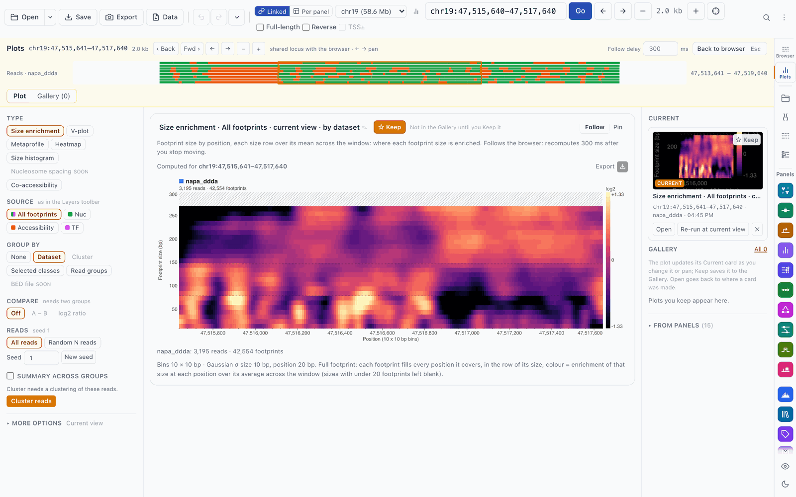
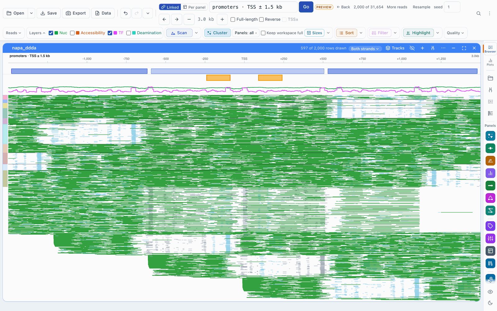
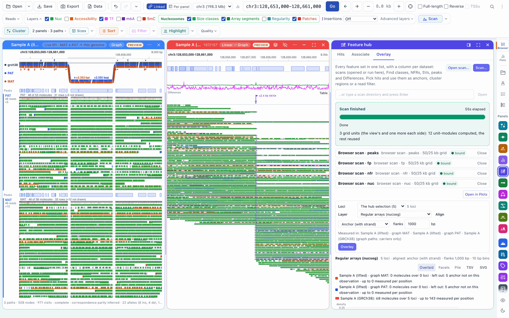

# What's new in 3.1

[← Docs index](index.md) · [Changelog](../CHANGELOG.md)

FiberBrowser 3.1 adds the **Plots** workspace, opens a BED file as a pooled
**meta-locus**, and brings live lift, graph mode, the Feature hub, the
Nucleosomes panel and sequence search. It needs **FiberHMM 3.2.0** or later, which the
apps and the pip install bring with them. Coming from 3.0? Read
[What's changed since 3.0](#whats-changed-since-30) first.

Live lift, graph mode and the meta-locus are **Preview** features: the app marks
them with a Preview badge, and they are on by default. Live lift needs
a lift map; graph mode also needs a graph helper (Apple silicon Macs for now)
and a registered package. See [Setting up](workflows/pangenome-setup.md).

## Plots

Press **P** (or **Plots** at the top of the icon strip on the right) for a
full-window plotting workspace that shares the locus, datasets, clusters and
filters with the browser. Choose a type (metaprofile, size enrichment, V-plot,
size histogram, heatmap, co-accessibility), a source layer, and how to group
the reads: pooled, by dataset, by cluster, by selected classes or by the panels
of a split. Plot the current view, selected peaks, BED region sets, or random
reads from the whole file. **Compare** shows A − B or log2 ratios.

Plots follow the browser as you move, or stay pinned to a locus. Metaprofiles
can be split into footprint size bands. **Summary across groups** reduces each
group to one number with a seeded bootstrap interval. Every random step is
seeded, so a plot can be made again exactly. **Keep** saves a plot to the
Gallery with the browser state it was made in. Read [Plots](workflows/plots.md).

## Meta-locus (Preview)

**Open ▾ → Open BED as meta-locus…** pools the reads of every site in a BED
file (for example every TSS ± 10 kb) into one virtual locus. A seeded working
set is shown like any locus: sort, filter, cluster and plot it. **More reads**
and **Resample** change what is shown; **Keep workspace full** tops up each
cluster from the pool; **Find more like this** reports how often a pattern
occurs across the pool. Read [Meta-locus](workflows/meta-locus.md).

## Live lift and Differences (Preview)

**Open ▾ → Add live lift…** draws reads aligned to a sample's own assembly on
the genome you are browsing. Choose **Graph**, **One panel per haplotype** or
**Pooled**. Graph is the default when a registered package binds the data.
Open a linked source view to follow the same molecules on their own assembly.

The **Differences** row shows assembly differences and read evidence. Click an
insertion to expand its bases across the panels. Cmd/Ctrl-click, or
right-click → **Inspect…**, opens its evidence. The inspector can compare the
read consensus with a supplied source assembly. **Identify** reports candidate
sequence matches with their support.

Read [Live lift](workflows/live-lift.md), [Linked panels](workflows/linked-panels.md),
[Differences](workflows/differences.md) and [Structural variants](workflows/structural-variants.md).

## Graph mode (Preview)

View haplotypes on separate graph lanes. Pop them out as lifted panels, source
views or both, then fold them back. Add other datasets as separate read bands.
Scan peaks and cluster on graph columns, including inserted sequence.

Right-click a read to sort at a graph site. Choose how repeats enter a cluster
run. Scan groups, custom layers, 5mC and deamination marks draw on graph rows.
**Linear view of a host → Host only** keeps folded members hidden during the
linear hand-off. Read [Graph mode](workflows/graph-mode.md).

## Feature hub and scans

The **Hub** panel brings classes, NFRs, nucleosome patches, peaks, SNPs, SVs,
Differences and graph bubbles into one list. Compare values by dataset or
haplotype. Browse a region, a whole scan or scan files across the genome with
page controls. Selection stays when you change pages.

**Scan…** runs selected modules on view units, a BED file or genes.
**Open scan…** loads an existing scan. Lifted hits keep their source positions
and show which graph paths carry them. **Use as** turns selected hits into
anchors, cluster regions, filters, splits, highlights or saved regions.

**Associate** tests co-occurrence, conditional responses, within-molecule rates
or overlap and distance. Results say when the data cannot answer the question.
**Overlay** aligns many loci and shows marked and measured molecules per panel
or graph path. Read [Feature hub and scans](workflows/feature-hub.md).

Genome-wide `fp` scans are slow: about 154 hours on four workers at 30×. Use
regions, or `nuc`, `nfr` and `peaks` for genome-wide work. Pooled live-lift
scans need complete records and refuse incomplete evidence. Staged and oriented
class workflows still use the legacy engine. M4 group contrasts are
conservative and can miss differences.

## Nucleosomes

The **Nucleosomes** panel scores how regular each molecule's nucleosome array
is, for every panel, strand split, haplotype and graph path side by side. It
calls high- and low-regularity patches along each molecule and finds the patch
geometries the datasets share. Click a geometry to highlight its molecules,
shift-click to use it in Cluster, Sort and Filter, or star it to save it.
**Charts** compare score distributions, repeat lengths and m6A
autocorrelation; **Near a site** splits molecules by the state of an open
region or TF site. The **Regularity** and **Patches** layers draw on the reads.
Read [Nucleosomes](workflows/nucleosome-panel.md).

## Sessions, updates and navigation

Sessions from 3.0.x keep their saved analyses and curation. Their classes,
NFRs and peaks also appear in the hub. New sessions keep association runs,
overlay results and small embedded browser scans. Read
[Opening sessions from 3.0.x](workflows/session-migration.md).

Packaged apps offer **Install and restart** when a verified update is
available. The app saves the session before restarting. Manual download and
pip updates remain available. Read [Updates](updates.md).

Native and lifted views reuse more decoded reads while panning. Back and
Forward follow locus jumps in linked and per-panel views. Graph pop-outs keep
cluster labels for folded and supplementary records. Split, focus, delete and
merge actions take one undo step. Read [Navigation and speed](workflows/navigation-speed.md).

## Find a sequence, metaprofiles and uncalled reads

Paste DNA into the locus box, or use **Tools → Find sequence**, to list where
it occurs in the loaded genome: exact and IUPAC matches on both strands for
short queries, BLAST for longer ones. Read
[Find a sequence](workflows/sequence-search.md).

The default metaprofile shows the layers switched on in the Layers toolbar and
follows them as you switch them (**Follow active layers** in the Tracks
panel). The cluster profiles follow the same layers.

Reads that FiberHMM did not call (no footprint calls at all) are hidden by
default. **Min footprints → All reads, including uncalled** shows them, and the
panel header says how many each filter hid. Read Stats lists them as *not
called*.

## What's changed since 3.0

- **Co-accessibility moved into Plots.** The Co-accessibility panel is now the
  **Co-accessibility** plot type, with the same settings and exports. ⌘K
  **Co-accessibility**, the track menu and old sessions open it there.
- **Footprint sizes** (Clusters › Charts) replaces the V-plot chart, with Size
  enrichment as the default view. The same plots are in Plots.
- **Metaprofile sources follow the layers.** The default metaprofile no longer
  has its own fixed list of sources; it shows the active layers unless you
  turn **Follow active layers** off.
- **P opens Plots.** Stepping back through saved regions is now **Shift+N**
  (**N** still steps forward).
- **Uncalled reads are hidden** at every Min footprints setting, including 0.
- **The SV row is the Differences row.** Saved SV splits and expanded
  insertions still restore.
- **MAPQ.** Read-difference analysis, SNP scans and consensus no longer apply
  MAPQ 20 by default.
- **FiberHMM 3.2.0** or later is required (`fiberhmm[consensus]>=3.2.0,<4`; 3.0 needed 3.0.3 or later). The apps update it
  for you; pip users run `pip install -U fiberbrowser`.
- **Experimental:** the full-window Feature hub workspace and the
  **Differential features** plot are behind **Settings › Read Display ›
  Experimental: Feature hub workspace**, off by default.

