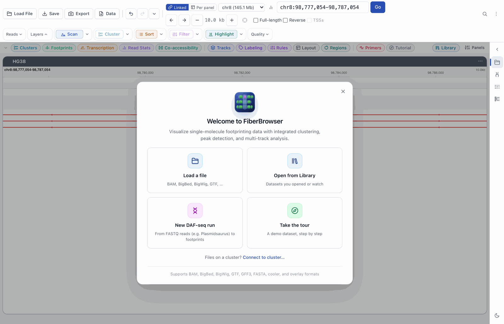
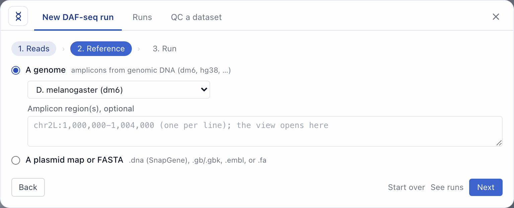
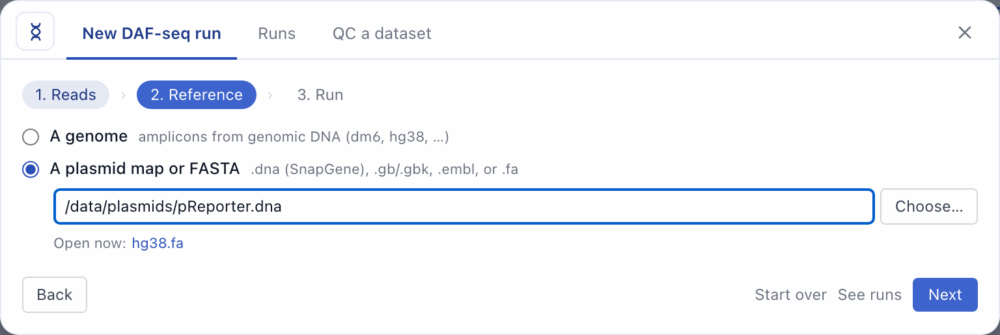
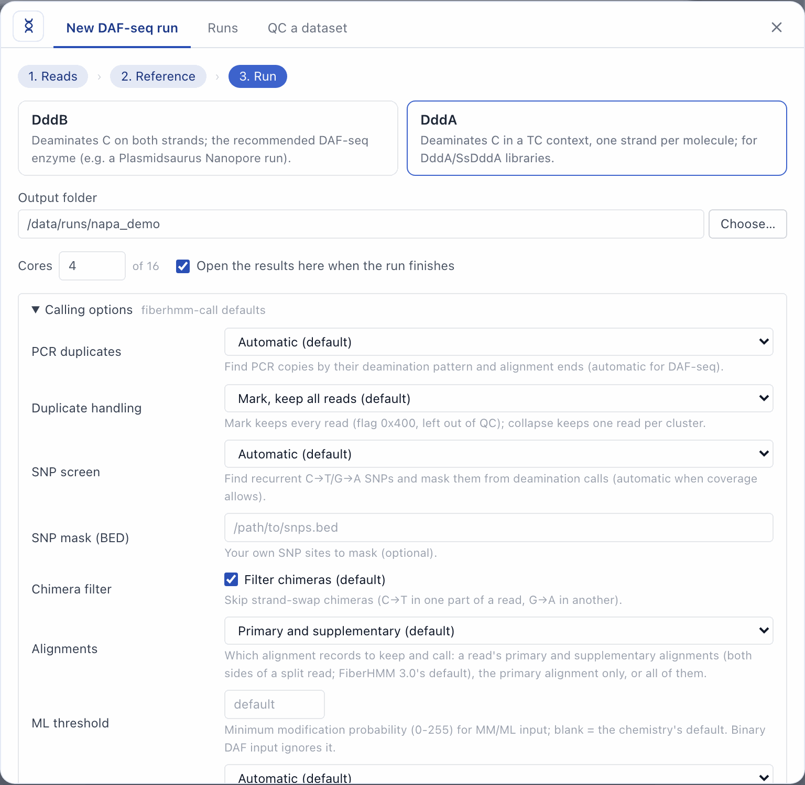
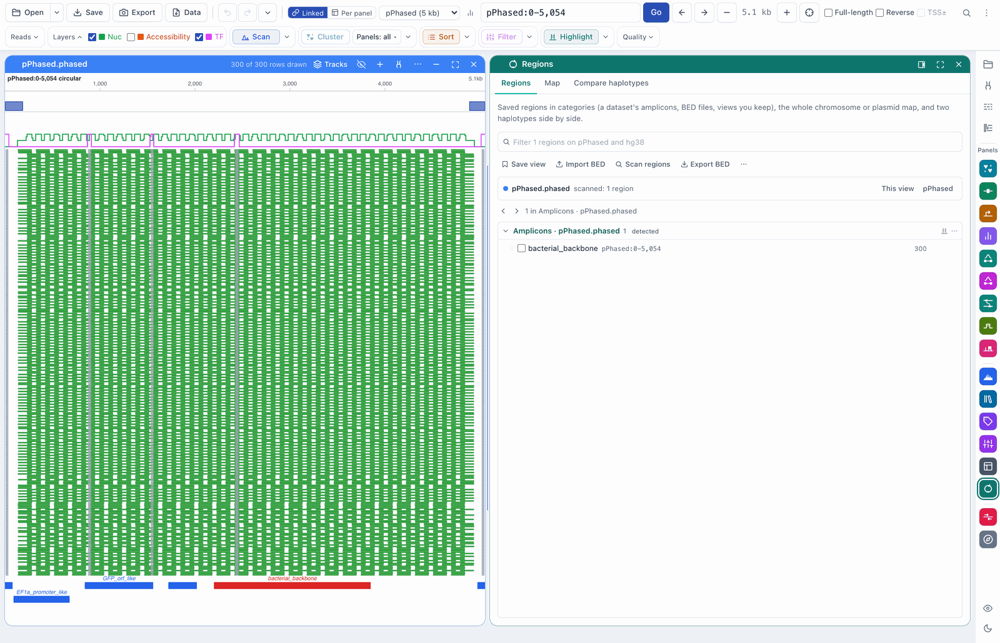
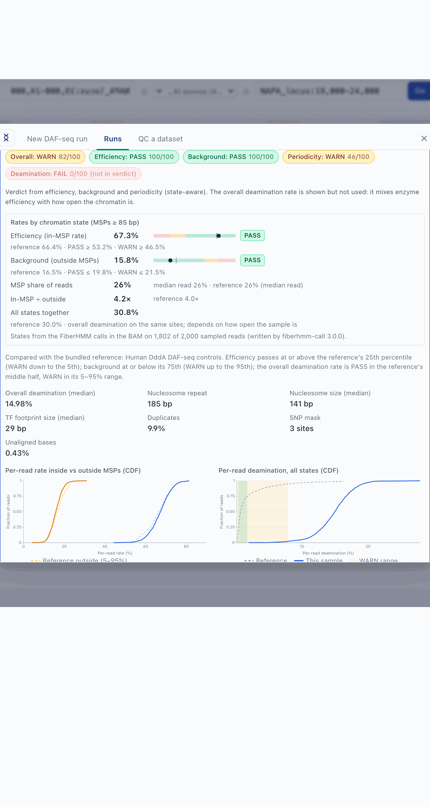

# Workflow: a DAF-seq run, from raw reads to footprints

[← Docs index](../index.md) · [← README](../../README.md)

**New DAF-seq run** takes the reads of a Nanopore DAF-seq run (for example a
Plasmidsaurus amplicon order: a zip of per-barcode FASTQs) and gives you
called footprints and a QC report in FiberBrowser. It needs no command line.
It runs `fiberhmm-pipeline` from FiberHMM 3 on your computer; several samples
run side by side when their cores fit. For each sample the pipeline aligns the reads with minimap2, calls
footprints with `fiberhmm-call` (duplicate marking, chimera filter and SNP
screen are on by default), and runs `fiberhmm-qc`.

A few thousand reads take one to two minutes. The runs in
[timings](#timings) are real examples.

It is for DAF-seq (DddA or DddB) reads from ONT, and for raw Nanopore data
(POD5), DAF-seq or Hia5 Fiber-seq, which it basecalls with dorado first: see
[Run everything from the app (POD5)](#run-everything-from-the-app-pod5).
Aligned Fiber-seq BAMs (e.g. PacBio, aligned with pbmm2 on the cluster) are
loaded with **Open** as usual.

## What you need

- FiberBrowser 3 and FiberHMM 3 in the same Python environment. The Mac app
  includes both.
- minimap2. The Mac app includes it. Otherwise install it with
  `brew install minimap2`, `conda install -c bioconda minimap2`,
  `sudo apt install minimap2` or `pip install mappy`. If it is missing, the
  dialog says so and gives the install command.
- A reference. This is a genome from FiberBrowser's list (dm6, hg38, …) for
  amplicons from genomic DNA, or the plasmid map (SnapGene `.dna`, GenBank,
  EMBL) or FASTA for a construct.

The feature works only in FiberBrowser on your own computer. A `--public`
server and the tour tab do not show it, and they refuse its API routes.

## 1. Open it



- On the welcome screen, click **New DAF-seq run**.
- Or go to Sidebar → **Data & Sessions → DAF-seq runs → New DAF-seq run…**.
  This section also lists your latest runs.

## 2. Reads

Drop the reads on the dialog, click **Choose files…** or **Choose folder…**,
or paste a path. The reads can be:

- FASTQ (`.fastq`, `.fq`, optionally `.gz`) or BAM files,
- a folder of them (subfolders are searched too),
- the `.zip` Plasmidsaurus sends. It is unzipped into the run's `reads/`
  folder when the run starts.

FiberBrowser groups the files into samples:

- **Plasmidsaurus names** (`<ORDER>_<barcode>_<name>.fastq`, e.g.
  `ABC123_3_embryo_2-4h.fastq.gz`): one sample per barcode, named after
  the part after the barcode.
- **MinKNOW folders** (`fastq_pass/barcode07/*.fastq.gz`): one sample per
  barcode.
- **Anything else**: one sample per file.

Rename a sample in the table (letters, digits, `.`, `_`, `-`), or untick it
to leave it out. When a folder holds both FASTQ files and BAMs, FiberBrowser
uses the FASTQ files and ignores the BAMs, which are usually the provider's
own alignments.

Browsers do not reveal where a dropped file lives, so a dropped file is copied
to FiberBrowser first. **Choose files…** and **Choose folder…** avoid the copy.

## 3. Reference



- **A genome**: pick it from FiberBrowser's genome list. A genome that is not
  on this computer yet has a **Download** button. You can also enter amplicon
  regions (`chr3L:15,038,001-15,052,000`, one per line). With regions, only
  reads overlapping them are kept, and the result opens at the first region.
  Without regions, the result opens at the most densely covered span.
- **A plasmid map or FASTA**: a SnapGene `.dna`, GenBank `.gb`/`.gbk`, EMBL,
  or FASTA file. A plasmid map keeps its circular topology, and reads that run
  through the origin are joined. References already open in this window are
  listed under **Open now**.



## 4. Enzyme, output and options



- **Enzyme**:
  - **DddB** deaminates C on both strands. It is the recommended DAF-seq
    enzyme, for example for a Plasmidsaurus Nanopore run.
  - **DddA** deaminates C in a TC context, on one strand per molecule.
- **Output folder**: the default is `~/FiberHMM runs/<date>_<sample>`, or
  `<date>_<order>` for several samples. With several samples, each gets its
  own subfolder.
- **Cores**: the number of threads for minimap2 and worker processes for
  calling, per sample. The default is 4. Samples queue: runs start while the
  cores they ask for fit in this computer's total.
- **Open the results here when the run finishes**: the result opens
  automatically in this window. This happens once per run, including runs
  that finished while the tab was closed.
- **Calling options** (collapsed). The defaults are `fiberhmm-call`'s, and
  only a changed option is passed on:

| Option | Default | What it does |
|---|---|---|
| PCR duplicates | automatic | Finds PCR copies by their deamination pattern and alignment ends (on for DAF-seq). |
| Duplicate handling | mark | Mark: keep every read, flag the copies (0x400) and leave them out of QC. Collapse: keep one read per cluster. |
| SNP screen | automatic | Finds recurrent C→T/G→A SNPs and masks them from the deamination calls, when coverage allows. |
| SNP mask (BED) | none | Your own SNP sites to mask. |
| Chimera filter | on | Skips strand-swap chimeras: C→T in one part of a read and G→A in another. |
| Alignments | primary and supplementary | Or the primary alignment only, or all alignments (secondary too). |
| ML threshold | chemistry default | Minimum modification probability (0–255) for MM/ML input. Binary DAF input ignores it. |
| CpG-aware recall (DddA) | on for DddA | Excludes CpG observations outside unmethylated islands from footprint recall. |
| CpG masking policy (DddA) | unmethylated-only | Keeps CpGs only inside unmethylated islands, or masks only methylated spans. |

The line under the options checks the run before it starts: that the files
and reference can be read, the output folder can be written, and the pipeline
and minimap2 are installed. It then shows each sample's output folder.
**Run** starts one job per sample.

## 5. Progress

The **Runs** tab lists every run. A run's card shows:

- each step (reference, index, align, call, QC) with its counts, rate and
  time left,
- **Cancel**: stops the run. The finished steps are kept.
- **Retry**: runs it again and reuses the steps that already finished.
- **View log**: the pipeline's output.
- **Copy command**: the equivalent `fiberhmm-pipeline` command for a
  terminal or a cluster.
- **Copy folder path**: the output folder.

Runs keep going when you close the tab or quit FiberBrowser. On a Mac,
`caffeinate` keeps the computer awake while a run is going. When you open
FiberBrowser again, it finds the runs and continues to show their progress.
Each run's record (its settings, progress, log and process id) is kept in
`~/.fiberhmm/jobs/<id>/`. **Remove** takes a finished run off the list and
keeps its output folder.

A small chip at the bottom left shows the running sample and its progress
while the dialog is closed.

## 6. Results and QC

A finished run shows reads aligned, reads called, the duplicate percentage,
footprints per read and the QC verdict. **Open in browser** opens it in the
current window:

- For a genome run: the genome (with its genes), the called BAM, and the
  region.
- For a plasmid run: the map and the called BAM together, linked by sequence
  (see [Plasmids](plasmids.md)). The **Regions** panel opens with the
  amplicon it found on the reads (named after the feature it covers); its
  **Map** tab shows the circular map.



**QC report** shows the `fiberhmm-qc` report. It compares the sample with
FiberHMM's bundled reference for the enzyme, for example the Drosophila
embryo DddB control:

- **Verdicts**: overall, efficiency, background and periodicity, each
  PASS, WARN or FAIL with a score out of 100, and a line saying what the
  overall verdict is based on. With FiberHMM 3.0 QC it combines efficiency,
  background and periodicity (*state-aware*); the overall deamination (or
  m6A) rate is still shown but marked *not in verdict*, because it mixes
  enzyme efficiency with how open the chromatin is. A QC report from an older
  FiberHMM has no efficiency or background and is shown as before (overall,
  deamination rate and periodicity).
- **Rates by chromatin state**: each read is split into MSPs (accessible
  stretches of at least 85 bp) and everything else.
  - **Efficiency** is the median per-read rate inside MSPs: how often the
    enzyme marked accessible DNA. It can be compared between amplicons and
    whole-genome data. It passes at or above the reference's 25th
    percentile, with WARN down to the 5th.
  - **Background** is the same rate outside MSPs (nucleosomes, linkers,
    short gaps). It passes at or below the reference's 75th percentile, with
    WARN up to the 95th.
  - Each has a small bar with its FAIL, WARN and PASS ranges, a dot for this
    sample and a gray tick for the reference median.
  - The panel also shows the **MSP share of reads** (how open the sample is,
    not a quality grade), the **in-MSP ÷ outside** ratio, the rate over all
    states together, and where the states came from: the FiberHMM calls in
    the BAM, or, for an uncalled BAM, a light call on a few hundred reads.
  - **Per-read rate inside vs outside MSPs (CDF)** draws both per-read
    distributions with the reference's 5–95% quantiles.
- **Per-read deamination (CDF)**: the fraction of reads at or below each
  deamination rate, for this sample and the reference. The green band is the
  reference's middle half (PASS). The amber band is the reference's 5–95%
  range (WARN).
- **Nucleosome periodicity (phasogram)**: how often two deaminations are a
  given distance apart, relative to the local baseline, with the reference
  curve and the nucleosome repeat length (NRL) found.
- **Footprint sizes**: nucleosome and TF footprint-length distributions
  against the reference.
- **Numbers**: the median deamination (labelled *overall* when the verdict
  is state-aware), NRL, median footprint sizes, duplicate fraction (whole
  run) and masked SNP sites.
- **QC figure (PNG/PDF)**: `fiberhmm-qc`'s own figure, ready for a
  supplement.



A finished run's card shows its QC verdict and, with FiberHMM 3.0 QC, its
efficiency and background rates.

**QC a dataset** (a tab of the same dialog, also under **DAF-seq runs**) runs
`fiberhmm-qc` on any loaded FiberHMM BAM, for example one called on the
cluster. With no BAM loaded it runs on a BAM from the Library or a file you
choose (which joins the Library), without loading it. It shows the same
report. The result is cached in `~/.fiberhmm/qc_cache/`.

## The output folder

```
<output>/
  reads/                          the unzipped FASTQs (from a .zip)
  <sample>.basecalled.bam         POD5 input: dorado's unaligned reads (logs/dorado.log)
  <sample>.aligned.bam(.bai)      minimap2 alignments (primary, MAPQ >= 20)
  <sample>.fiberhmm.bam(.bai)     called footprints; load this in FiberBrowser
  qc/<sample>.fiberhmm.qc.*       fiberhmm-qc: .json, .curves.json, .png, .pdf, .tsv
  qc/<sample>.fiberhmm.dedup.json, .daf_snps.*   duplicate and SNP reports
  logs/                           minimap2, fiberhmm-call and fiberhmm-qc logs
  outputs.json                    what was written (read by FiberBrowser)
```

Running the same command again with the same output folder skips the steps
that are complete. If the inputs or settings changed, the pipeline refuses to
run and says what changed.

## Timings

These are real runs on a 16-core Mac with 4 cores per run and minimap2 2.30.
The dm6 minimap2 index was already cached.

| Data | Reads | Reference | Run → done | Steps |
|---|---:|---|---:|---|
| Plasmidsaurus DddB amplicon (*Drosophila* embryos), zip | 3,433 (3,343 aligned, 2,370 called) | dm6 | 70 s (API), 98 s (in the UI, machine busy) | align 4 s, call 52–55 s, QC 10–40 s |
| Plasmidsaurus DddB plasmid construct, zip | 1,892 | its plasmid map (12.2 kb, circular) | 68 s | align 3 s, call 20 s, QC 14 s |
| The NAPA demo's reads (DddA), one FASTQ | 3,202 (3,202 aligned, 3,191 called) | a FASTA of the NAPA locus (45 kb) | 85 s | align 1 s, call 41 s, QC 11 s |

The first run on a genome also builds its minimap2 index. It is cached in
`~/.fiberhmm/minimap2_index/`, so later runs skip it.

The FASTQ of the first run was regenerated from an aligned BAM
(`samtools fastq -F 0x900`) and zipped the way Plasmidsaurus delivers it.

The screenshots on this page come from
`browser/frontend/scripts/capture-daf-run-screenshots.mjs`, which drives the
dialog in a headless browser through a real run and prints these timings. The
run and QC report shown are the last row: the reads of the bundled NAPA demo
(`samtools fastq -F 0x900 browser/data/demo/napa_ddda.bam`, sample
`napa_demo`, DddA) against a FASTA of the NAPA locus (hg38
chr19:47,495,001-47,540,000, named `NAPA_locus`). The reference steps show a
genome and a plasmid map instead.

## Run everything from the app (POD5)

Straight from the sequencer: give FiberBrowser the run's raw POD5 folder and
it basecalls, aligns, calls and checks it in one go. FiberHMM 3's
`fiberhmm-pipeline` runs Oxford Nanopore's **dorado** for the basecalling.

**Once: install dorado.** FiberBrowser and FiberHMM do not include it (Oxford
Nanopore distributes it under its own licence; it needs a GPU for practical
speed: an Apple-silicon Mac or an NVIDIA card).

1. Download the archive for your computer from
   [github.com/nanoporetech/dorado](https://github.com/nanoporetech/dorado)
   (Releases), e.g. `dorado-<version>-osx-arm64.zip`.
2. Unpack it anywhere, for example `~/dorado-2.0.1`. FiberBrowser and the
   pipeline look on `PATH` and in the usual places (`~/dorado-*/bin`,
   `~/.local/bin`, `/opt/dorado*/bin`, ...); to use a copy elsewhere, set
   `"tools": {"dorado": "/path/to/dorado"}` in
   `~/.fiberhmm/browser_settings.json`, or `FIBERHMM_DORADO`.

The first run of a model downloads it into `~/.fiberhmm/dorado_models/`.

**The run.**

1. **New DAF-seq run → Reads → Raw Nanopore (POD5).** The line under the box
   says which dorado will run (its version and path). If it was not found it
   shows how to install it, and **Check again** looks once more after you
   have.
2. **Choose POD5 folder…** (or paste its path). Pick MinKNOW's `pod5/` (or
   `pod5_pass/`) folder, or any folder of `.pod5` files; subfolders are
   searched. A folder is one sample, named after the MinKNOW run folder above
   `pod5/`; rename it in the table. Several `.pod5` files chosen together
   are one sample per folder. The files stay where they are: a drop would copy
   them, so the POD5 option takes a chosen folder or a path.
3. **Reference**, as for reads.
4. **Enzyme**: DddB, DddA or **Hia5 (Fiber-seq)**. The **Basecalling** line
   says what dorado will do:
   - Hia5: the `sup` model plus the **6mA** modification model (`dorado sup + 6mA`).
   - DddB / DddA: plain `sup` basecalling (the deaminations are read from
     the sequence).

   Nothing needs to change. **Basecalling → Advanced** has the model (`sup`,
   `hac`, `fast`, a version such as `sup@v5.2.0`, or a model folder), the
   modified bases (automatic, 6mA, none), the device (automatic, Apple GPU
   `metal`, NVIDIA `cuda:all`, CPU) and dorado's batch size. Only a changed
   choice is passed on (`--dorado-model`, `--dorado-modified-bases`,
   `--dorado-device`, `--dorado-batchsize`). DAF-seq's calling options
   (duplicates, SNP screen, chimeras) are not shown for Hia5.
5. **Run.**

In **Runs**, **Basecalling (dorado)** comes first: dorado's version and model,
then how much it has written and for how long; when it is done, how many reads
it basecalled. The usual steps follow. If dorado was not found the run stops
with **dorado was not found** and the instructions. Basecalling takes hours on
a big run; if it stops (cancelled, a crash, the computer restarted),
**Resume basecalling** starts the same run again: dorado keeps the reads it
finished and does the rest. A finished basecalling is never repeated (the
pipeline's `--redo basecall` does that, from **Copy command**). If
FiberBrowser found dorado somewhere the pipeline would not look, the command
names it (`--dorado PATH`).

A finished run shows **Reads basecalled** and its **Basecaller**, e.g.
`dorado 2.0.1 · sup v5.2.0 · 6mA v1`; hover for the full model names. The
output folder also has `<sample>.basecalled.bam` (dorado's unaligned reads,
with its `@PG`/`@RG` header lines) and `logs/dorado.log`.

**Basecaller provenance.** The models are recorded wherever the reads go: in
the BAMs' headers (dorado's own `@PG`/`@RG` lines, and FiberHMM's `@PG DS`
tokens `basecaller=… basecall_model=… modbase_models=…`) and in
`outputs.json` (`settings.basecaller`). The **Library** shows a
**Basecaller** line for every BAM: from the run's `outputs.json`, else its
header; **unknown** when neither records it (FASTQ input, or a BAM without
those header lines). For FASTQ, record it on the command line with
`fiberhmm-pipeline --basecaller-info "program=dorado version=… basecall_model=…"
--modbase-model …`; a re-call from the Library gives such an override again.
A re-call of a POD5 run starts from its aligned (or basecalled) BAM and never
basecalls again.

## Troubleshooting

| Problem | What to do |
|---|---|
| "fiberhmm-pipeline (FiberHMM 3.0 or newer) is not installed" | Install FiberHMM 3 in FiberBrowser's Python: `python -m pip install "fiberhmm[consensus]>=3.0,<4"`. |
| "minimap2 is not installed" | Install minimap2 (see [What you need](#what-you-need)) and open the dialog again. |
| A genome says "not downloaded" | Click **Download**. The genome also loads in the window. |
| "This FiberHMM's fiberhmm-pipeline has no option for …" | The installed FiberHMM is older than the option. Update FiberHMM, or leave that option at its default. |
| The run failed | **View log** shows the pipeline's output. Fix the cause, then click **Retry**. The steps that finished are reused. |
| The pipeline refuses a changed input or setting | Choose a new output folder, or run `fiberhmm-pipeline … --redo STEP` from **Copy command**. |
| "dorado was not found" (POD5) | Install dorado (see [Run everything from the app](#run-everything-from-the-app-pod5)), click **Check again** in the dialog, then **Resume basecalling** on the run. |
| dorado fails or runs out of GPU memory | **View log** (and `logs/dorado.log` in the output folder) has dorado's message. Lower **Batch size** under Basecalling → Advanced in a new run, or try the `hac` model. |
| "cannot basecall raw Nanopore POD5" | The installed FiberHMM is older than 3.0: update it, or basecall with dorado yourself and give the BAM as reads. |
