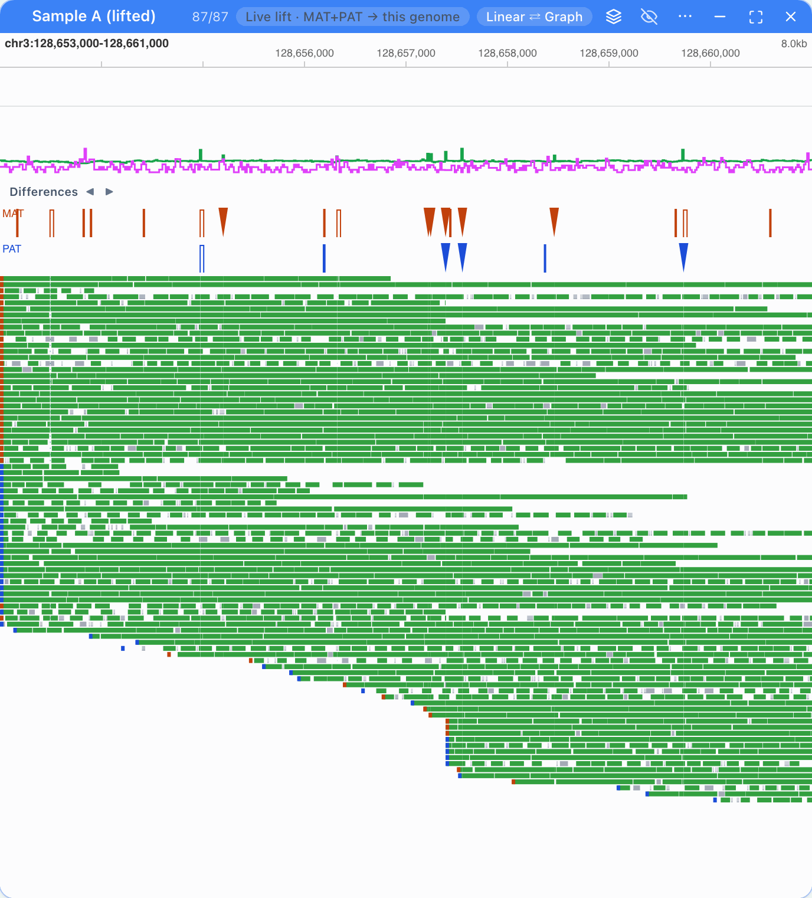
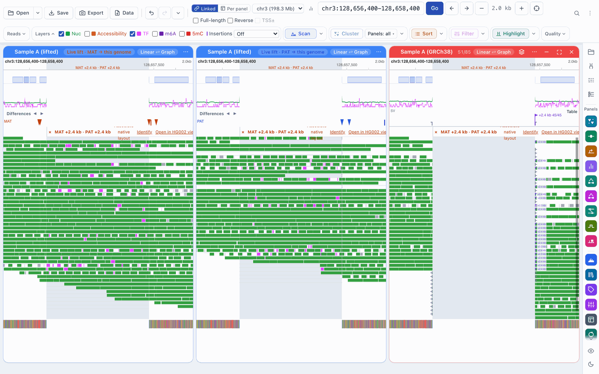
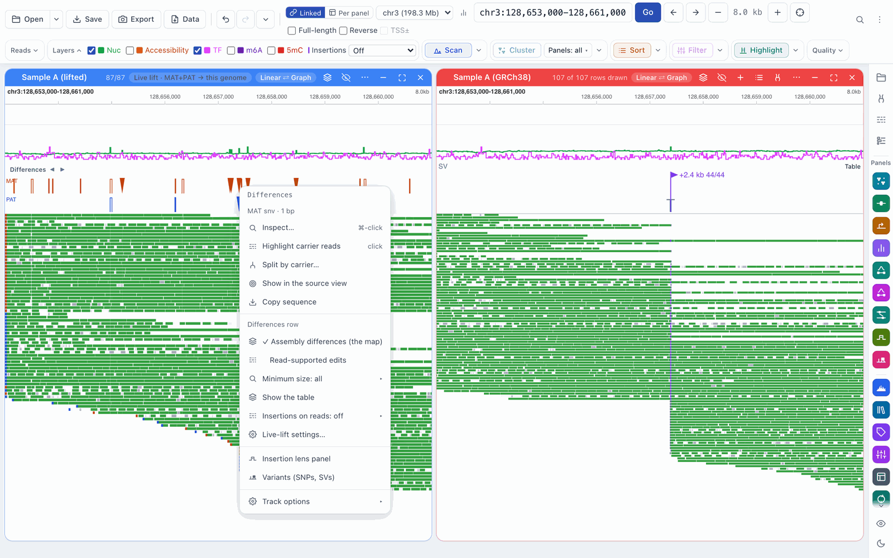
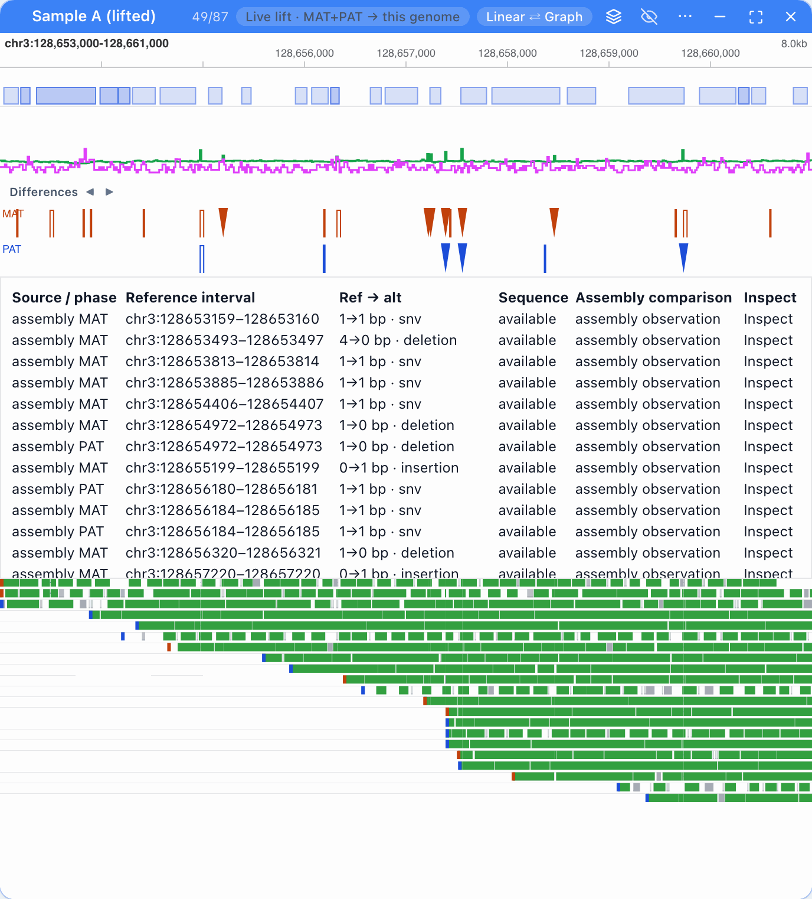
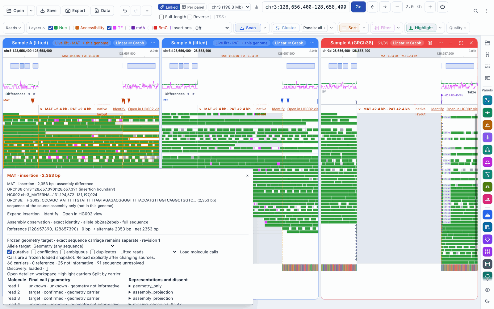
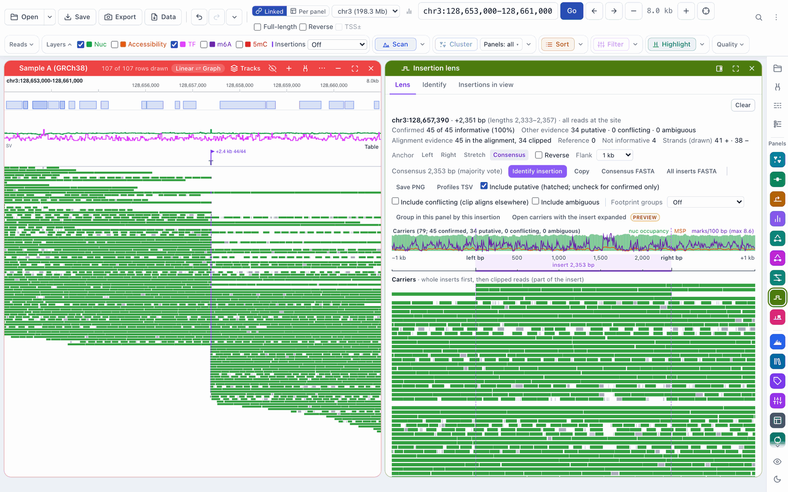

# Workflow: the Differences row and inspector

[← Docs index](../index.md) · [← README](../../README.md)

The **Differences** row sits above a panel's reads. It marks where the reads,
or the sample's assembly, differ from the genome you are browsing: insertions,
deletions, substitutions and rearrangements. From the row you can open an
insertion in place, highlight the reads that carry a difference, and inspect
it read by read.

What the row shows depends on the panel:

- **A BAM aligned to this genome:** the structural variants found in the reads
  (insertions and deletions of 50 bp or more), as in FiberBrowser 3.0's SV row.
  See [Structural variants](structural-variants.md) for how carriers are
  counted.
- **A lifted dataset** ([live lift](live-lift.md)): where each haplotype of
  the sample's assembly differs from this genome, read from the lift map, and,
  if you turn them on, the edits the reads themselves support.

## Reading the row on a lifted panel

- **Lanes.** A panel split by haplotype has one lane, its own. A pooled panel
  has one lane per haplotype (**MAT**, **PAT**), and a **Reads** lane when
  **Read-supported edits** is on. Marks are drawn in the lane's colour.
- **Marks.** An insertion is a wedge, a deletion a bracket, and other
  differences (substitutions, inversions, stretches with no counterpart) a
  block. Zoomed out, the row shows density bars instead; its status says
  *Density; zoom for individual differences*.
- **◀ ▶** jump to the previous or next difference outside the view, on the
  same chromosome.
- **Hover** a mark for what it is: the haplotype, kind and size, its position
  on this genome and on the sample's assembly, the bases on each, and the
  reason (for example *an indel between the assemblies*).

## Clicking

The same clicks work on the Differences row, on a lifted read's insertion tick,
and on the row of a BAM aligned to this genome.

| Action | What it does |
|---|---|
| **Click** an insertion | Expands it in place (see below). Click it again to collapse it. |
| **Click** any other difference | Highlights the reads that carry it, in every panel. |
| **Shift-click** | Selects the difference: an amber dashed guide line runs through every panel at it. |
| **⌘-click** (Ctrl-click on Windows and Linux) | Opens the inspector. |
| **Right-click** | Opens the row's menu; its first item is **Inspect…**. |

On the keyboard, Tab to a mark and press Enter to inspect it; Escape closes the
inspector.

## Expanding an insertion

A plain click on an insertion of 50 bp to 50 kb opens a column at that position
holding the inserted bases. Each read that carries the insertion shows its
inserted sequence there, with its m6A, accessibility and footprints, at the
same scale as the rest of the view. Reads that don't carry it show a gap.

- **Every panel shares the column**, so a native panel and the MAT and PAT
  panels stay aligned. The genome coordinates on either side don't change; the
  ruler shades the column and labels it.
- **Matching insertions share one column.** When MAT and PAT both carry an
  insertion at the same place with lengths within 10% (or 3 bp) of each other,
  one column holds both, as wide as the longer one. The label gives both sizes
  (*MAT +2.4 kb · PAT +2.3 kb*). A carrier of the shorter allele ends with a
  dashed grey tail: its calls are never stretched to fit.
- **An insertion only one haplotype carries** opens on that haplotype's reads;
  the other haplotype's reads show a gap.
- **The bar at the top of the column** has **×** (collapse), **Identify** (what
  the inserted sequence is) and, on a lifted panel, **Open in HG002 view** (the
  source view at the insertion; see [Linked panels](linked-panels.md)).

Insertions shorter than 50 bp or longer than 50 kb can't be expanded; the row
says why. They can still be inspected.

## The right-click menu

Right-click a mark for its actions, then the row's own options.

**On a difference** (headed with its haplotype, kind and size):

| Item | What it does |
|---|---|
| **Inspect…** | Opens the inspector. |
| **Expand insertion** / **Collapse insertion** | As a plain click, on insertions. |
| **Highlight carrier reads** | As a plain click, on other differences. |
| **Split by carrier…** | Opens the inspector, where the reads are split into carriers and non-carriers. |
| **Show in the source view** | Moves the linked source view to this difference (opens one if needed). |
| **Copy sequence** | Copies the inserted or alternative bases. |

**The row's options** (under **Differences row**):

| Item | What it does |
|---|---|
| **Assembly differences (the map)** | The haplotype lanes (on by default). |
| **Read-supported edits** | The **Reads** lane: insertions, deletions and replacements found in the loaded reads (off by default). |
| **Minimum size** | All sizes, ≥10 bp, ≥50 bp or ≥1000 bp. |
| **Show the table** / **Hide the table** | The difference table, below. |
| **Insertions on reads** | Off, Ticks or Ticks with size: the marks on the reads themselves. |
| **Live-lift settings…** | The dataset's settings. |

On a BAM aligned to this genome the menu also has the structural-variant
actions: group or split the reads by the SV, highlight carriers by evidence
level, and open the insertion in the lens. See
[Structural variants](structural-variants.md#the-differences-row-on-a-native-bam).

## The table

**Show the table** lists the differences in view below the row: where each
comes from (haplotype or reads), its interval on this genome, the change
(reference → alternative size), its sequence or support, and an **Inspect**
button.

## The inspector

The inspector opens beside the reads (⌘-click, or **Inspect…**). For a
difference on a lifted panel it shows:

- **The difference:** its haplotype, kind and size, its place on both
  assemblies, and the bases on each.
- **Buttons:** **Expand insertion** (or **Expand alternate**), **Identify** and
  **Open in HG002 view**.
- **Molecule calls:** click **Load molecule calls** to sort the reads into
  carriers, reference and not informative. Tick **putative**, **conflicting**,
  **ambiguous** or **duplicates** to count those reads as carriers too (only
  putative is ticked at first; see
  [Structural variants](structural-variants.md#evidence-levels)). **Lifted
  reads** uses the lifted panel's reads; **Combined representations** adds an
  open native dataset of the same molecules. Then **Highlight carriers**,
  **Split by carrier**, or **Open detailed workspace** (the insertion lens,
  below).
- **Per haplotype:** how many reads of each haplotype carry the sample's
  allele and how many the reference allele. Reads of a haplotype that show the
  reference allele are flagged as possible mis-phasing or mismapping.
- **The read table:** each read's haplotype and strand, its allele, its own
  bases next to the two assemblies' bases, and the chromatin nearby. Hover a
  row to highlight that read.

The read table loads by itself when the panel has up to 2,000 reads in view.
With more, the inspector says so and offers **Load observed bases and
chromatin**.

For a structural variant on a BAM aligned to this genome, the inspector
(*Inspect difference*) shows each read's observed bases, coverage and
chromatin, with **Expand alternate**, **Load full observed sequence** and
**Identify observed alternate**.

## The insertion lens

The insertion lens draws the carriers of one insertion in the insertion's own
coordinates (left flank, insert, right flank), with group profiles and the
insert's consensus. Open it with:

- **Open detailed workspace** in the inspector, after loading molecule calls;
- **Open this insertion in the lens** in the right-click menu of an insertion
  on a native BAM's row;
- **Open insertion lens** in the read menu.

Its tabs are **Lens**, **Identify** and **Insertions in view**. Reads that are
not confirmed carriers are hatched; **Include putative**, **Include
conflicting** and **Include ambiguous** choose which ones are drawn.

## Settings

On a lifted panel, **Live-lift settings… → Differences row** holds the row's
options (they are also in its right-click menu):

| Setting | Default |
|---|---|
| Assembly differences (the map) | on |
| Read-supported edits | off |
| Minimum size | All sizes |
| Insertions on reads | Ticks |

**Save** applies them to every panel of the dataset.
