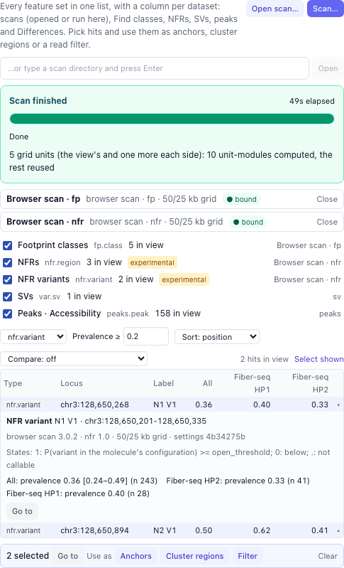
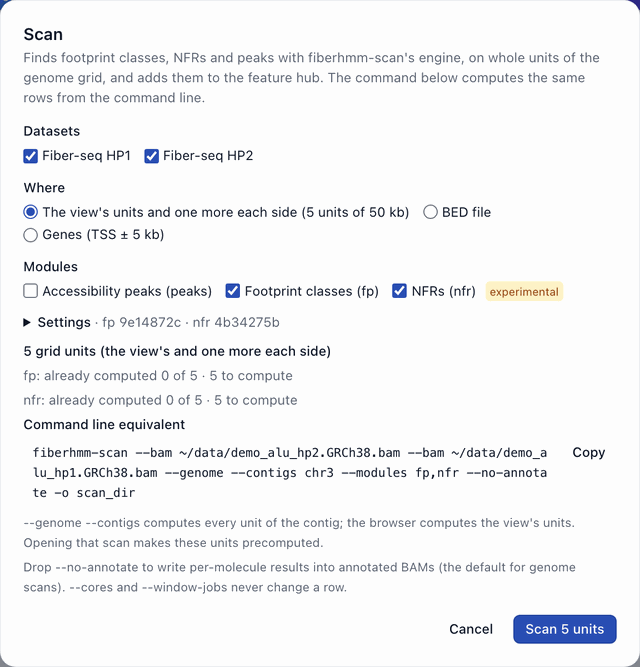
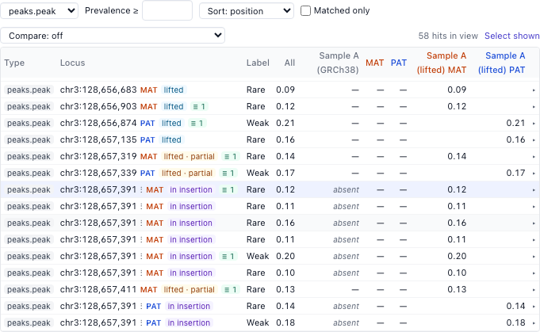
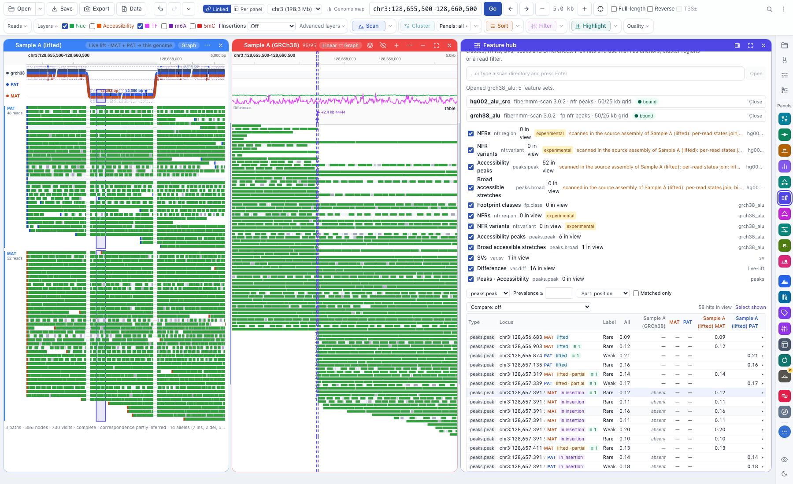
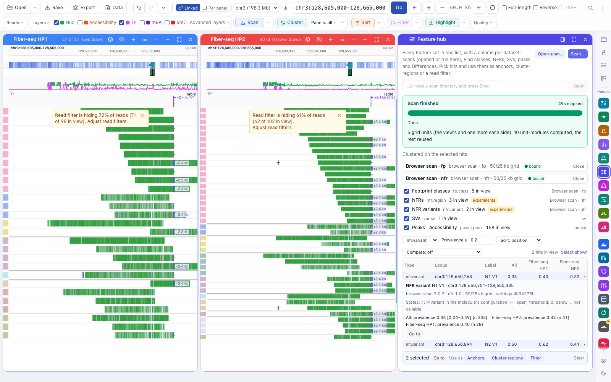

# Workflow: the feature hub and scans

[← Docs index](../index.md) · [← README](../../README.md)

The **Feature hub** lists every set of features the browser knows in one table:
footprint classes, NFRs and peaks from **fiberhmm-scan** (opened from disk or run
here), a **Find classes** run, an NFR run, the SVs in view, the peak rules'
peaks and the live-lift **Differences**. Each row has a column per dataset (and
per haplotype for Differences), so you can compare datasets side by side and
then use the features you pick as anchors, cluster regions or a read filter.

Open it from the panel rail (**Hub**) or the command palette (**Feature hub**).
It docks beside the reads.

## Scans

A scan is a fiberhmm-scan output directory: `manifest.json`, tables of pooled
hits per module (`fp` footprint classes, `nfr` NFRs, `peaks` accessibility
peaks), and per-read results, either as annotated BAMs or as tables. See
FiberHMM's `docs/workflows/scanning.md` for running scans on the command line.

### Opening a scan

**Open scan…** picks a scan directory (or type its path under the buttons and
press Enter). The hub binds each dataset of the scan to a loaded dataset by its
file contents (not its name or path), and says how it went:

- **bound**: the scan's per-read states join this dataset's reads, so its hits
  can filter, sort and cluster reads;
- **stale**: a loaded BAM has the scanned file's name but different contents
  (it changed since the scan). Re-scan it;
- **scan of other files**: no loaded dataset matches. The hits are listed, but
  they can't select reads.

A scan made on another reference is refused, unless it is bound to a loaded
file. That is the case for a live-lift dataset's own BAM, scanned in the
sample's assembly: its per-read states join the lifted rows record by record,
and its hits are lifted onto this genome (see
[Hits of an assembly scan](#hits-of-an-assembly-scan)).

The scan's sets keep where they came from: the tooltip at the right of a set
names the scan, the FiberHMM and module versions, the units and the settings.

### Annotated BAMs

Genome scans write each input BAM again with the scan's per-read results as
extra MA groups (`fpcls` class membership, `nfrvar` NFR states, `nfrmol` NFR
molecule scalars; `nucsz` nucleosome sizes, `nucseg` array segments and
`nucmol` scalars from `nuc`). Open an annotated BAM like any BAM, or as a live-lift dataset:
the groups appear as layers (**Scan · classes**, **Scan · NFR variants**…) and
follow the reads through live lift. Scans written as tables (BED scans, and the
browser's own scans) give the same layers to the bound datasets.

### Scanning here

**Scan…** runs the same engine as fiberhmm-scan on the data you have open.

- **Datasets**: FiberHMM-called BAMs (live-lift datasets are scanned in their
  own assembly: run fiberhmm-scan on their BAM and open the scan).
- **Where**: the view's units of the genome grid (50 kb units, each owning its
  central 25 kb) and one more on each side; a BED file; or genes (TSS ± 5 kb).
- **Modules**: `fp`, `nfr` (experimental), `peaks`, and `nuc` (nucleosome
  arrays, experimental) when your FiberHMM has it. Peaks use the local Rare
  rule: a base is Rare where at least 8% of the molecules are open and at least
  **min reads** molecules cover it, whatever the view; every record counts,
  supplementaries included. The older window rule is a setting for this release
  (`{"peaks": {"tier_rule": "window", "row_rule": "view"}}`), for BED and gene
  scans.
- **Settings**: depth caps (molecules used to discover and to quantify),
  workers (never changes a row), and module settings as JSON, as
  `fiberhmm-scan --parameters` takes them.
- **Already computed**: units an opened scan or an earlier scan here already
  computed with the same datasets, read policy and settings. They are never
  computed again.
- **Command line equivalent**: the `fiberhmm-scan` command that computes the
  same rows. **Copy** copies it. For a view it scans the whole chromosome; open
  that scan later and every unit of it counts as computed.

The scan runs in the background with a progress bar and **Cancel**. Its results
go into the browser's scan cache (`~/.fiberhmm/scan_cache`, or the folder
`FIBERBROWSER_SCAN_CACHE_DIR` names) and appear in the hub as
**Browser scan · fp**, **Browser scan · nfr**… Scans of later views add units
to the same cache, so panning back costs nothing.

A browser scan and the command line give the same rows for the same units,
datasets, depth caps and settings: both call `fiberhmm.scan.run_units` on the
BAM files.

## The table

- **Sets**: untick a set to leave its hits out of the table. The count is the
  hits in view.
- **Columns**: **All** is the pool; then one column per dataset (and per
  haplotype, in MAT orange and PAT blue, for Differences). Footprint classes and
  NFR variants show their prevalence (the share of callable molecules that are
  members); nucleosome patches the share of measured molecules in the segment
  class (phased patches: phasing over its null), also per haplotype; peaks their
  score; SVs the share of informative reads that carry it.
  An empty cell is a dataset of the set without a value there; **—** is a
  dataset the set did not scan.
- **Type**, **Prevalence ≥**, **Sort** and **Compare** (a Δ column between two
  datasets) filter and order the rows.
- Click a row to select it (shift-click adds); **Select shown** selects every
  row in the table. **▸** shows the values with their counts and intervals,
  where the set came from, and **Go to** / **Open in its panel**.

The hub lists the hits in the main view. It is saved with the session: the
scans it opened (reopened when the session is), its settings, the selection and
the anchor sets. A scan that can't be found is listed as **Scan not found**:
open it again from where it is now, or re-scan.

## Hits of an assembly scan

A scan of a live-lift dataset's own BAM (for example HG002's maternal and
paternal contigs) lists its hits in the view of this genome. Each hit is lifted
with graphlift's `liftbed`, through the dataset's map and with the settings
`fiberhmm-lift --bed` uses, so it lands where `fiberhmm-lift --bed` puts it and
where the dataset's reads land. It keeps its own coordinates.

- **Locus** is where the hit is on this genome, followed by its haplotype (MAT
  orange, PAT blue) and how it lifted:
  - **lifted**: one placement, every base on this genome;
  - **lifted · split**: its bases land in several places (an inversion edge, a
    gap of 10 kb or more); the place with the most bases is shown;
  - **lifted · partial**: some of its bases have no place here (an insertion
    or a gap inside the hit);
  - **in insertion**: the whole hit lies in sequence this genome lacks. It is
    placed at the insertion's junction (`⋮`, the base after it);
  - **unmapped**: off the map; it has no place here.

  Hover a row, or expand it (**▸**), for the source coordinates, what the lift
  did, and which haplotypes carry the hit.
- **Columns**: the scan's dataset becomes one column per haplotype
  (**Sample A (lifted) MAT**, **… PAT**), filled for the haplotype the hit is
  on.
- **absent**: with a graph package registered, the hub knows which paths carry
  each hit's sequence (its graph columns). A column whose reads are on a path
  that lacks it says **absent**: a MAT or PAT hit inside an insertion is absent
  for a dataset on GRCh38, not "not scanned".
- **≡ n**: the same feature found in another frame or set. A GRCh38 scan's hit
  and a lifted hit match when they overlap by at least half of each (points:
  within 20 bp); hits inside an insertion match on their graph columns, so only
  haplotypes that carry that sequence share them. Hover the chip for the
  matches; **Matched only** keeps rows with a match.
- **Use as** works on lifted hits. Anchors and cluster regions use where the hit
  is on this genome (a hit in an insertion: a small region around its junction,
  so a graph-mode Cluster clusters on the inserted sequence); the anchors keep
  the source coordinates. **Filter** uses the scan's per-read states, which join
  the lifted rows record by record.

**In graph mode** the hub's hits are drawn on the graph's own sequence: a faint
box on the lanes that carry each hit, and the selected ones filled, on those
lanes and their reads. A hit inside an insertion is drawn on the inserted
sequence of the haplotypes that carry it. **Shift-click** a box to add or remove
its hit in the hub's selection (a plain click on a tube still selects the
graph's own locus; a plain click on a selected hit's reads selects it alone).
The selected hits are also outlined on the linear panels, the haplotype panels
popped out of the graph, and the linked source views of the assembly.

**Pooled scans in this genome's frame.** A scan that pools the lifted molecules
of several haplotypes in GRCh38 coordinates is made with `fiberhmm-lift` (a
lifted BAM) and then `fiberhmm-scan` on that BAM. The browser can't run it from
live-lift rows yet: live lift places the records where `fiberhmm-lift` does,
but some footprint calls differ at small map gaps, so the two would not give
the same rows.

## Use as

With hits selected:

- **Anchors** saves them as an anchor set (position, strand, label), kept with
  the session, for comparisons at anchors.
- **Cluster regions** makes the hits in view the Cluster button's regions, each
  on its own layer (footprint classes on the TF class layer, NFRs and peaks on
  accessibility), and runs Cluster. Hits with the same span are one region. It
  needs the **Custom** peak rule on. Cluster uses the reads that span every
  region, so pick hits that the same reads cover.
- **Filter** keeps the reads that are members (state 1: in the class, open in
  the NFR) of any selected hit with per-read states; peaks, SVs and Differences
  have none here and are left out, as the notice says. The filter chip says
  **Feature hub**.
- **Go to** shows the selected hits.

## Limits in this release

- The table lists the hits in the main view; genome-wide lists of a scan come
  later.
- A scan in another assembly is lifted onto this genome through a live-lift
  dataset of its BAM; without one, its hits can't be placed here. Lifting needs
  graphlift's `liftbed` next to the graph helper (or `FIBERBROWSER_LIFTBED`).
- Graph columns, and so **absent**, are for scan hits; Differences, peak rules
  and Find classes rows have none yet.
- Graph bubbles are not listed yet.
- Association tests between feature types come later.
