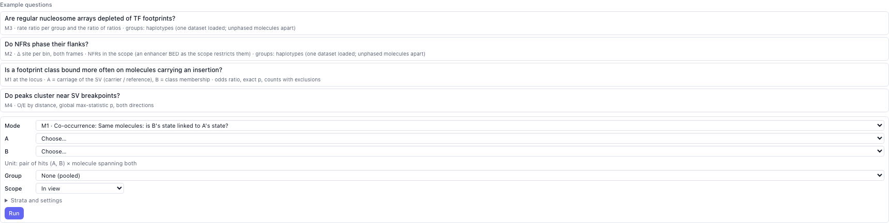
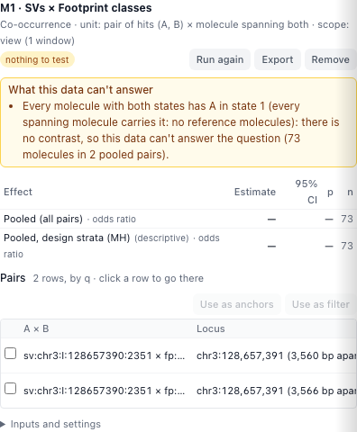
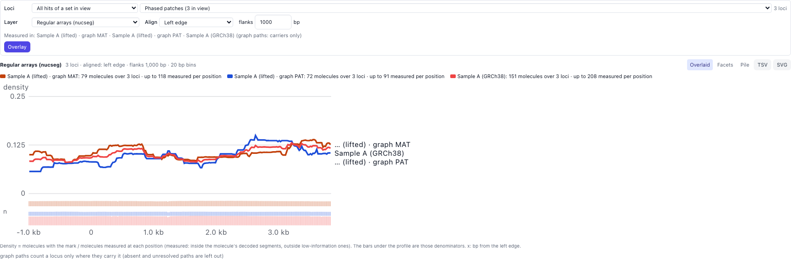
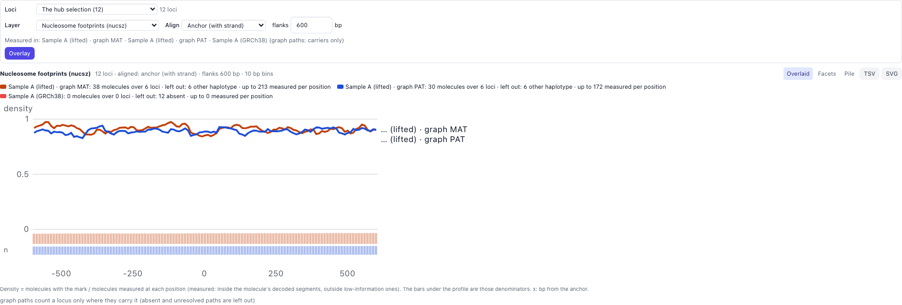

# Workflow: the feature hub and scans

[← Docs index](../index.md) · [← README](../../README.md)

The **Feature hub** lists every set of features the browser knows in one table:
footprint classes, NFRs and peaks from **fiberhmm-scan** (opened from disk or run
here), a **Find classes** run, an NFR run, the SVs in view, the peak rules'
peaks and the live-lift **Differences**. Each row has a column per dataset (and
per haplotype for Differences), so you can compare datasets side by side and
then use the features you pick as anchors, cluster regions or a read filter,
test whether two feature types go together (**Associate**), or overlay many
patches at once (**Overlay**).

Open it from the panel rail (**Hub**) or the command palette (**Feature hub**).
It docks beside the reads.

## Scans

A scan is a fiberhmm-scan output directory: `manifest.json`, tables of pooled
hits per module (`fp` footprint classes, `nfr` NFRs, `peaks` accessibility
peaks), and per-read results, either as annotated BAMs or as tables. See
FiberHMM's `docs/workflows/scanning.md` for running scans on the command line.

### Opening a scan

**Open scan…** picks a scan directory (or type its path under the buttons and
press Enter). The hub binds each dataset of the scan to a loaded dataset by its
file contents (not its name or path), and says how it went:

- **bound**: the scan's per-read states join this dataset's reads, so its hits
  can filter, sort and cluster reads;
- **stale**: a loaded BAM has the scanned file's name but different contents
  (it changed since the scan). Re-scan it;
- **scan of other files**: no loaded dataset matches. The hits are listed, but
  they can't select reads.

A scan made on another reference is refused, unless it is bound to a loaded
file. That is the case for a live-lift dataset's own BAM, scanned in the
sample's assembly: its per-read states join the lifted rows record by record,
and its hits are lifted onto this genome (see
[Hits of an assembly scan](#hits-of-an-assembly-scan)).

The scan's sets keep where they came from: the tooltip at the right of a set
names the scan, the FiberHMM and module versions, the units and the settings.

### Annotated BAMs

Genome scans write each input BAM again with the scan's per-read results as
extra MA groups (`fpcls` class membership, `nfrvar` NFR states, `nfrmol` NFR
molecule scalars; `nucsz` nucleosome sizes, `nucseg` array segments and
`nucmol` scalars from `nuc`). Open an annotated BAM like any BAM, or as a live-lift dataset:
the groups appear as layers (**Scan · classes**, **Scan · NFR variants**…) and
follow the reads through live lift. Scans written as tables (BED scans, and the
browser's own scans) give the same layers to the bound datasets.

### Scanning here

**Scan…** runs the same engine as fiberhmm-scan on the data you have open.

- **Datasets**: FiberHMM-called BAMs (live-lift datasets are scanned in their
  own assembly: run fiberhmm-scan on their BAM and open the scan).
- **Where**: the view's units of the genome grid (50 kb units, each owning its
  central 25 kb) and one more on each side; a BED file; or genes (TSS ± 5 kb).
- **Modules**: `fp`, `nfr` (experimental), `peaks`, and `nuc` (nucleosome
  arrays, experimental) when your FiberHMM has it. Peaks use the local Rare
  rule: a base is Rare where at least 8% of the molecules are open and at least
  **min reads** molecules cover it, whatever the view; every record counts,
  supplementaries included. The older window rule is a setting for this release
  (`{"peaks": {"tier_rule": "window", "row_rule": "view"}}`), for BED and gene
  scans.
- **Settings**: depth caps (molecules used to discover and to quantify),
  workers (never changes a row), and module settings as JSON, as
  `fiberhmm-scan --parameters` takes them.
- **Already computed**: units an opened scan or an earlier scan here already
  computed with the same datasets, read policy and settings. They are never
  computed again.
- **Command line equivalent**: the `fiberhmm-scan` command that computes the
  same rows. **Copy** copies it. For a view it scans the whole chromosome; open
  that scan later and every unit of it counts as computed.

The scan runs in the background with a progress bar and **Cancel**. Its results
go into the browser's scan cache (`~/.fiberhmm/scan_cache`, or the folder
`FIBERBROWSER_SCAN_CACHE_DIR` names) and appear in the hub as
**Browser scan · fp**, **Browser scan · nfr**… Scans of later views add units
to the same cache, so panning back costs nothing.

A browser scan and the command line give the same rows for the same units,
datasets, depth caps and settings: both call `fiberhmm.scan.run_units` on the
BAM files.

## The table

- **Sets**: untick a set to leave its hits out of the table. The count is the
  hits in view.
- **Columns**: **All** is the pool; then one column per dataset (and per
  haplotype, in MAT orange and PAT blue, for Differences). Footprint classes and
  NFR variants show their prevalence (the share of callable molecules that are
  members); nucleosome patches the share of measured molecules in the segment
  class (phased patches: phasing over its null), also per haplotype; peaks their
  score; SVs the share of informative reads that carry it.
  An empty cell is a dataset of the set without a value there; **—** is a
  dataset the set did not scan.
- **Type**, **Prevalence ≥**, **Sort** and **Compare** (a Δ column between two
  datasets) filter and order the rows.
- Click a row to select it (shift-click adds); **Select shown** selects every
  row in the table. **▸** shows the values with their counts and intervals,
  where the set came from, and **Go to** / **Open in its panel**.

**Scope** chooses the view, a BED file, gene names around their TSS, an anchor
set, one complete scan, or all open scans genome-wide. Genome scopes use scan
files; browser providers retain the territory in which they were computed.
The server filters and sorts the full hit set before returning a page (50–500
rows). **Select shown** selects that page. Selection survives changing pages.
Strength, q, and declared-score filters combine with prevalence and type.

The session keeps scans, list settings, selection, and anchor sets. Browser
scan directories are embedded up to a cumulative 25 MiB of uncompressed files;
larger scans stay references. Embedded scans restore even after the original
cache was removed. A missing reference offers **Open scan** or **Re-scan**.
Scans of other files remain read-only: their hits and values are available,
but they cannot join molecules from the loaded datasets.

## Hits of an assembly scan

A scan of a live-lift dataset's own BAM (for example HG002's maternal and
paternal contigs) lists its hits in the view of this genome. Each hit is lifted
with graphlift's `liftbed`, through the dataset's map and with the settings
`fiberhmm-lift --bed` uses, so it lands where `fiberhmm-lift --bed` puts it and
where the dataset's reads land. It keeps its own coordinates.

- **Locus** is where the hit is on this genome, followed by its haplotype (MAT
  orange, PAT blue) and how it lifted:
  - **lifted**: one placement, every base on this genome;
  - **lifted · split**: its bases land in several places (an inversion edge, a
    gap of 10 kb or more); the place with the most bases is shown;
  - **lifted · partial**: some of its bases have no place here (an insertion
    or a gap inside the hit);
  - **in insertion**: the whole hit lies in sequence this genome lacks. It is
    placed at the insertion's junction (`⋮`, the base after it);
  - **unmapped**: off the map; it has no place here.

  Hover a row, or expand it (**▸**), for the source coordinates, what the lift
  did, and which haplotypes carry the hit.
- **Columns**: the scan's dataset becomes one column per haplotype
  (**Sample A (lifted) MAT**, **… PAT**), filled for the haplotype the hit is
  on.
- **absent**: with a graph package registered, the hub knows which paths carry
  each hit's sequence (its graph columns). A column whose reads are on a path
  that lacks it says **absent**: a MAT or PAT hit inside an insertion is absent
  for a dataset on GRCh38, not "not scanned".
- **≡ n**: the same feature found in another frame or set. A GRCh38 scan's hit
  and a lifted hit match when they overlap by at least half of each (points:
  within 20 bp); hits inside an insertion match on their graph columns, so only
  haplotypes that carry that sequence share them. Hover the chip for the
  matches; **Matched only** keeps rows with a match.
- **Use as** works on lifted hits. Anchors and cluster regions use where the hit
  is on this genome (a hit in an insertion: a small region around its junction,
  so a graph-mode Cluster clusters on the inserted sequence); the anchors keep
  the source coordinates. **Filter** uses the scan's per-read states, which join
  the lifted rows record by record.

**In graph mode** the hub's hits are drawn on the graph's own sequence: a faint
box on the lanes that carry each hit, and the selected ones filled, on those
lanes and their reads. A hit inside an insertion is drawn on the inserted
sequence of the haplotypes that carry it. **Shift-click** a box to add or remove
its hit in the hub's selection (a plain click on a tube still selects the
graph's own locus; a plain click on a selected hit's reads selects it alone).
The selected hits are also outlined on the linear panels, the haplotype panels
popped out of the graph, and the linked source views of the assembly.

**Pooled scans in this genome's frame.** A scan that pools the lifted molecules
of several haplotypes in GRCh38 coordinates is made with `fiberhmm-lift` (a
lifted BAM) and then `fiberhmm-scan` on that BAM. The browser can't run it from
live-lift rows yet: live lift places the records where `fiberhmm-lift` does,
but some footprint calls differ at small map gaps, so the two would not give
the same rows.

## Use as

With hits selected:

- **Anchors** saves them as an anchor set (position, strand, label), kept with
  the session, for comparisons at anchors.
- **Cluster regions** makes the hits in view the Cluster button's regions, each
  on its own layer (footprint classes on the TF class layer, NFRs and peaks on
  accessibility), and runs Cluster. Hits with the same span are one region. It
  needs the **Custom** peak rule on. Cluster uses the reads that span every
  region, so pick hits that the same reads cover.
- **Filter** keeps the reads that are members (state 1: in the class, open in
  the NFR) of any selected hit with per-record states. SVs, SNPs, Differences,
  graph bubbles, and measured peak openness also supply states. Unmeasured or
  unresolved records retain “.”. The filter chip says **Feature hub**.
- **Split** opens the state-pattern panel split; its descriptors survive sessions.
- **Highlight** highlights carrier reads and the selected regions.
- **Region catalog** saves placed hits under **Feature hub**.
- **Condition** opens M2 with exactly the selected hits as A, including earlier pages.
- **Export BED6** retains zero-width insertion boundaries. **Export values**
  includes group values, bounds, counts, and provenance.
- **Go to** shows the selected hits.

## Associations

The **Associate** tab asks whether two feature sets go together. Every
analysis has a feature **A**, a feature **B** (or, for one mode, a measure of
the molecules), a **unit**, a **group** to compare, and a **scope**. The
statistics are FiberHMM's (`fiberhmm.assoc`, the same functions as
`fiberhmm-scan assoc`), with FiberHMM's defaults.

| Mode | The question it asks | Unit | Result |
|---|---|---|---|
| M1 co-occurrence | On the same molecules, is B's state linked to A's state? | a pair of hits (A, B) × each molecule spanning both | odds ratio (pooled, per group), per-pair tables with exact p |
| M2 conditional response | Does a measure of the molecules differ when A is open (or bound)? | an anchor × each molecule | Δ (open − closed) at the anchors, and Δ site: anchors against matched backgrounds |
| M3 within-molecule rate | Is B denser inside A than outside, on the same molecules? | a molecule, inside versus outside A | rate ratio |
| M4 overlap and distance | Are B hits nearer A hits than chance? | a hit | observed / expected by distance, one global test |

**Example questions.** The four buttons at the top fill the builder for the
questions the hub was designed around. Each says what it needs when the hub
doesn't have it yet (for example a nucleosome scan for the first one):

- *Are regular nucleosome arrays depleted of TF footprints?* M3: regular-array
  segments of a nucleosome scan as A, its TF footprint calls as B.
- *Do NFRs phase their flanks?* M2: NFRs of a scan as anchors, nucleosome
  phasing (R − null) around them in the anchor's frame and the molecule's own
  frame. Give an enhancer BED as the scope to restrict the NFRs.
- *Is a footprint class bound more often on molecules carrying an insertion?*
  M1: the SV's carriage (carrier or reference, from the SV row's split) as A,
  class membership as B.
- *Do peaks cluster near SV breakpoints?* M4: SVs as A, peaks as B, both
  directions.

**The builder.**

- **Mode** and **A**, **B**: A and B are the hub's sets. M1 needs per-molecule
  states for both: scan sets (footprint classes, NFRs) and SVs have them; peak
  rules, Differences and anchor sets don't, and say so. M2's **Response** is
  either nucleosome phasing or a measure per molecule from a scan (repeat
  length, regularity, linker variability, openness). Phasing conditions on
  open or closed at the anchor (an MSP of at least 80 bp over it, or a
  nucleosome on it) and compares with matched random positions, so its anchors
  must have a state defined anywhere: NFR regions, peaks or an anchor set. It
  runs jointly on native datasets, using each dataset's own repeat length,
  marking prior and size calibration. Choose **Datasets** for the test of the
  difference between datasets. A per-molecule measure uses A's own states (footprint
  classes, NFRs), with other hits of A as backgrounds when an anchor BED is
  given. M3 takes nucleosome marks as A and TF calls or a state set from
  another compatible scan as B. Dataset bindings join the scans; only their
  shared callable territory contributes exposure.
- **Group**: none (pooled), **datasets**, **haplotypes** (HP tags of native
  reads, MAT/PAT of an assembly scan's hits; unphased molecules are left out of
  the contrast and reported apart), or the **cluster labels** of the shown
  Cluster run. Comparing clusters is circular when the cluster run used the
  tested window: the run is refused, unless you accept a "post-selection"
  label, which shows the numbers without p-values.
- **Scope**: the view, the regions of a BED file, an anchor set ± a flank, or
  the scans' whole territory (scan sets only).
- **Strata and settings** say what each mode controls for (mark density,
  openness and channel in M1; density strata, coverage and matched backgrounds
  in M2; each molecule's own bases in M3; the scanned territory in M4) and hold
  the pair distance (5 kb), the pooled test, permutations, bootstrap draws
  and the seed.

**Running.** **Run** starts a job on the scan job manager, with progress and
**Cancel**. Cancellation is checked during the engine's resampling batches.
For NFR phasing, **Rediscover NFR anchors on held-out molecule halves**
reruns NFR discovery on one stable molecule half and tests the other, then
reverses the halves. The Q2 preset enables this option. The pooled readout
uses the mean of the two directions and their independent permutation nulls;
group contrasts are shown for each held-out direction. A finished run joins **Runs**, which are kept with the session and
come back when the session is opened again.

**Results.**

- **What this data can't answer** comes first, in plain words: no pairs within
  the distance, one state only (for example every spanning molecule carries the
  insertion, so there are no reference molecules), too few anchors or hits,
  relocations that couldn't be placed. A run with no contrast shows its counts,
  not an odds ratio.
- The **effects** table: estimate, 95% interval, p and n, pooled and per group.
  The **group difference** is an interaction test (each group keeps its own
  margins); with one library per group it describes these libraries, not a
  population.
- The **pairs** (M1) or **anchors** (M2), ordered by q: click a row to go
  there; **Use as anchors** saves the picked rows (or those with q ≤ 0.1) as an
  anchor set; **Use as filter** keeps the reads in state 1 at A of those rows.
- M4 draws O/E by distance for both directions (filled points: per-distance
  p < 0.05, descriptive), with the same numbers in a table.
- **Inputs and settings** lists the hits, molecules and states used, what was
  left out and why, the covariates found, the territory and strata.
- **Export** saves the run as JSON and its rows as TSV. When A and B come from
  one opened scan, the result shows the equivalent `fiberhmm-scan assoc` line.

**Hits of an assembly scan.** A lifted hit is placed where it lifted. A hit
inside an insertion has no extent on this genome: M4 leaves it out and counts
it. A molecule never gets a state the scan didn't give it, so molecules on a
haplotype that lacks a hit's sequence are left out, never counted as unbound.

## Overlaid patches

The **Overlay** tab pools a mark layer over many loci, so you can see, for
example, every regular array at once.

- **Loci**: the hub selection, all hits of a set in view, an anchor set, or the
  patches the Nucleosomes panel's patch list sends (**Overlay…** there).
- **Layer**: regular, disordered or undetermined array segments, low-information
  segments, undersized runs, missing nucleosomes, nucleosome footprints or TF
  footprints (the nucleosome outputs: **Compute in view** in the Nucleosomes
  panel, or a scan with the nuc module).
- **Align**: at the anchor (with strand), the left or right edge, or scaled
  (each patch stretched to 0–1, flanks in bp).

Each shown panel is measured on its own, as the Nucleosomes panel's columns
are: a dataset panel, a haplotype pop-out, each path of a graph. At each
position the density is the molecules with the mark over the molecules
**measured** there (inside their decoded segments, outside low-information
ones). A molecule that doesn't reach a position never counts as absence. The
bars under the profile are those denominators.

**Graph mode: carriers only.** A graph path counts a locus only where it
carries it (whole or in part); paths where it is absent or unresolved are left
out and counted in the legend. A haplotype panel of a lifted dataset follows
the same rule.

**Views and export.** **Overlaid** draws every panel's profile on one axis;
**Facets** gives each panel its own chart on the same axis; **Pile** draws a
sample of molecule × locus rows (at most 400, the same sample on every reload),
sorted by mark length or by panel. **TSV** saves the bins with numerators and
denominators per panel; **SVG** saves the chart.

## Limits in this release

- A scan in another assembly is lifted onto this genome through a live-lift
  dataset of its BAM; without one, its hits can't be placed here. Lifting needs
  graphlift's `liftbed` next to the graph helper (or `FIBERBROWSER_LIFTBED`).
- Browser-produced graph bubbles share the list, path columns, outlines, and
  selection with scan hits. Geometry-only variation identities are labelled
  separately from exact alleles; legacy ids remain aliases.
- Associations: M2 phasing runs on native datasets with per-dataset calibration and dataset
  interaction tests; M3 reads nucleosome scans in table mode (live scans are), one per
  dataset; M4 has no territory for an assembly scan yet; M4 strata are one per
  contig unless a strata BED is given. The hub loads SV and Differences inputs
  independently of mounted read panels.
- The overlay measures an assembly scan's hit inside an insertion on its own
  haplotype's panel only.
- The overlay also accepts loaded MA layers and bound scan state/mark layers.
  State layers count only evaluated intervals in their denominators. Graph
  observations align through unique node columns; missing alleles, repeated
  nodes and offsets outside path clips stay unmeasured. Graph alignment needs
  a registered package covering each locus.
