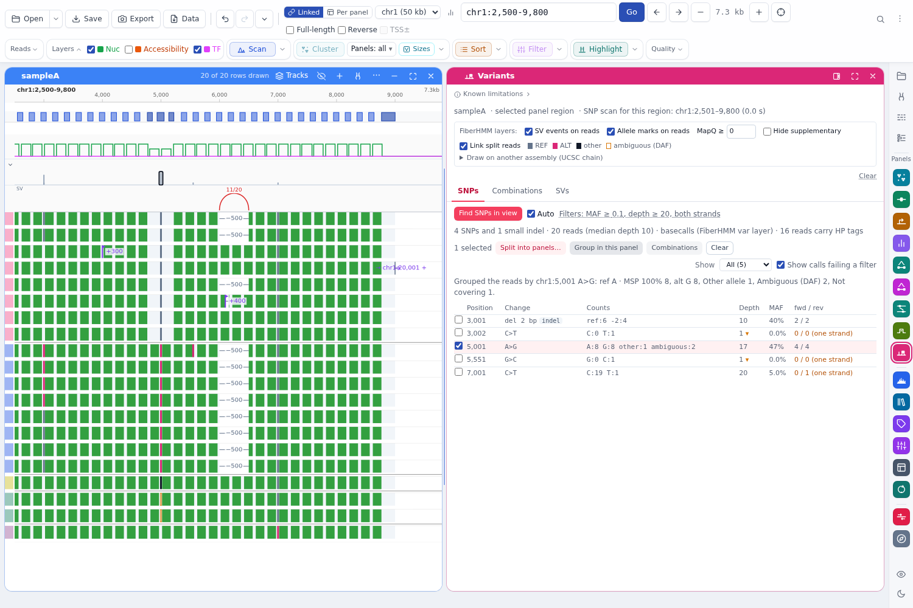
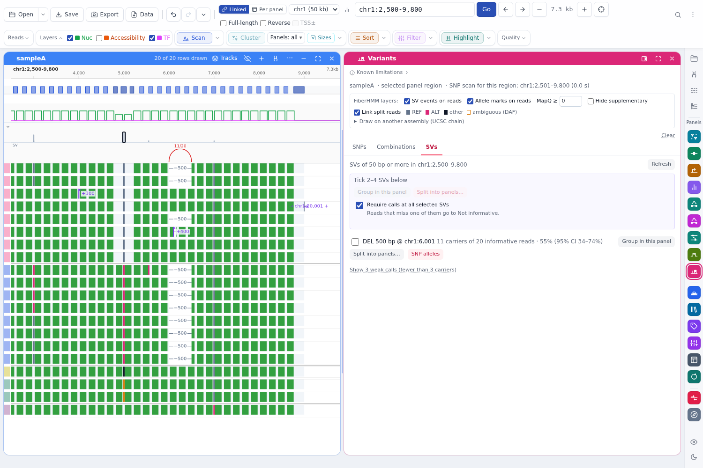

# FiberHMM variant and SV layers (bigBed)

`fiberhmm-extract` can write two more bigBeds for a sample, next to its
footprint, MSP, TF and m6A layers:

- **`fiberhmm_var`**: each read's allele at the sites of a VCF (the one you
  gave, or the automatic DAF SNP VCF);
- **`fiberhmm_sv`**: each alignment record's deletions, insertions and clips,
  with its MAPQ, flag and SA tag (supplementary records have their own rows).

With these, a sample opened from bigBeds alone can be split by allele and
show structural events. The BAM is not needed.

`fiberhmm-extract` writes them from FiberHMM 3.2.0: `--variants VCF` (or
`--variants auto` for the DAF SNP screen VCF) writes `var`, and `--sv`
writes `sv`. `--all` writes `sv`, and `var` when a VCF is available.
FiberHMM 3.1.0 and earlier don't write these layers (3.2.0 was not yet
released when FiberBrowser 3.0.6 came out).

The Variants panel and read rows use the same reads as the read panel.
Reads without footprint calls (no row in the sample's footprint, MSP or TF
bigBeds) are left out unless Min footprints is set to **All reads,
including uncalled**. QC-fail records (SAM flag 0x200 in the sv file) are
left out unless **Show QC-fail reads** is on. `fiberhmm-extract` does not
write FiberHMM chimeras to any layer.

## Opening

Open the sample's footprint bigBed, or its folder, as usual. The var and sv
files are found by their autoSQL table name and `Sample:` tag, the same way
the MSP and TF files are found. They are joined to the reads by read id.

These files are read only when you use them. Opening a dataset that has them,
which `--all` extractions usually do, costs nothing extra.

## Allele groups (Variants panel)

Open **Variants** and pick the dataset. The **SNPs** tab lists the VCF sites
in view with their allele counts. If the VCF named in the var file sits next
to it (indexed, `.tbi`/`.csi`), the bases are shown (`A>G`). If not, the
alleles are shown as `REF>ALT`.

Select one site and use **Group in this panel** or **Split into panels…** to
put the reads in these groups:

| Group | Reads |
|---|---|
| ref / alt | the VCF's REF or (most common) ALT allele |
| Other allele | another ALT allele, another base, or a deletion at the site |
| Ambiguous (DAF) | the base can't be told from a DAF conversion; not counted as covering the site |
| Not covering | the read does not reach the site |

When the sample has an MSP layer, each ref/alt group's label also gives the
mean fraction of its reads within ±500 bp of the site that lies in MSPs, for
example `ref A · MSP 42%`. Footprint, MSP and nucleosome rows follow their
reads into the groups and split panels.

Selecting several sites groups the reads by their alleles at all of them
(**Combinations**). **Group by HP** uses the var file's `hp` column.

Combining SNPs with SVs in one grouping, and the SVs tab's **SNP alleles**
(SV–SNP linkage), still need the BAM. With the var and sv layers, group by
the SNPs or by the SVs.

## Marks on the reads

The **FiberHMM layers** line in the Variants panel turns the layers on for
the dataset's read rows. The read panel's row menu has the same toggles. Both
are off by default.

- **Allele marks on reads**: a mark at each site a read covers. REF is
  slate, ALT pink, another base dark, a deletion a dark line, and an ambiguous
  base an amber outline.
- **SV events on reads**: deletions break the read, and insertions and clips
  are flagged with their length. Hovering an event gives its length. The SV
  band above the reads shows the clustered events. Its carrier / reference
  split and the **SVs** tab work as they do for a BAM. Only records that have
  an event are in the sv file, so reads without one are not counted there.
- **MapQ ≥** and **Hide supplementary** filter SV records.
- **Link split reads** uses the SA tag. A supplementary row is placed under
  its primary read and joined to it by a dashed line. A piece outside the view
  shows as an arrow at the clip, labelled with where it goes. Deletions
  supported by a clip plus a matching piece count as carriers.

## Another assembly

Under **Draw on another assembly (UCSC chain)**, give a `.chain` (or
`.chain.gz`) from the reads' assembly to the one on screen. The var and sv
rows are lifted block by block. A site or event whose block doesn't lift is
dropped together with its allele, type and length. Split-read (SA) positions are
lifted too, and the VCF's bases are looked up on the reads' assembly. A read crossing a gap in
the chain keeps its lifted ends. **As stored** turns the lift off. The lift is
not saved with sessions.

## Formats

Both files are BED12 plus extra columns, and the table name identifies the
layer. A row's span is the hull of its blocks. A read whose sites or events
overlap is written as several rows with the same name, and these are merged
again. A read's extent, which decides whether it spans an SV, comes from the
sample's nucleosome, MSP and TF rows.

- `fiberhmm_var`: blocks are sites (block size = REF length), then
  `int[blockCount] blockAllele` (k ≥ 0: VCF allele index; −1 other base,
  −2 deleted, −3 ambiguous after DAF conversion), `int[blockCount] blockBq`,
  and optionally `int hp`, `int ps`.
- `fiberhmm_sv`: a deletion's block is the deleted span. An insertion's block
  is its anchor base (the reference base before it). A left clip's block is
  the first aligned base, and a right clip's is the last. Then `int[blockCount] blockType` (0 DEL, 1 INS,
  2 CLIP_LEFT, 3 CLIP_RIGHT), `int[blockCount] blockLen`, `uint mapq`,
  `uint readLen`, `uint flag`, `lstring sa`, and optionally `int hp`, `int ps`.

Both end with `isDuplicate`. Columns are found by their autoSQL names, so
optional columns do not shift them. The var description's
`VCF: name=…; md5=…; sample=…` marker gives the VCF that is looked for next
to the file.
