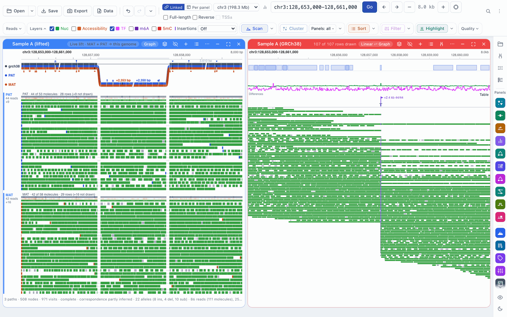
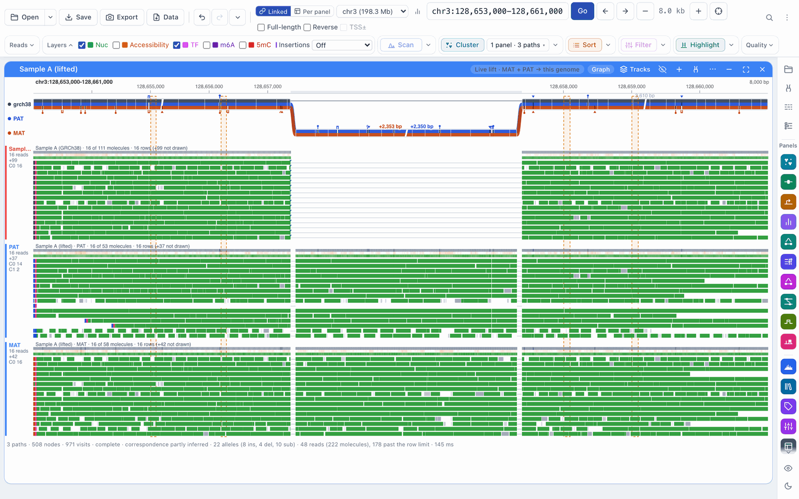
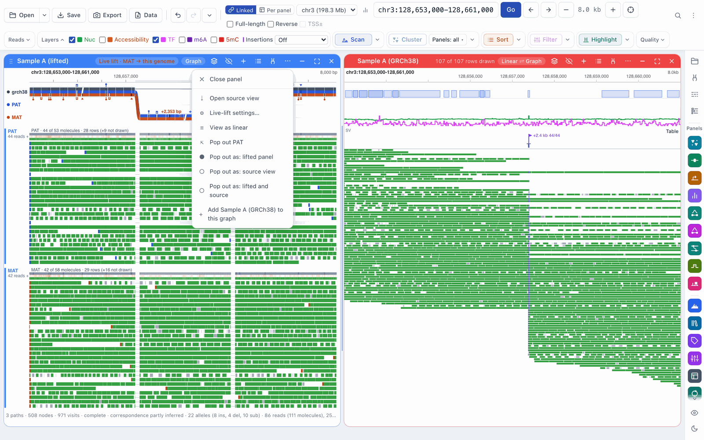
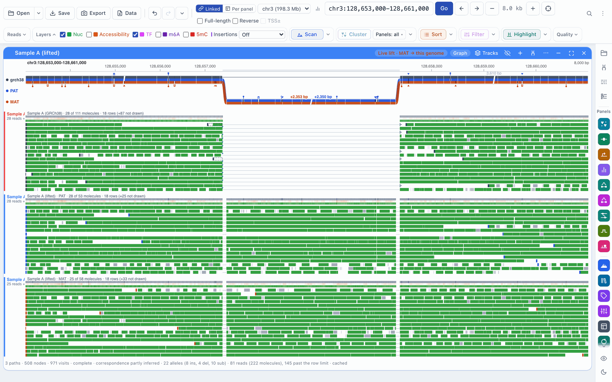
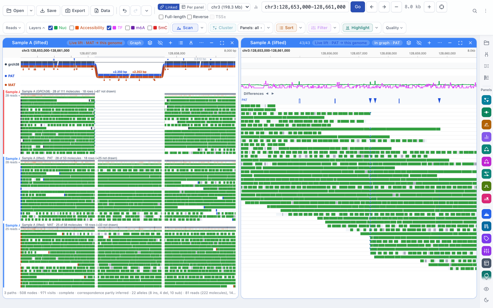
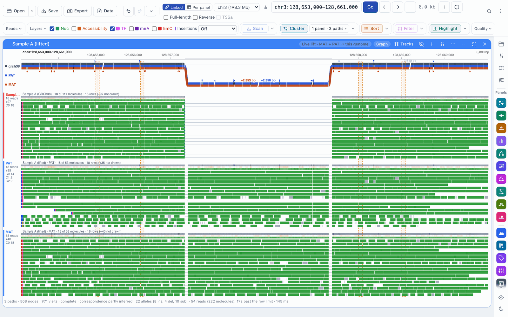
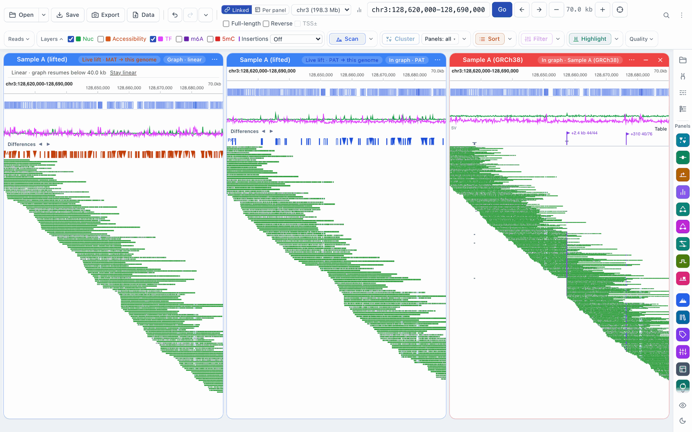

# Workflow: graph mode

[← Docs index](../index.md) · [← README](../../README.md)

Graph mode draws a dataset panel on a pangenome graph instead of one linear
reference. Each haplotype (or assembly) in the graph is a lane, and the reads
are drawn along the lane they come from. Insertions, deletions and
rearrangements that a linear reference hides are drawn where they are.

Graph mode is a way of viewing a panel, not a separate workspace. A panel in
graph mode keeps its name, colour, filters, selections and clusters, and you
can switch it back to linear at any time. The other haplotypes of the dataset
are panels of their own: they are folded into the graph, and you can pop any of
them out to see it side by side, with all the usual read tools.

## What you need

Setting up is described in
[Setting up live lift and graph mode](pangenome-setup.md). In short:

- **The graph helper.** The macOS app includes it; with pip, install
  `fiberbrowser[graph]`, or build `fiberbrowser-graph` from
  [graphlift](https://github.com/mtcicero26/graphlift)
  ([details](pangenome-setup.md#installing-the-graph-helper)).
- **A graph package.** This is a prepared pangenome graph (for example an HPRC
  release cut to the contigs you work on), made with `fiberbrowser-graph
  prepare` from [graphlift](https://github.com/mtcicero26/graphlift).
  Packages are registered once, from the **Graph view** panel's **Register a
  graph package…** item, and are remembered
  ([details](pangenome-setup.md#registering-a-graph-package)). The Graph view
  panel is a preview feature: turn on **Show preview features** in Settings to
  see it. Graph mode on dataset panels does not need preview features.
- **Reads that the graph knows.** Either of these works:
  - a **lifted dataset**: reads aligned to a sample's own assembly and viewed on
    the reference through a lift map (**Open → Add live lift…**; see
    [Live lift](live-lift.md)). Each haplotype's reads are drawn on that
    haplotype's lane. Live lift has to be switched on when FiberBrowser starts
    ([how](pangenome-setup.md#turning-on-live-lift));
  - a **native dataset**: reads aligned to the reference the graph is built on.
    Its reads are drawn on the reference lane.

FiberBrowser checks that a dataset really belongs to a graph path by the path's
identity (sample, haplotype and contig, with its size), not by its name. A
dataset that does not match is never drawn on the graph, and the menu item says
why.

## Opening a dataset in graph mode

- **New lifted datasets open in graph mode** when a registered package binds
  them. In **Add live lift…**, **Open as** is set to **Graph**; choose
  **One panel per haplotype** or **Pooled** to open it the old way. The first
  haplotype's panel shows the graph; the other haplotypes are folded into it.
- **A dataset with one haplotype** (a strain against its reference, for
  example) opens in graph mode on its one panel.
- **Any bound panel** can be switched with the **Linear ⇄ Graph** pill in its
  header, or with **View as graph** / **View as linear** in its **…** menu. The
  switch is one undo step.
- **Native datasets open linear.** Switch them to graph mode, or add them to a
  graph (below).

## Reading the view

- **Lanes.** The top lane is the reference; the others are haplotypes, in the
  package's colours. Sequence a haplotype carries that the reference lacks is
  drawn as a branch with its size (for example **+2,350 bp** for an insertion).
- **Bands.** Under each lane there is one band per panel drawn there. A band is
  labelled with its panel's name and its read count, with that panel's colour
  down the left edge.
- **Rows.** The bands share the panel's height ("Rows fill the panel height" in
  the panel's **Reads** menu, the default). Choose **At most 20 / 40 / 100 rows
  per band** to fix the count instead.
- **When not every read fits.** A band that draws fewer reads than it has gets
  a density strip above its rows: coverage (grey), then the share of reads that
  are accessible and the share that have a nucleosome, at each position. Its
  label says how many molecules are drawn out of how many, and whether they were
  sampled, for example *PAT · 140 of 1,240 molecules · sampled 1/8 by name · 38
  rows*.

- **The status line** under the graph says what was drawn and what was left
  out (rows past the limit, reads sampled out, reads off the shown paths).

## Comparing panels side by side

The graph is a set of panels drawn together. Every band is a real panel, and
you can take any of them out to look at it on its own.

- **Pop out** a haplotype: in the header's **…** menu, **Pop out PAT** (or
  **Pop out all haplotypes in view**). The haplotype opens as its own panel
  next to the graph, with its own read tracks and tools. It keeps the state it
  had in the graph (filters, selections, clusters).
- **Fold it back** with **Fold into graph** in its menu. Its state is kept.
- **Add another panel** to the graph with **Add panel to this graph**: for
  example the same sample aligned to the reference, or a second sample. Its
  reads are drawn in their own band on the lanes they belong to. **Remove from
  graph** takes it out again.

Selections are shared: a read you Shift-click in the graph is selected in its
panel, and a read you select in a popped-out panel is outlined in the graph.
Hovering a read outlines the same molecule everywhere it is drawn.

## Read tools in graph mode

On every band: **Select** (Shift-click), **Highlight**, the read menu
(right-click: **Keep only selected**, **Exclude selected**, **Copy name**,
**Pop out**), and the panel's own filters, orders and clusters, which each band
applies as its panel does. DAF-seq panels that show one strand (CT or GA) show
only that strand's reads in their band too. Soft-clipped read ends are marked
as in the read tracks (a bar with a tick toward the clipped sequence), with the
same **SV display** switch and minimum length.

The toolbar's **Sort** and **Filter** run on every panel in view, lifted or
native, including the haplotypes folded into a graph: each band takes its
panel's order or filter, and a popped-out haplotype shows the same one. They
are worked out on the reference's coordinates, so sequence that only a
haplotype carries (an insertion) does not count towards a footprint or
accessibility rule. A haplotype panel (MAT or PAT) is sorted on its own reads.

### Clustering

With a panel drawing its graph, **Cluster** clusters on the graph itself.
The toolbar button says so ("Cluster at 4 regions on graph columns").

1. Choose the regions: select peaks as usual, or draw one directly on the graph
   with **Alt/Option-drag**. With a panel drawing its graph, **Scan** finds
   peaks on the graph itself: each haplotype's reads count on their own path,
   pooled where the haplotypes share the graph, so a peak is one peak for every
   band. A peak inside sequence the reference lacks (an insertion) is listed as
   a region around the insertion, named in the peak list; clustering there uses
   the inserted sequence.
2. Click **Cluster**.

Each haplotype (and each native dataset) is fitted once, so every band of the
same haplotype gets the same labels, and popping a haplotype out or folding it
back never changes them. Bands are grouped by cluster, and each band's label
lists its counts per cluster (*C0 24 · C1 3*).

Sequence that only some haplotypes carry (an insertion, for example) is used to
split clusters further among the haplotypes that carry it. Those clusters are
named **C0.1**, **C1.0** and so on; the other reads keep their labels. When
the regions hold only such sequence (no part every haplotype shares), the
haplotypes that carry its first part are clustered, and the reads there of
haplotypes that carry none of it are labelled **Not a carrier**, in a colour of
their own. A haplotype that carries only another part is left out of that run
(the run details say so): choose its region alone to cluster it. The **Cluster detail** panel lists
what was used and what was left out.

A cluster run stays while you pan and zoom on the same chromosome: new reads
that come into view are given labels from the same run.

### Exports and Read Stats

- **Read names** (Export data → Reads) are written as plain read names for
  every band.
- **BAM subset** writes the reads' records with every tag. For a lifted
  dataset, the records come from the sample's own assembly (the BAM you
  opened), on its contigs; the export says which.
- **Read Stats** and the **read table** describe lifted reads too. Footprints,
  accessibility and modifications are counted on the reference, as the reads
  are drawn; MAPQ, NM, length and CIGAR come from each read's own record, and
  its start and end are on the sample's own assembly (the read table's
  `ref_contig` column names that contig).

## Zooming out

The graph is drawn up to 50 kb wide. Past that the panel switches to its linear
tracks, and the folded haplotypes open beside it, so you still see them side by
side. A bar under the header says *Linear · graph resumes below 40 kb*. Zoom
back in to 40 kb or less and the graph returns, with the haplotypes folded
again (unless you moved one of them yourself).

The panel also switches to linear when more than half of the window has no
resolved place in the graph (for example a region the graph could not build at
this width), and comes back when less than 30% is unresolved. The bar then says
*Linear · most of this window is unresolved in the graph*.

- **Stay linear** (on the bar, or in the graph's right-click menu) keeps the panel linear
  until **Resume graph**.
- **Linear above …** in the graph's menu sets the width (50, 30 or 20 kb), and
  turns the "most of the window is unresolved" rule off or on.

## Speed and memory

How many reads are drawn follows the **Performance mode** setting (Settings):

| Profile | Molecules per view | Decoded reads in memory |
|---|---|---|
| Low memory | 1,000 | 8 MB |
| Standard and High | 4,000 | 32 MB |

The molecules are shared between the bands (at least 50 each). When a view
holds more, each band is sampled by read name, so the same reads are drawn every
time you come back; the band's label and the status line say so. With long
fiber-seq reads the memory limit usually applies first: a band then shows a few
hundred molecules and its density strip.

## Sessions

Graph mode, the folded and popped-out panels, the hand-off setting and the
cluster run are saved with sessions and the undo history. A session opened on a
computer without the graph package shows the panel with **View as linear**.

## Troubleshooting

| Symptom | What to check |
|---|---|
| **View as graph** is greyed out | Its tooltip says why: no package is registered, or no package path matches the dataset (sample, haplotype, contig and size). |
| A band is missing | The panel is not on this graph's paths, or it was removed from the graph. Check **Add panel to this graph**. |
| The panel keeps showing linear | The view is wider than the hand-off width, **Stay linear** is on, or most of the window is unresolved; the bar under the header says which. |
| Sort or Filter does nothing on a band | The rule counts only reference positions: a region inside an insertion has none. Choose a region on the reference. |
| Fewer reads than in the linear view | The band is sampled or past its rows: its label and the status line give the counts. Choose a higher **Performance mode**, or fix a row count in the **Reads** menu. |

See also [Haplotype comparison](haplotype-comparison.md) for comparing two
haplotypes of a phased reference without a graph, and
[Clustering](clustering-and-transcription-states.md) for peaks and cluster
runs.
