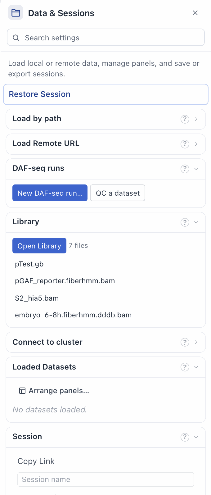
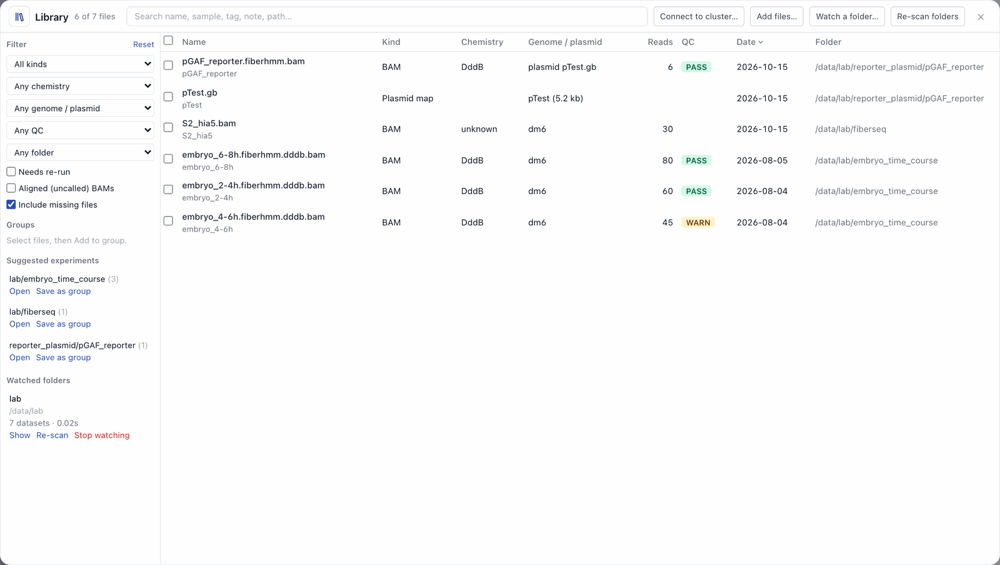
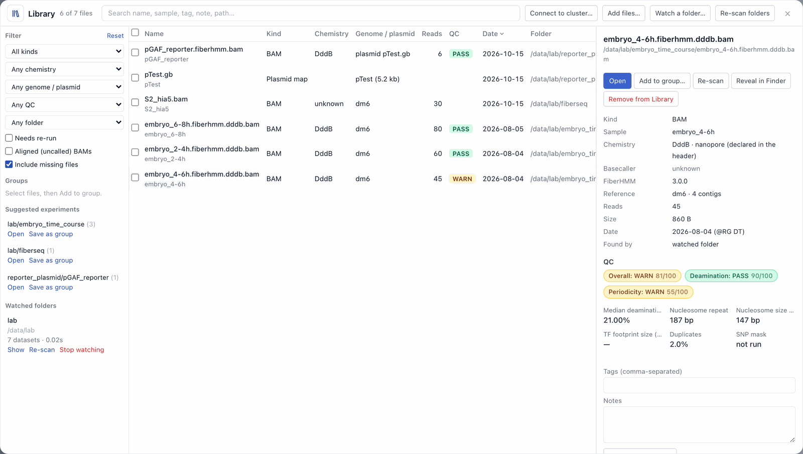

# Workflow: the Library, your datasets in one place

[← Docs index](../index.md) · [← README](../../README.md)

The **Library** lists your own datasets: every BAM, BigBed and plasmid map
you open, the results of your [DAF-seq runs](daf-seq-quick-run.md), and the
files in folders you choose to watch. For each file it shows what the file's
header says (sample, chemistry, FiberHMM version, genome or plasmid, read
count) and its QC verdicts. You can search, filter, tag and group the files,
and reopen them with the right genome or plasmid map in one click.

The Library works only in FiberBrowser on your own computer. A `--public`
server and the tour tab do not show it, and they refuse its API routes.

## Where it is kept

The Library is one file per user, `~/.fiberhmm/library.json`. Every
FiberBrowser window and workspace on the computer shares it. It records where
files are and what their headers say, plus your tags, notes and groups.

- The Library never writes, moves or deletes your data files.
  **Remove from Library** only removes the entry.
- `FIBERBROWSER_LIBRARY=/path/library.json` uses another file.
- `FIBERBROWSER_LIBRARY_DISABLE=1` stops FiberBrowser from recording the
  files you open. Watched folders and runs are still listed.

## 1. Open it



Go to Sidebar → **Data & Sessions → Library**. The section shows how many
files the Library has and the last few you used. Click a file to see its
details, or click **Open Library** to open the full window.

## 2. How files get in

- **Files you open.** A BAM, BigBed or plasmid map you load (with Open,
  by drag and drop, from a session, or on the command line) is added in the
  background. Drag-and-drop upload copies and the bundled demo are not
  added. Files opened from a cluster with **Connect to cluster…** are kept as
  `ssh://host/path` references, and opening them later asks you to connect
  first (see [Data on a cluster](remote-cluster-data.md)).
- **Finished DAF-seq runs.** When a **New DAF-seq run** finishes, its called
  BAM and plasmid map are added, with the run's QC. The run's
  `outputs.json` (schema `fiberhmm.pipeline.outputs.v1`) says which files
  these are. Each run is added once, so if you remove it from the Library it
  does not come back.
- **Watched folders.** Click **Watch a folder…** and choose a folder.
  FiberBrowser lists the indexed BAMs (`.bam` with `.bai` or `.csi`), the
  BigBeds (`.bb`, `.bigBed`) and the plasmid maps (`.dna`, `.gb`, `.gbk`,
  `.embl`) in it and in its subfolders, up to 6 levels deep. It rescans the
  folder when FiberBrowser starts and when you click **Re-scan folders**.
  A scan:
  - reads only file headers and indexes, never the reads. It writes nothing
    in the folder and does not build indexes,
  - does not follow symlinks out of the folder. Files beside a dataset
    (index, QC, `outputs.json`) are read only from inside the folder too,
  - skips hidden folders, app bundles, `node_modules` and similar folders,
    and folders with more than 20,000 entries (it says how many it skipped),
  - skips files that are only in the cloud (for example Dropbox online-only
    files), so it does not download them. They are listed as **Cloud**. An
    online-only QC file or index beside a local BAM is not read either,
  - stops at 5,000 files or 10 minutes, and says so,
  - does not read files again if they have not changed since the last scan.
    It does read them again when a QC file or `outputs.json` beside them
    appears, changes or disappears, or FiberHMM is updated,
  - lists a BAM whose QC file cannot be read with a **QC file unreadable**
    badge, and carries on with the other files.
- **Add files…** adds files without opening them.

## 3. Find files



The table has one row per file. Click a column header to sort by it. The
search box matches names, samples, tags, notes and paths. The filters on the
left narrow the list by:

| Filter | Values |
|--------|--------|
| Kind | BAM, BigBed, plasmid map |
| Chemistry | DddA, DddB, Hia5 PacBio, Hia5 Nanopore, unknown. It comes from the BAM's `@CO FIBERHMM-CHEMISTRY:v1` declaration. A pre-3.0 FiberHMM BAM shows *(inferred)*, read from its `fiberhmm-call` `@PG` line. Fibertools and other BAMs are *unknown*. |
| Genome / plasmid | A catalog genome, recognised from the `@SQ` chromosome lengths (hg38, hg19, mm39, mm10, dm6, sacCer3), or *Plasmids* for circular `@SQ` contigs and BAMs that name a plasmid map (`@CO FIBERHMM-REFERENCE:v1`). |
| QC | PASS, WARN, FAIL, or no QC |
| Tag, folder | Your tags. A folder filter also includes its subfolders. |
| Needs re-run | Files that FiberHMM says should be called again (see [Re-running](#5-re-running-on-a-newer-fiberhmm)). |

By default the table hides aligned BAMs that have not been called yet (a
run's `*.aligned.bam`) and shows missing files. Two checkboxes change this.

Row badges:

- **Missing**: the file is not at its saved location.
- **Cloud**: the file is online-only.
- **Changed**: the file was modified since it was last read. Click
  **Re-scan**.
- **Needs re-run**: FiberHMM advises calling the file again.
- **Frame unconfirmed**: the header has no FiberHMM/fibertools provenance
  (a pipeline stripped `@PG`), so footprint coordinates on reverse reads
  can't be confirmed; re-call with FiberHMM 3.0. Opening such a BAM says the
  same. See [footprint-tag frame](../reference/footprint-tag-frame.md).

## 4. Details and actions



Click a row to see its details:

- **Metadata.** Sample, chemistry and platform, the FiberHMM version and
  table digests, the reference (genome or plasmid, contig count), the read
  count from the index, size, date (`@RG DT`, the run's finish time, or the
  file date) and how the file got into the Library.
- **QC.** The QC report from fiberhmm-qc: verdicts, key numbers and the
  deamination and periodicity curves. With FiberHMM 3.0 QC it also shows
  efficiency (the rate inside MSPs) and background (the rate outside them)
  against the reference, and the overall verdict is based on those and
  periodicity (see
  [A DAF-seq run](daf-seq-quick-run.md#6-results-and-qc)); the **QC** column
  shows that verdict. The Library shows the report when the files
  are next to the BAM (`<name>.qc.json`, `qc/<name>.qc.json` and
  `.qc.curves.json`, as written by `fiberhmm-qc`, `fiberhmm-call` and
  `fiberhmm-pipeline`). For a run's result, **Open in Runs** shows the run.
  If a BAM has no QC files, **Run QC** runs `fiberhmm-qc` on it without
  opening it, with the entry's chemistry and, when one is on this computer,
  its reference FASTA (only raw DAF BAMs without MD tags need one). The
  result goes to FiberBrowser's own cache (`~/.fiberhmm/qc_cache/`), never
  beside the BAM, and the Library keeps it with the entry: the QC column,
  filter and details show it after a restart, for as long as the file has
  the same size and modification time. It runs on files on this computer
  (not on a cluster); an online-only file is downloaded only after you
  confirm.
- **Open.** Loads the file with its reference:
  - A BAM aligned to a plasmid opens with its map through
    [Open plasmid dataset](plasmids.md#open-plasmid-dataset-one-step). The
    Library links a BAM to a map in the Library by the `@SQ M5` checksum,
    the header's map declaration, or the run that made it.
  - A genome BAM loads its genome first, if that genome is already
    downloaded (or the run used it). Opening a file never starts a genome
    download. If the genome is not downloaded, the message says to load it
    from **Reference & Tracks**.
  - A plasmid map opens beside the current view.
  Double-clicking a row also opens it. To open several files, tick them and
  click **Open**.
- **Add to group…**, **Re-scan** (read the header and QC again),
  **Reveal in Finder** (Explorer on Windows, the file manager on Linux) and
  **Remove from Library**.
- **Locate…** (for a missing file) asks where the file is now. It accepts
  the new file only if it is the same data: the same size, header and
  content (sampled from its start, middle and end). Another run with the
  same header is refused. If you move a file inside a watched folder, the
  next scan finds it the same way and updates the entry. Tags, notes and
  groups are kept. An entry recorded by an older FiberBrowser (or while its
  file was online-only) has no content fingerprint: **Locate…** then says
  that only the header and size could be checked and asks you to confirm,
  and a scan never moves it on its own. A rescan while such a file is still
  in place records its fingerprint.
- **Tags and notes.** These are yours. Rescans do not change them.

## 5. Re-running on a newer FiberHMM

When the installed FiberHMM provides advisories (`fiberhmm.advisories`),
the Library checks each BAM's header: its FiberHMM version, table digests
(`apply_sha256`, `recall_sha256`) and chemistry declaration. A BAM that
should be called again gets the **Needs re-run** badge, with the reason and
the fix. It checks again after FiberHMM is updated. If FiberHMM has no
advisories, nothing is shown.

For a DddA or DddB BAM made by `fiberhmm-pipeline` (or a New DAF-seq run),
**Re-call with FiberHMM <version>** starts a
[New DAF-seq run](daf-seq-quick-run.md) job: the pipeline, from the run's
aligned BAM (or the BAM itself), against its plasmid map, run FASTA or
downloaded catalog genome, with the original run's calling settings (from
its `outputs.json`, or the run record) and regions.

A DddA or DddB BAM with neither (made by `fiberhmm-call` directly, or a
copy whose run folder is gone) is re-called from the command its header
records: the last `fiberhmm-call` (or `fiberhmm-pipeline`) `@PG` command
line, read against the installed FiberHMM's own options and re-run with the
same tool, not converted to a pipeline run. Only what must change is
changed, and the review lists each change:

- the outputs (`-o` and every output prefix) go into the new folder, with
  their original names; the cores are the Library's; the job writes its own
  progress file,
- `--seq` is added from the BAM's chemistry declaration when the command had
  none,
- an input not found where the header records it (for example a path
  written on another computer, such as `/mnt/d/Dropbox/...`) is looked for
  under your home and Dropbox folders and next to the BAM, and shown for
  you to check; one recorded relative to an unknown folder, or not found,
  can be chosen with **Locate the input…**; an online-only Dropbox input is
  downloaded by the run, and the review says so,
- a flag FiberHMM renamed is spelled the new way (`--force-chemistry` is
  `--force-seq`).

Every other option is kept as it was. The review also lists the FiberHMM
3.0 defaults the original run predates (for example: 3.0 calls primary
alignments only, where 2.x called every alignment), with **keep the original
behaviour** where an option restores it.

`fiberhmm-call` writes its command line unquoted, so a path with spaces
spans several words; the Library joins the words between two options back
into one value and says so. Check the original command it shows.

It refuses, and says why, when:

- an advisory needs steps the re-call does not run (for example
  `fiberhmm-tag-m5c` and then `fiberhmm-recall-tfs --use-m5c`). FiberHMM's
  fix is shown,
- a re-call would not fix what FiberHMM reports: for the DAF duplicate
  advisory the command must mark duplicates and read the un-deduplicated
  reads (not this BAM or another FiberHMM output); for the DddB model one it
  must not name its own `-m` model; for a QC one it must run QC. When one
  advisory is fixed and another is not, the review says which,
- the header's command has an option the installed FiberHMM does not have
  (and no known new spelling), writes to a pipe, or names a path relative to
  an unknown folder other than the input,
- the header records no FiberHMM calling command at all. Start a
  [New DAF-seq run](daf-seq-quick-run.md) from the aligned reads instead.

The first click shows what will run: the settings it keeps, the regions and
the full command (for a header re-call, the original command as well). The
second click starts exactly that, and is refused if an input, the settings
or the FiberHMM that runs it changed in between. Follow it in
**Runs**. The new files join the Library when the job finishes. The
original files are not changed.

## 6. Groups and suggested experiments

Tick files and click **Add to group…** to make an experiment, for example a
time course. A group can be opened in one step (**Open group**) and used as
a filter.

**Suggested experiments** offers the groups FiberBrowser can guess: one per
folder of BAMs, and one per multi-sample DAF-seq run. **Save as group** keeps
one.

A folder's suggestion first counts only the files the Library already lists.
**Open** or **Save as group** on it scans the folder once, with the same
rules as a watched folder, without watching it: the folder itself and the
`tracks/` and `calls/` sub-folders a FiberHMM run writes to (**Include all
sub-folders** looks six levels down instead). It lists every BAM, BigBed and
plasmid map found, marks the files new to the Library and the online-only
ones (which are not downloaded), and says in one line what it left out:
aligned-only BAMs, BAMs without an index, other sub-folders and non-dataset
files. Untick what you don't want; the rest are added to the Library and the
group (or Open) covers all of them. Opening more than 12 BAMs at once asks
first. **Watch this folder** keeps the folder's new files listed from then on.

### Export a group as a catalog

**Export catalog** on a group saves `<group>.catalog.json` in the
[`--catalog` format](../reference.md#dataset-catalog), with the group's BAMs
and BigBeds and their labels. The paths are relative to the folder the files
share, so save the JSON in that folder (the message says which one) and
serve it, for example to reviewers:

```bash
python browser.py --public --catalog Embryo.catalog.json
```

Plasmid maps are not part of a catalog, so they are left out, and the
message says how many were left out. If all the datasets are on one catalog
genome, it is set as the catalog's genome.

## Troubleshooting

| Problem | Cause and fix |
|---------|---------------|
| A BAM in a watched folder is not listed | It has no `.bai`/`.csi` index, it is deeper than 6 levels, or it is in a hidden or skipped folder. Index it (`samtools index`) or add it with **Add files…**. |
| *Cloud* on a file | The file is online-only. Make it available offline (in Finder, for Dropbox) and click **Re-scan**. |
| Chemistry *unknown* | The BAM has no `FIBERHMM-CHEMISTRY:v1` declaration (fibertools, other tools, or an old FiberHMM BAM without a call record). Opening it still works, and you can set the chemistry on the loaded dataset. |
| Opening a genome BAM loads no genome | The genome is not downloaded. Load it from **Reference & Tracks** (the Library does not start a download). |
| The Library is empty and says it was written by a newer FiberBrowser | `library.json` has a newer schema. FiberBrowser leaves it as it is. Update FiberBrowser, or move the file away to start a new Library. |
