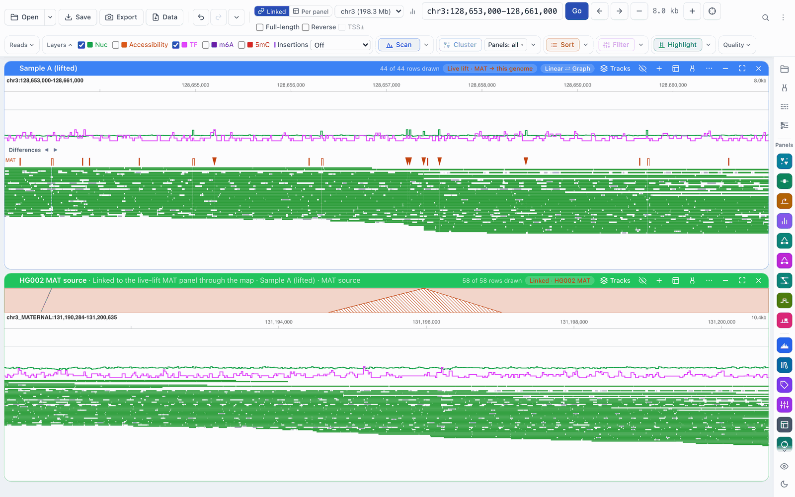
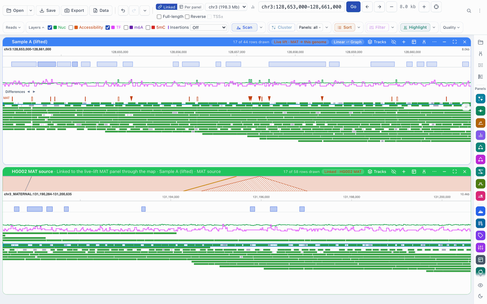

# Workflow: linked panels

[← Docs index](../index.md) · [← README](../../README.md)

A lifted panel shows a sample's reads on the reference. Its **source view** shows
the same reads where they were aligned: on the sample's own assembly. The two
panels are linked through the lift map. A ribbon between them shows which
stretches correspond, hovering a molecule outlines it in both, and moving either
panel moves the other.

It starts from a [lifted dataset](live-lift.md).

## Opening a source view

In a lifted panel's **…** menu, choose **Open MAT source view** (or **Open PAT
source view**; **Open source view** when the panel has one haplotype).

The source view opens directly under the lifted panel, at the stretch of the
assembly that corresponds to the view. It is an ordinary panel of the same BAM
on the assembly's contigs, titled with the sample and haplotype (for example
*HG002 MAT source*; the sample's name comes from the lift map, and a map that
names no single sample gives *MAT source*). It needs no FASTA of the assembly.
Each haplotype has at most one source view: choosing the item again brings
back the one that is open.

The source view's header shows a chip in the haplotype's colour, *Linked ·
HG002 MAT* (with *· reversed* when it is drawn reversed).

A source view can also open from [graph mode](graph-mode.md): with **Pop out
as: source view** (or **lifted and source**) in a graph panel's **…** menu,
popping out a haplotype opens its source view beside the graph, starting with
that haplotype's filters, selections and clusters. A source view of a
haplotype that is in a graph cluster run takes the run's labels by read name.

## The ribbon

The **Lift ribbon** at the top of the source view joins the two panels. Its top
edge is the lifted panel's coordinates (including any expanded insertion), and
its bottom edge is the source view's.

| Shape | Meaning |
|---|---|
| Filled band in the haplotype's colour | The two stretches correspond (the main match). |
| Dashed outline, no fill | An alternative match. |
| Violet band that crosses over | The match runs on the opposite strand. |
| Hatched wedge pointing up | Bases only the sample's assembly has (an insertion relative to the reference). |
| Grey wedge pointing down | Bases only the reference has (a deletion in the sample). |
| Hatched grey | Unaligned sequence on both sides. |
| Thin hatched band along an edge | No counterpart at all for that stretch. |

Hover a shape for its coordinates on both assemblies. A badge in the corner
(*+2 on chr3_PATERNAL*, for example) counts matches on other contigs, which
are not drawn. Its height can be changed like any track's.

When the view is too wide for the ribbon, it says *Zoom in to see the ribbon*.

## Shared hover

Hover a read in either panel: the same molecule is outlined (in cyan) in both,
and a line joins its two positions across the ribbon. This works with tooltips
on or off. Molecules are matched by their dataset, file and read name, so two
libraries with the same read names are never confused.

## Shared navigation

- **Pan or zoom the lifted panel** (or the main view): the source view moves
  to the corresponding stretch. It moves at once to an approximate position and
  then settles once the detailed map has loaded.
- **Pan the source view**, type a locus in its locus box or choose one of its
  contigs: the main view moves to match.
- **Change chromosome:** the source view follows, to the haplotype's contig of
  that chromosome (for example from `chr3_MATERNAL` to `chr1_MATERNAL`).
- Where nothing corresponds within a view's width, the other panel stays where
  it is.
- **Expanding an insertion** in the lifted panel (see
  [Differences](differences.md#expanding-an-insertion)) moves the source view to
  the inserted bases; the main view stays put.
- **Show in the source view**, in a difference's right-click menu, moves the
  source view to that difference.

In **Per panel** navigation (the **Linked / Per panel** switch; *Each panel
navigates*) the lifted panel and its source view still move each other through
the map, while the main view stays where it is. A move made before the map has
loaded there leaves the other panel in place.

**Zoom to read** (in the read menu) also moves the panel when the read is
found on another chromosome.

## When there is more than one match

A repeat or a segmental duplication can correspond to several stretches of the
assembly. When other matches cover a good part of the view, the source view's
header shows *N correspondences*. Its **…** menu then has **Dominant: …** and
one **Follow …** per alternative: choose one to follow it instead.

The same menu has **Reverse relative to the lifted panel** (and **Same
orientation as the lifted panel** to undo it). A source view whose match runs
on the opposite strand opens reversed.

## Ending a link

Close the source view to end the link; **Open source view** opens it again.
When you pool or split the lifted panels, the link moves to the matching
haplotype panel (or to the pooled panel). Links, ribbons and the followed match
are saved with sessions, and restoring a session never moves your main view.

## Linked panels and linked datasets

Lift links are not the same as the links made in the **Layout** panel
(guide step 40), which share clustering and analyses between datasets on the
same genome. A source view is on another assembly, so it has no **Link** button
of its own; it is joined to its lifted panel through the map instead.
