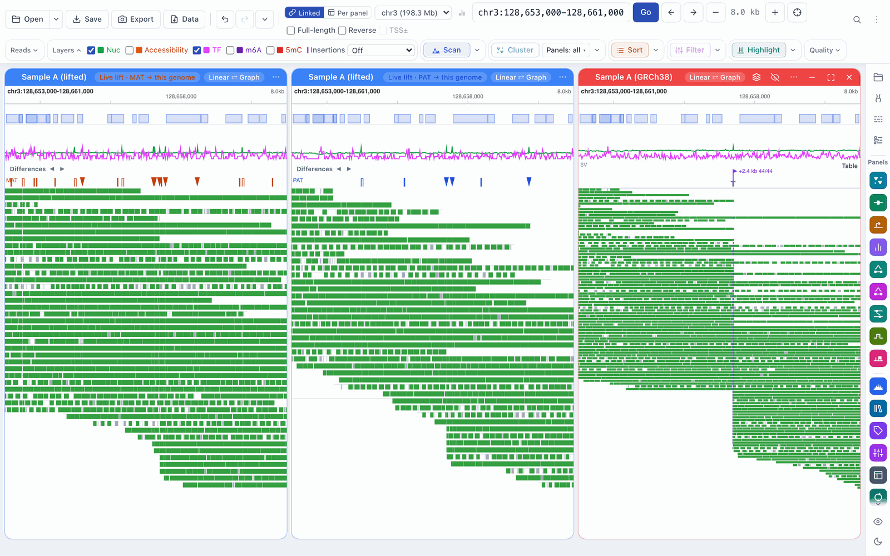
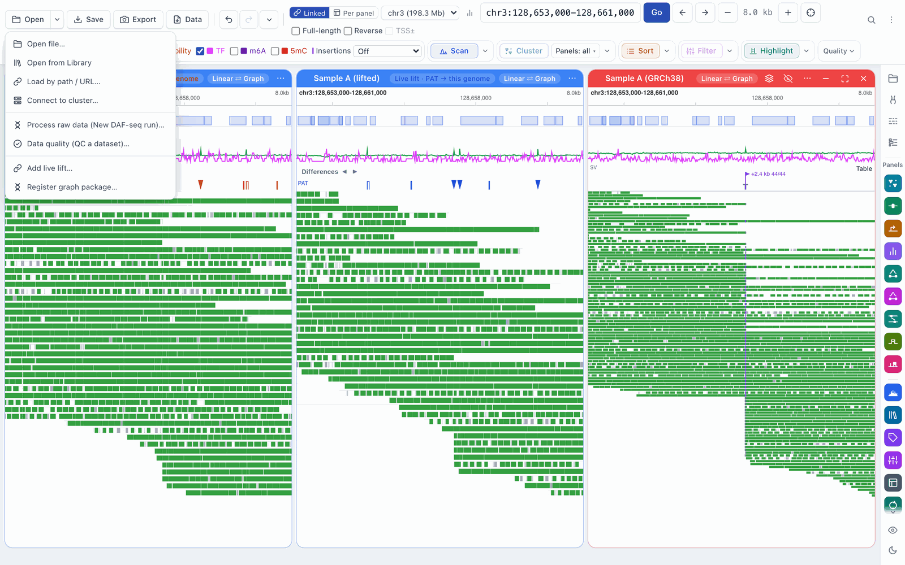
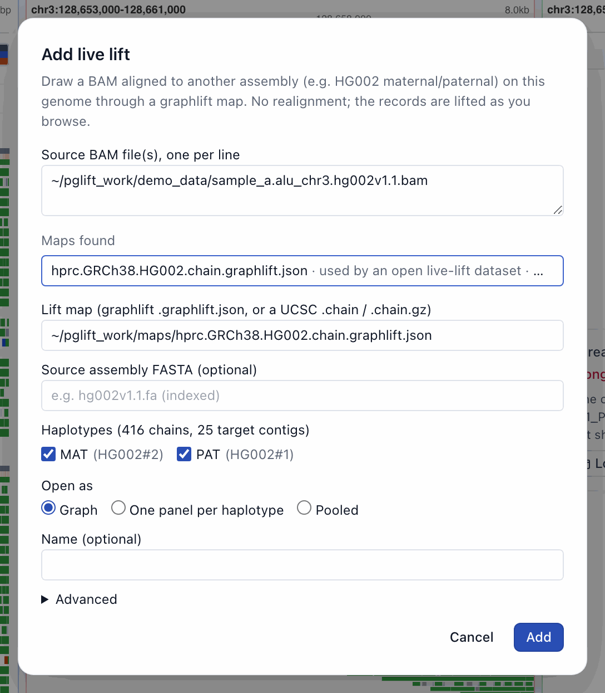
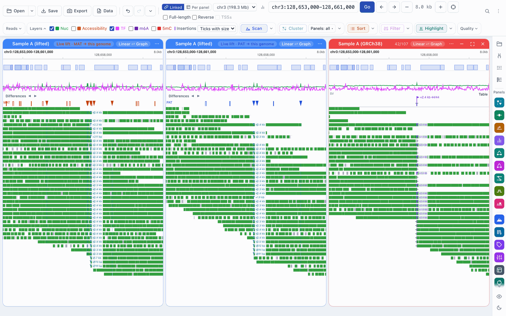
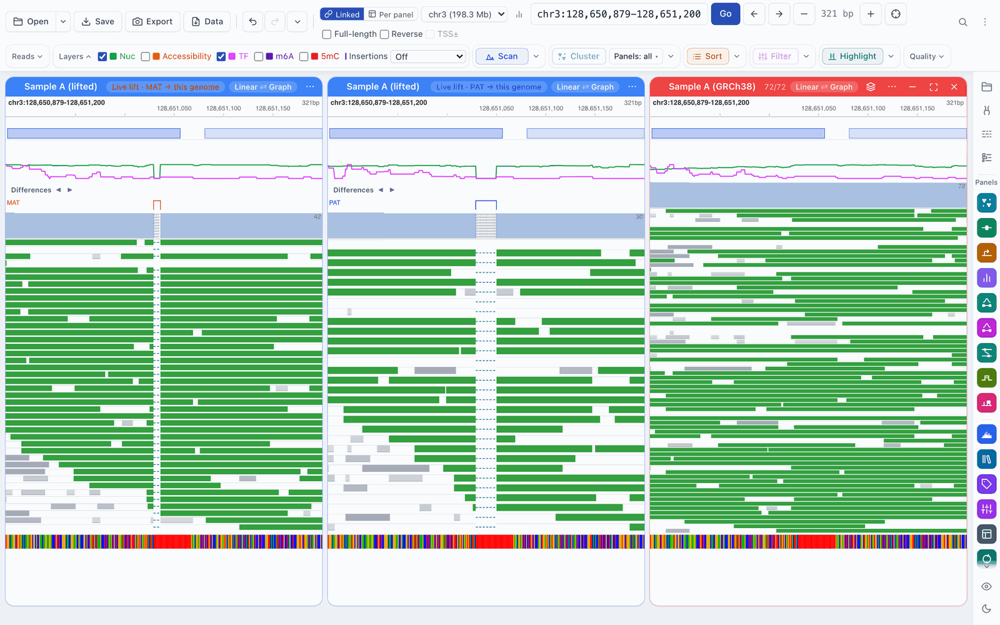
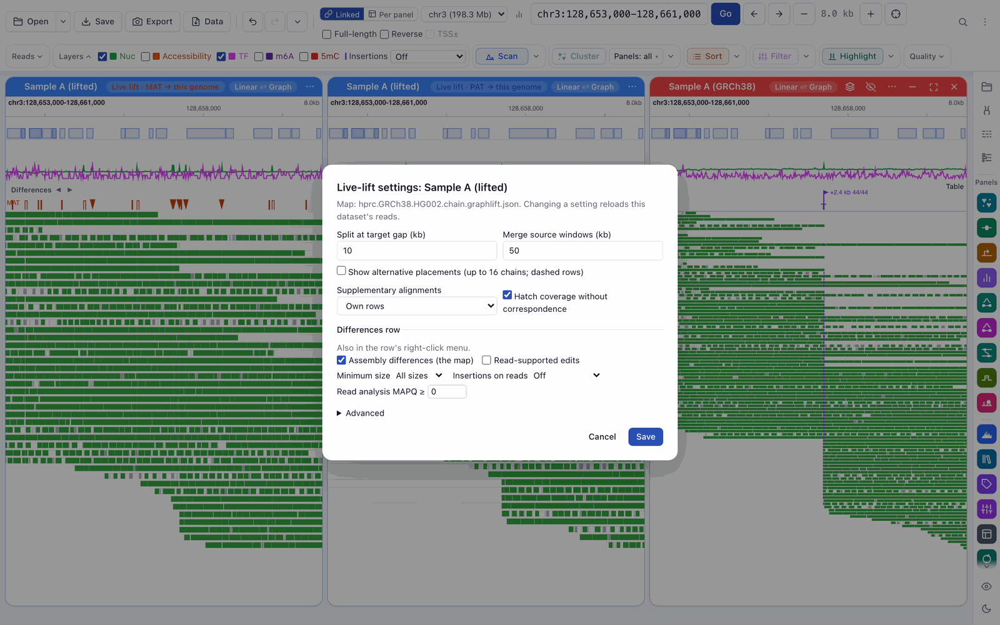

# Workflow: live lift

[← Docs index](../index.md) · [← README](../../README.md)

Live lift draws a BAM aligned to another assembly on the genome you are
browsing, without realigning it. A typical case is a sample's reads aligned to
its own phased assembly (maternal and paternal haplotypes) and viewed on GRCh38.
The records are lifted through a map as you browse: only the view and a margin
around it are lifted, so a new dataset opens in seconds.

Each haplotype gets its own panel by default, next to any panel of the same
reads aligned to the reference, so you can compare them side by side and
cluster them together.

## What you need

A lift map (see below), a BAM aligned to the sample's assembly and, if you
have it, that assembly's FASTA. See
[Setting up live lift and graph mode](pangenome-setup.md) for where these come
from.

## What a map is

A **lift map** relates the contigs of the sample's assembly (for example
`chr3_MATERNAL` and `chr3_PATERNAL`) to the reference you are browsing. It is
either:

- a **graphlift map**: a `.graphlift.json` file with a few files next to it,
  written by `gbz2chain` in [graphlift](https://github.com/mtcicero26/graphlift)
  from a pangenome graph; or
- a plain **UCSC chain** (`.chain`, `.chain.gz`, `.over.chain`), for example a
  liftOver chain. Its haplotypes come from its contig names (`_MATERNAL` and
  `_PATERNAL` give **MAT** and **PAT**), and the Differences row shows its
  gaps but no substitutions. See
  [Setting up](pangenome-setup.md#what-you-need) for the other differences.

One map can hold several haplotypes; FiberBrowser shows them by their labels
(**MAT**, **PAT**, or the map's own names). The BAM's contig names must be the
map's source names.

## Opening a lifted dataset

There are two ways in:

- **Open ▾ → Add live lift…** opens an empty dialog.
- **View on another assembly (live lift)…** in a BAM panel's **…** menu opens
  the same dialog with that BAM filled in, and lists the maps it found.

FiberBrowser looks for maps (graphlift maps and chains) next to the BAM, in
its parent folder, in the folders inside the BAM's folder, in the Library, and
among the maps already in use. For a remote BAM only the Library and the maps
in use are searched, and on a lab server only its data folders. Maps whose
source contigs match the BAM come first, and the best match is chosen for you.
If none is found, the dialog says so; type the map's path instead.

The dialog asks for:

- **Source BAM file(s), one per line.** Several BAMs of the same sample make
  one dataset.
- **Lift map (graphlift .graphlift.json, or a UCSC .chain / .chain.gz).**
- **Source assembly FASTA (optional):** the sample's own assembly, indexed.
  With it the inspector shows the assembly's bases, **Copy sequence** copies
  an assembly insertion's bases, and insertions can be **Confirmed by
  assembly** (see [Differences](differences.md#assembly-comparison)).
  (**Identify** works on the sequence of one carrier read that holds the whole
  insertion, with or without this FASTA.) When the
  reference FASTA is loaded too, a spot check of the map's anchors refuses a
  FASTA that doesn't match the map.
- **Haplotypes.** All are ticked; untick any you don't want.
- **Open as** (it starts from **Settings › Reads & Display › Graph mode › Open
  lifted datasets as**):
  - **Graph** (the default): one panel drawn on a pangenome graph, with the
    haplotypes folded in. This needs a registered graph package that knows the
    map's haplotypes; otherwise the dataset opens as one panel per haplotype.
    See [Graph mode](graph-mode.md).
  - **One panel per haplotype:** a **MAT** panel and a **PAT** panel (and one
    for each other haplotype).
  - **Pooled:** one panel with every haplotype's reads.
- **Name (optional).**
- **Advanced:** the display settings below.

Click **Add**.

## Reading a lifted panel

- **The header chip** says what you are looking at, in the haplotype's colour:
  *Live lift · MAT → this genome*. MAT is orange and PAT is blue; other
  haplotypes get teal, magenta, olive, rose and brown, in the map's order.
- **Reads** are drawn on the reference wherever the map places them. A read
  that crosses a stretch the reference lacks is drawn in pieces, with a dashed
  connector across sequence that only the reference has.
- **Insertions.** The Differences row above the reads shows where the sample
  has bases the reference lacks; click one there to expand it. The reads
  themselves carry no insertion marks unless you ask for them: the
  **Insertions** control in the toolbar's **Layers** row (shown while a lifted
  dataset is open) chooses **Off** (the default), **Ticks** (a small tick on
  each read with an insertion there) or **Ticks with size** (labelled, for
  example *+2.4 kb*, where rows are at least 7 px tall). The same choice is in
  the Differences row's right-click menu and in **Live-lift settings…**; it is
  one setting for the session. Clicking a tick expands the insertion (see
  [Differences](differences.md#expanding-an-insertion)).

- **Hatching.** Grey diagonal lines over the coverage histogram mark stretches
  of the reference that have no counterpart on the haplotype (for example a
  deletion in the sample). There, an empty coverage track means "nothing to
  lift", not "no reads". Light hatching marks partial correspondence. The
  coverage histogram is off by default: turn on **Coverage histogram** in
  **Settings › Reads & Display**. The reads show the same stretch as a dashed
  connector.
- **The Differences row** above the reads shows where the haplotype differs
  from the reference. See [Differences](differences.md).
- **The read tooltip** says where the read came from (*Live lift from
  chr3_MATERNAL:…*), its haplotype, its DAF-seq strand (taken from the read's
  own `st` tag, so it is the same on every piece) and any parts that run
  reversed or cross gaps.

## Haplotype panels

In a lifted panel's **…** menu:

- **Pool haplotypes** puts every haplotype's reads in one panel.
- **Split by haplotype** splits a pooled panel again.
- **Group in this panel by haplotype** (pooled panels) groups the rows by
  haplotype and keeps doing so as new reads load.
- **Open MAT source view** (or PAT) opens the reads on the sample's own
  assembly, linked to this panel. See [Linked panels](linked-panels.md).
- **Live-lift settings…** opens the settings below.

Lifted panels are ordinary dataset panels: filters, selections, Sort, Filter,
Read Stats and clustering work on them, and native and lifted panels can share
one clustering model. A read keeps its own name everywhere.

## Supplementary alignments

**Supplementary alignments** (in the dialog's **Advanced** section and in the
settings) chooses how a molecule's supplementary records are drawn:

- **Own rows** (the default): each supplementary record on a row of its own;
- **On the primary's row**: on the row of the molecule's primary record, when
  it is loaded;
- **Hide**.

This changes the display only. Which records count in analyses is a separate
setting (**Supplementary records in analyses**, under **Advanced**).

## Settings

**Live-lift settings…** opens *Live-lift settings: {dataset}*. Changing a
setting reloads that dataset's reads; **Save** applies it to every panel of the
dataset.

| Setting | Default | What it does |
|---|---|---|
| Split at target gap (kb) | 10 | A gap in the reference at least this long splits a read's piece. |
| Merge source windows (kb) | 50 | Stretches of the source closer than this are read together. |
| Show alternative placements | off | Also draw reads at their other placements (up to 16, dashed rows). |
| Supplementary alignments | Own rows | As above. |
| Hatch coverage without correspondence | on | The hatching above. |
| **Differences row** | | Sources, minimum size, insertion ticks and **Read analysis MAPQ ≥** (0: no MAPQ filter); see [Differences](differences.md#settings). |
| **Advanced** | | How lifted reads enter analyses: haplotype panels (split or pooled), supplementary records and alternative placements in analyses, folding a molecule's records into one row, pooled coverage, and which libraries share molecules with an open native dataset. |

## Exporting lifted reads

**Export data → Reads → BAM subset** writes the lifted reads in view as they
are in the BAM you opened: on the sample's own assembly, with every tag. The
**Read table** export gives each lifted read's alignment on its source
assembly. BAM export is not available on a public server.

## What lifted datasets can't do yet

Some analyses refuse lifted datasets and say so: *{Feature} is not available
for live-lift datasets yet. Use the source BAM, or a BAM aligned to this
genome, for it.* These include metaprofiles, co-accessibility and figure read
tracks. Open the source view, or the same reads aligned to the reference, for
them. **Scan** works on lifted datasets: in the linear view it finds peaks in
the lifted reads on the reference's coordinates, every haplotype pooled, and
in graph mode on the graph.

## Troubleshooting

| Symptom | What to check |
|---|---|
| No **Add live lift…** | The server has live lift turned off (`FIBERBROWSER_LIVE_LIFT=0`, a lab server, or a public server; see [Setting up](pangenome-setup.md#live-lift-is-on)). |
| *Anchor sequence mismatch* | The source assembly FASTA is not the assembly the map was made from. |
| *No lift map was found* | Put the map (with its files) next to the BAM or in the Library, or type its path. |
| *the BAM's contigs are not this map's sources* | The BAM was aligned to a different assembly, or its contigs are named differently. |
| A stretch has no reads | Check for hatching: the reference may have no counterpart on that haplotype there. |
| A panel shows only one haplotype | It is split by haplotype; **Pool haplotypes** shows them together. |
