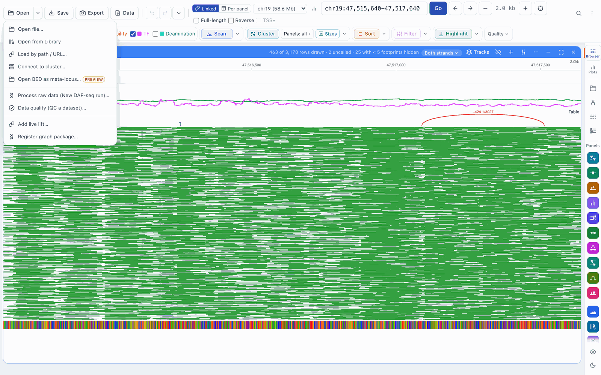
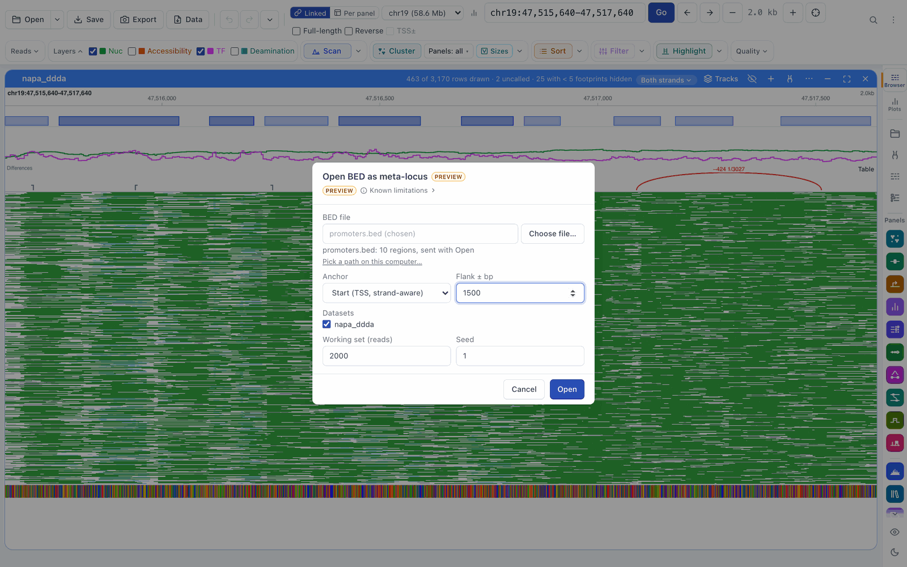
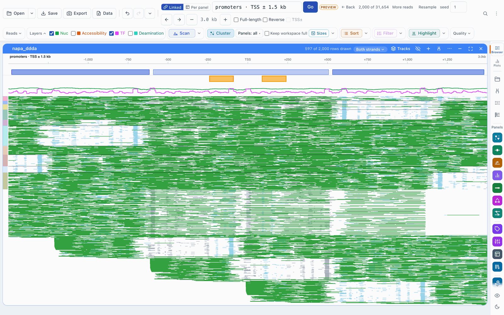

# Workflow: open a BED as a meta-locus (Preview)

[← Docs index](../index.md) · [Plots](plots.md) · [What 3.1 includes](../release-scope.md#meta-locus)

A **meta-locus** pools the reads from every site in a BED file (every promoter,
every CTCF site, every enhancer) into one virtual locus. Each site is anchored
at its centre or start and oriented by strand, so the reads line up. A seeded
working set of reads from the pool is shown like any locus: you can sort,
filter, cluster, plot and inspect them. Use it to look for rare events shared
across many sites, with enough molecules to see them.

The meta-locus is a **Preview** feature: the dialog, the Open menu item and the
bar above the reads carry the **Preview** badge. Preview features are on by
default; **Settings › Reads & Display › Read Display › Show preview
features** hides them.

## Opening a BED

**Open ▾ → Open BED as meta-locus…**, or ⌘K → *meta-locus*.

- **BED file**: **Choose file…** sends a BED from this computer with Open. On
  a server, type a path the server can read.
- **Anchor**: **Start (TSS, strand-aware)**, centre or end.
- **Flank ± bp**: the window around each anchor. The default is ±10 kb, up to
  ±50 kb (less in the Low memory performance mode).
- **Datasets**: which loaded datasets take part.
- **Working set (reads)** and **Seed**: how many reads are shown at first, and
  which ones. The same seed shows the same reads.

**Open** goes to the meta-locus at once. A progress strip shows the pool being
built (with **Cancel**); a large BED takes a few seconds. Pools are cached, so
opening the same BED again is quick.

## Browsing the pool

The locus box names the meta-locus (*promoters · TSS ± 1.5 kb*) and the ruler
counts from the anchor. The bar under it shows:

- **2,623 of 31,654**: reads shown of the pool;
- **More reads**: the next reads of the sampling order (the shown ones stay);
- **Resample**: another sample (the next seed); **seed** sets it directly;
- **← Back**: to the real locus you came from.

Everything that works on one locus works here: metaprofiles, sort, filter,
**Cluster**, Read Stats and [Plots](plots.md).

### Filling clusters from the pool

After clustering, tick **Keep workspace full** (beside **Cluster**). Each
cluster is topped up with matching reads from the pool, so rare clusters fill
the display too. The display is then *enriched*: an **enriched** chip says so,
and the share of reads on screen is no longer a frequency.

### Find more like this, and the real site

Right-click a read (or a selection):

- **Find more like this** scans the pool for reads like it and adds them. The
  chip reports the honest frequency: *found N of M read-site observations
  scanned*, with a Wilson 95% interval.
- **Open this site** goes to the read's real locus. **Back** (Alt+←) returns
  to the same working set.

The read inspector shows each read's real site, strand and position.

## Counting

A read that overlaps several sites is shown once per site, and counts once per
site: the unit is the read–site pair. Wide windows make this common.

Sessions save the pool, the seed and the refilled reads. Links and reloads keep
the pool and the seed.

## Known limitations

- Tracks and panels that need one real genome position are not shown on a
  meta-locus: reference sequence, genes, motifs and other external tracks,
  primers, contact maps, the Differences row, the Variants panel, graph view,
  the insertion lens and the Feature hub. Autozoom and **Best-covered window**
  are off too.
- **Find classes** uses FiberHMM's pooled mode, which analyses each molecule at
  one site, so a shared read's other copies carry no class.
- Links and reloads rebuild the pool from the BED path, so the server must
  still be able to read that file.
- Exports add each read's real site, strand and span.
