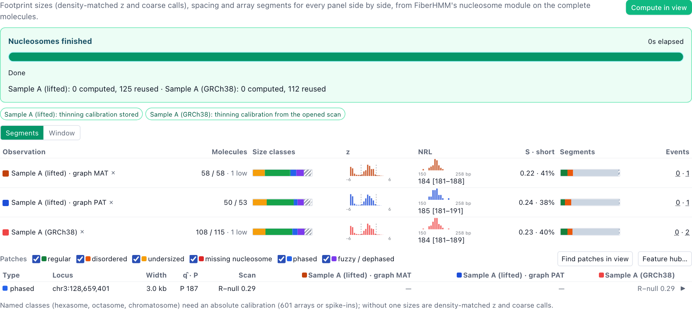
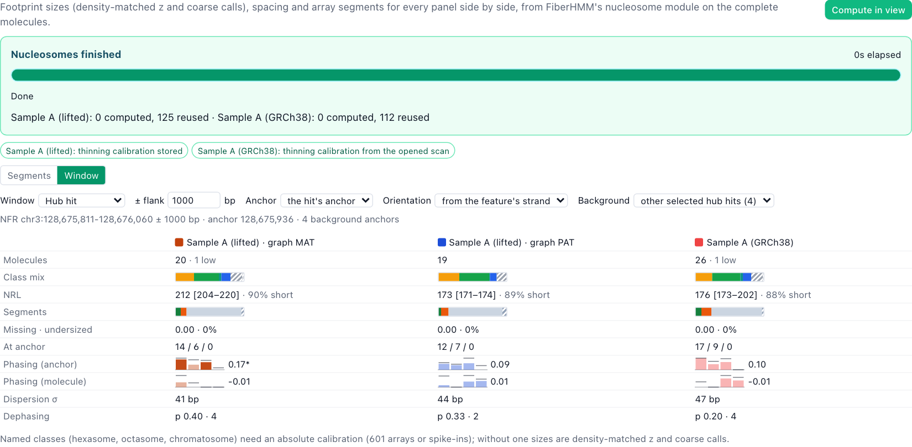
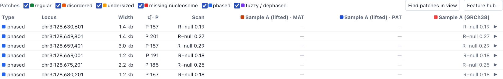
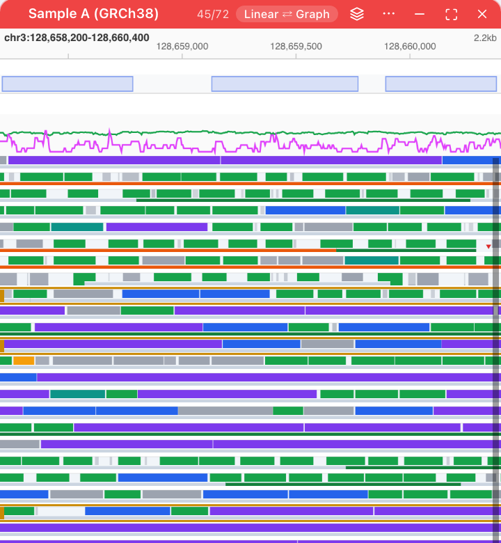

# Workflow: the Nucleosomes panel

[← Docs index](../index.md) · [← README](../../README.md)

The **Nucleosomes** panel puts footprint sizes, nucleosome spacing and array
structure side by side for every panel on screen. Each dataset panel, haplotype
pop-out, strand split, linked locus and graph path is a column of its own. The
numbers come from FiberHMM's nucleosome module (`fiberhmm.nuc`), computed on
whole molecules; the browser never re-implements them.

Open it from the panel rail (**Nuc**) or the command palette (**Nucleosomes**).
You can open several, for example one per locus.

## Computing

**Compute in view** calibrates each dataset once and computes every molecule
in view. Each column then fills in.

- **Calibration** is drawn from a fixed sample of the dataset's own reads,
  never from the view. It is computed once per dataset and settings, then
  stored, so later computes take a few seconds. A chip per dataset says where
  it came from (an opened scan, the stored copy, or computed now); hover it
  for the digest and the pooled repeat length.
- **Outputs that already exist are used first.** An opened scan with the nuc
  module, or a BAM annotated by `fiberhmm-scan --annotate`, fills the columns
  without computing. The source chip on a column says **scan** or
  **BAM tags**. Stale annotations (the calls changed since the scan) are
  ignored.
- Live-lift datasets compute on their source records and project the results
  like the calls. A graph-path column counts every molecule over the path,
  insertions included.

## Segments mode

Each row is one observation.

| Column | What it shows |
|---|---|
| Molecules | molecules with outputs / records in view; molecules below the low-information floor are counted and left out of segments |
| Size classes | the coarse call of each footprint centred in view: short, mono, long, multi (2), multi (3+). **Can't tell** and **edge-truncated** are hatched and never dropped |
| z | the density-matched size deviation of short, mono and long calls (dashed lines at ±2) |
| NRL | the per-molecule repeat length (median of dyad gaps): histogram, median and interquartile range |
| S · short | median per-molecule regularity S, and the share of molecules too short for a repeat length |
| Segments | the share of segmented bases that are regular, disordered, undetermined or low information |
| Events | undersized footprint runs · missing nucleosomes in view |

Sizes are shown as z and coarse calls. Named classes (hexasome, octasome,
chromatosome) need an absolute calibration such as 601 arrays or spike-ins;
without one the panel does not show them.

**Click to select.** A part of a size or segment bar, an NRL bar, or an event
count highlights that observation's molecules with it in every read track,
lifted panels and graph pop-outs included. **clear** removes the highlight.

### Disrupted nucleosomes

The panel shows four kinds, each defined by what is there rather than by what
is missing:

1. **Undersized footprints**: a run of footprints well below the
   density-matched mono size.
2. **Missing nucleosome**: an open stretch of about one nucleosome where the
   array's dyad grid predicts one, flanked by nucleosomes. Longer openings are
   NFRs.
3. **Disordered spacing**: irregular, with evidence against every regular
   repeat. Stretches without evidence either way are **undetermined**.
4. **Fuzzy or dephased** (a locus property): positions spread or phase lost
   at an anchor across molecules. See window mode's dephasing readout and the
   fuzzy patches below.

The first three are per-molecule layers you can draw, filter and cluster on.

## Window mode

**Window** measures every observation inside one window, with an optional
anchor.

- **Window**: the view, the first selected peak, the first selected Feature
  hub hit, typed coordinates (`chr3:128,655,000-128,657,000`), or a window
  sent from another panel. A peak, hit or hand-off is widened to its anchor
  ± the flank (1 kb by default) so the nucleosomes around it are measured.
- **Anchor**: none, the feature's own anchor (a hit's anchor, a peak's
  centre), the window centre, or a position. **Orientation** comes from the
  feature's strand, or is set: unoriented pools both flanks by distance.
- **Background**: the other selected hub hits, for the dephasing readout.

Per observation it reports the molecules measured over at least 80% of the
window, the class mix (**insufficient** when can't-tell dominates), NRL,
segment shares, missing nucleosomes per molecule and the undersized share.
With an anchor it adds the nucleosome state at the anchor (nucleosome / open /
not measured) and phasing in the anchor and molecule frames: R − null per
whole-period bin (solid bars are p < 0.05), the summary over all bins, and the
positional dispersion σ. With background anchors, **Dephasing** places the
anchor's phase coherence among matched backgrounds (matched on marking rate
and depth): p is the share of backgrounds at or below it.

**From the Feature hub**: **Nucleosome window** on a selected hit, or in a
hit's details, opens this mode at that hit.

## Patches

Below the table in segments mode, **Patches** lists the patches in view from
every open scan with the nuc module:

- **regular, disordered, undersized, missing**: windows where more molecules
  carry the kind than chance placement of each molecule's own calls would
  give (FiberHMM's depth-aware shift-within-read test, Benjamini-Hochberg
  FDR), merged into patches;
- **phased**: molecules share a dyad phase;
- **fuzzy / dephased**: inside a regular patch, but the molecules share no
  phase; scored by the positional dispersion.

**Find patches in view** runs the nuc scan over the view (the hub's live scan,
the same engine as `fiberhmm-scan`) for the datasets on this genome. A
live-lift dataset is scanned in its own assembly: run `fiberhmm-scan` on its
BAM and open the scan in the Feature hub. Its columns still score every patch
with their own molecules. For a BED file or gene list, scan from the Feature
hub (**Feature hub…**); its patches list here wherever you go.

Each observation scores each recurrence patch with its own molecules: the
fraction of its measured bases with the kind, and the same recurrence test on
its molecules alone, with a q-value across the listed patches (bold:
recurrent at 5% FDR). Phased and fuzzy patches show the scan's per-dataset
values. Click a score to highlight those molecules; ▶ goes to the patch.

## In the read tracks

After a compute (or with a scan or annotated BAM) the reads carry two layers,
under **Nucleosomes** in the layer toggles:

- **Size classes**: each footprint's coarse class, z and TF flag. Colour by
  them with **Colormap → Add nucleosome size classes**, or set nucleosome
  conditions on any colour rule (coarse class, z range, TF calls only or
  nucleosomes only).
- **Array segments**: a thin lane along the bottom of each read, coloured by
  segment state, with undersized runs as a bar and missing nucleosomes as a
  gap with a triangle.

In **graph mode** the call pieces take the same colours and each read row has
the same lane; hovering a call shows its class and z, and the array state under
the pointer.

## Filter, sort, cluster, Read Stats and export

- **Filter and Sort** take nucleosome terms: a molecule metric (NRL,
  regularity S, gap CV, marking rate, footprint counts, segment fractions,
  missing nucleosomes) compared with a value or a range (**between**), a
  layer term on the segment states or events, or a colour rule with
  nucleosome conditions. A molecule without the metric never passes a
  comparison and sorts last.
- **Cluster** has nucleosome modes per peak (size class present, segment
  state, event) and molecule metrics as columns (percentile ranks, split at
  the median).
- **Read Stats** adds the nucleosome columns to its table and TSV.
- **Export → Nucleosome footprints** writes one row per footprint: read,
  coordinates, molecular length, size class, named class, posterior, z and TF
  flag.

## Sessions

The panel's settings (hidden columns, mode, window, anchor, background,
patch types, nuc parameters) are saved with the session. Computed outputs are
not: recompute, or keep the scan that holds them.

## See also

- [Feature hub and scans](feature-hub.md): opening and running scans, the
  patch types as hub sets, anchors.
- [Graph mode](graph-mode.md) and [Live lift](live-lift.md).
- FiberHMM's nucleosome module documentation for the definitions, the
  calibration and the tests.
