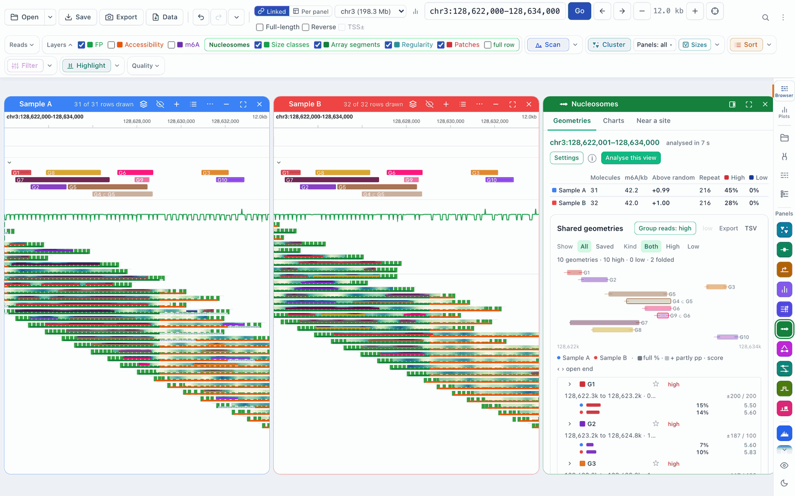
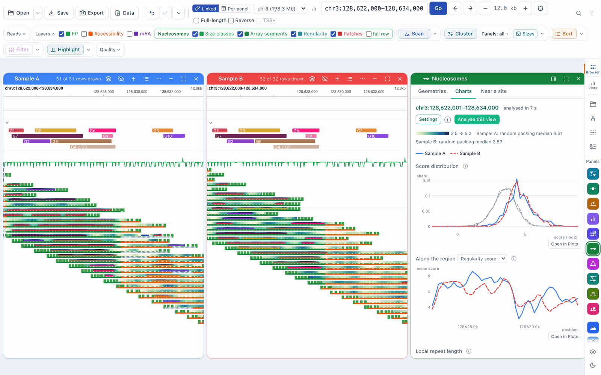

# Workflow: the Nucleosomes panel

[← Docs index](../index.md) · [← README](../../README.md)

Open **Nucleosomes** from the panel rail or command palette. The panel scores how
regular each single molecule's nucleosome array is, calls high- and low-regularity
patches, finds the patch geometries the shown datasets share, and compares them.
It works like the NFR and Footprints panels: pool, find, compare. Calls come from the
same complete decoded molecules used in the read tracks; existing outputs and
calibrations are reused.

Each read panel, strand split, lifted haplotype and graph path is a column (a
series), with its own filters; clustered reads split into one series per cluster.

## Layout

- **Header.** The title with the locus, **Settings**, ⓘ (how the score, patches and
  geometries work, and each dataset's calibration) and **Analyse this view**. Analyse
  computes the nucleosome calls for the view's datasets that have none yet (or
  re-checks every column; current outputs are reused). A newer analysis replaces the
  previous job; **Cancel** stops it. One status line under the header shows its
  progress, how long it took, or an error.
- **Settings** opens one drawer with every parameter, one row per task: columns,
  the regularity score, molecules and auto-Analyse, patch calling on or off, high
  regularity, low regularity, shared geometries, the reference and positions. The
  button shows how many settings differ from the defaults; **Score defaults** and
  **Patch defaults** restore them.
- **Geometries** (the default tab). A table gives each series' molecules, m6A per kb,
  score above random packing, repeat length and the share of the window inside high-
  and low-regularity patches. Under it, the **Shared geometries** card: **All** or
  **Saved**, **Both**, **High** or **Low**, the lane map and the class list.
- **Charts.** Every chart (score distribution, along the region, local repeat length,
  score against m6A density, m6A autocorrelation, share in a patch along the locus,
  patch lengths), each dataset's random-packing median, the read-lane colour key and
  the two detail tables.
- **Near a site.** Regularity next to an open region or TF site (below).

Sessions saved with the older **Sites**, **Spacing and calls** or **At a site** tabs
open on **Geometries**.

## Regularity

**Regularity** scores how evenly spaced the nucleosomes are along each single
molecule. FiberHMM scores sliding windows (default 2 kb, every 250 bp) by the
strongest spectral peak at nucleosome repeat lengths (140–260 bp) against the rest
of the spectrum, as a log2 ratio. The signal is the m6A calls (default) or footprint
occupancy. The peak's period is the local repeat length.

The scores form the **Regularity** layer in the read tracks. Opening the panel or
switching the layer on computes the scores for the molecules in view, once per setting. A colour lane runs over
each read, interpolated between window centres. It is pale at the dataset's
random-packing level and deep blue at its most regular 5%. **Full row** draws the
lane over the whole read instead of over the footprints. Random packing places each
window's own footprints at random positions and simulates marks at that window's
own marking rates. Its median is computed once per dataset and setting from a fixed
sample of molecules.

The **Regularity score** settings recompute the layer: signal, window, step, band,
minimum calls, open-stretch masking, thinning and read ends. Nucleosome calls and
calibration are left as they are. **Molecules: spanning the window** restricts the
comparison to molecules that cover the whole view. When the reads are clustered, every chart is drawn per
cluster. With several datasets open, each dataset gets its own line style. The
charts show the score distribution against random packing, the mean score along the
region, the local repeat length, the score against m6A density (Spearman's ρ), and
the m6A autocorrelation with open stretches of 300 bp or more masked and calls
thinned to 25 per kb. A table gives molecules, m6A per kb, the footprint median, the
share of footprints longer than 230 bp, the median nucleosome spacing, the score
above random packing and the repeat length.

In the Cluster control, **Nuc regularity** clusters reads on their scores; windows
without a score take the random-packing level. **Nuc regularity: pattern only**
centres each read on its own mean first, so reads group by where regularity rises
and falls. Combinatorial clustering splits at the random-packing level. Sort and
Filter offer **Regularity score (median)**, **(max)** and the **share of tiles above
random packing**, from the tiles in view.

**Auto-Analyse.** A view without nucleosome calls needs the panel's Analyse first.
**Auto-Analyse** (Settings) decides whether the panel starts it by itself: **first
open** (the default) starts it once, when the panel first opens; after that, a view
that has not been analysed says so, and **Analyse this view** in the header analyses
it. **every view** starts it on each unanalysed view once the view has
stayed put for a second, and cancels the automatic Analyse of a view you move away
from. **off** never starts it by itself.

**Read ends.** With **Ends: blank** only full windows are scored, so about the first
and last 875 bp of each read, and reads shorter than one window, have no score.
**Extend** paints the outermost scores out to the read ends. **Truncated** scores
windows cut at the read end, down to **End min** (and **Short min** for reads shorter
than one window). In the lane, a hatched stretch had too few calls for a score
(**Min calls**); an empty stretch is beyond the reach of any window.

### Patches and shared geometries

Patch calling is on by default (**Settings → Patches**; nothing is computed while it
is off). Each molecule's scores become discrete patches: a **high-regularity** patch
starts at a window at least **start ≥** over the random-packing median (log2) and
extends while windows stay above **extend ≥**, for at least the minimum number of
windows. A **low-regularity** patch is the mirror below the median (its own
thresholds; it can be switched off). A single window without a score is bridged; two or more end the patch.
Patches that reach a read or view end are open. **Edges** are the tile grid or
snapped to nucleosome edges: each closed edge moves to the nucleosome boundary next
to the nearest spacing break within the snap window (an **open linker** of at least
the given length, or a spacing **off the period** by more than the tolerance).

Shared geometries pool every panel and cluster: the most common (start, end) and
every patch with both ends within the tolerance form a geometry when enough molecules
carry it; its span is the median of its members' ends, and the search repeats on the
rest. A geometry is **nested** in a longer one when it lies inside it, shares one end
and its other end moved by more than the tolerance. **Fold nested** decides what
happens to nested geometries: **none** keeps them apart; **near** folds one into its
longest parent only when the other end moved at most the near limit; **all** folds
every nested pair. Folding never changes the grouping: carriers of a folded geometry
carry its parent partly, and the table shows full and partial carriers apart.

The **Geometries** tab shows the lane map and the class list (span, full and partial
carriers per series, the median patch score, edge spread, open ends). Click a
geometry to highlight its carriers, shift-click to select it for Cluster, Sort and
Filter, the star to save it and the arrow to inspect it (density-matched shares,
member patches, nested pairs, **Group reads by** it, **Go to span**). **Nested
geometries** (collapsed) holds the member patches, the carriers' score along the
locus and the table of nested pairs. **Group reads** groups each panel's reads by
the geometry they carry; **TSV** exports the list. **Saved** lists the saved
geometries, matched to the current analysis by kind and both ends. The share in a
patch along the locus and the patch lengths are on the **Charts** tab. The
**Patches** layer draws each read's patches in its geometry's colour.

A geometry selected for Cluster, Sort or Filter (shift-click), or used in the
Feature hub, keeps working after FiberBrowser restarts or a session is reopened: the
view is analysed again with the panel's settings when needed (the random-packing
reference is kept between runs, so the same geometries come back). It is refused only
when the panel's settings have since changed, and the message names the settings
that differ. An opened `fiberhmm-scan` with `--nucpatch` gives the same geometries
and per-read states as the panel with the scan's settings (molecules spanning the
unit, the scan's reference medians); the hub's prevalence columns show the m6A
density-matched share for both.

**Near a site** (Regularity next to an open region or TF site) splits molecules by the state at a
site: open or closed (an open stretch between nucleosome-sized footprints covers the
site), or, among open molecules, TF bound or not. It plots each group along the
locus, compares open with closed molecules of similar m6A density, and tests each
geometry's carriage against the site state with FiberHMM's co-occurrence test
(Mantel-Haenszel within dataset and m6A-density strata).

## Layers and read controls

Read tracks keep the nucleosome size colouring. Regular, disordered and undetermined
terms remain available in the app's Filter, Sort and Cluster controls, next to the
regularity and patch terms above.
