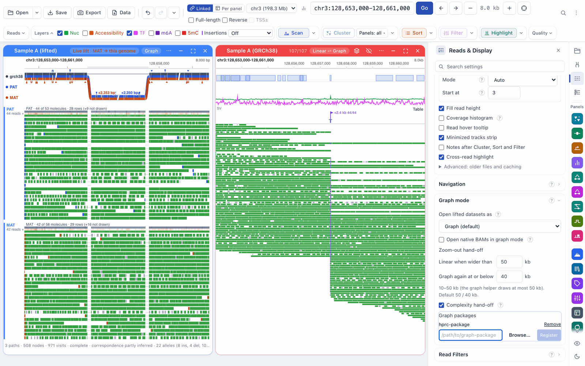
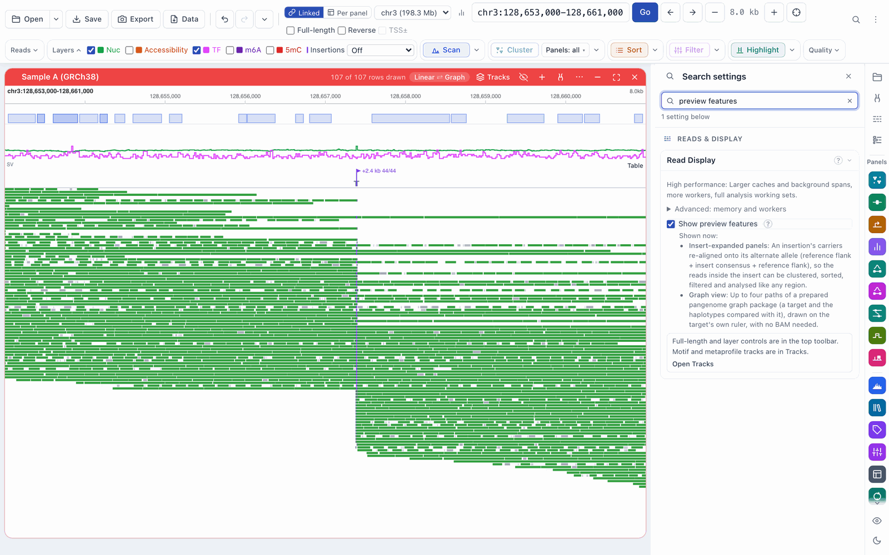

# Setting up live lift and graph mode

[← Docs index](../index.md) · [← README](../../README.md)

Live lift and graph mode let you look at reads aligned to a sample's own
assembly (for example the maternal and paternal haplotypes of HG002) on the
reference genome, and on a pangenome graph. This page says what to install and
set up. The features themselves are described in:

- [Live lift](live-lift.md): reads from another assembly drawn on this genome
- [Linked panels](linked-panels.md): the source assembly beside the lifted view, joined by ribbons
- [Differences](differences.md): the Differences row, expanding insertions, the inspector
- [Structural variants](structural-variants.md): confirmed, putative and conflicting carriers
- [Graph mode](graph-mode.md): a dataset panel drawn on a pangenome graph

All of the files below are made with
[graphlift](https://github.com/mtcicero26/graphlift), which is free and open
source (MIT).

## What you need

| What | Used by | Where it comes from |
|---|---|---|
| **A lift map**: a graphlift map (`*.graphlift.json`, with the files next to it), or a plain UCSC chain (`.chain`, `.chain.gz`) | live lift, linked panels, the Differences row | `gbz2chain` in [graphlift](https://github.com/mtcicero26/graphlift#chains-and-sidecar-gbz2chain), from a pangenome graph (for example an HPRC release), which writes both; or any UCSC chain, for example a liftOver chain |
| **A BAM aligned to the sample's assembly** | live lift | your aligner, against the assembly whose contig names the map uses (for example `chr1_MATERNAL`) |
| **The sample's assembly FASTA** (optional, indexed) | the inspector's assembly bases, copying an assembly insertion, **Confirmed by assembly** for insertions | the assembly you aligned the BAM to |
| **The graph helper** (`fiberbrowser-graph`) | graph mode, the graph view panel | the macOS app includes it; otherwise `pip install "fiberbrowser[graph]"` (see below) |
| **A graph package** | graph mode, the graph view panel | `fiberbrowser-graph prepare` in [graphlift](https://github.com/mtcicero26/graphlift#fiberbrowser-graph-helper-fiberbrowser-graph) |

A graphlift map is the better choice when you have one. A plain chain works,
with these differences:

- its haplotypes come from its contig names: `SAMPLE#HAP#CONTIG` gives one
  haplotype per `SAMPLE#HAP`, `_MATERNAL` and `_PATERNAL` give **MAT** and
  **PAT**, and anything else is one haplotype, **H**;
- the Differences row shows insertions, deletions and other gaps, but no
  substitutions (a chain doesn't record them);
- the whole chain is held in memory (about 850 MB for a whole genome).

## Live lift is on

<!-- ENABLEMENT (owner decision, 25 Oct): live lift is on by default; FIBERBROWSER_LIVE_LIFT only turns it off
     (and turns it on for a lab server). If this changes again, this section is the one place to update. -->

Live lift needs no setup beyond a lift map: **Open ▾** has **Add live lift…**
and a BAM panel's **…** menu has **View on another assembly (live lift)…**.

- **To turn it off** for a server, start FiberBrowser with
  `FIBERBROWSER_LIVE_LIFT=0` (or `false`, `no`, `off`). The two menu items are
  then hidden.
- **A shared lab server** keeps it off unless its host starts it with
  `FIBERBROWSER_LIVE_LIFT=1`. **A public server** never offers it.
- **A saved session** that holds a lifted dataset, opened where live lift is
  off, says *This session or request uses a live-lift dataset, which is turned
  off in this server. Start FiberBrowser with FIBERBROWSER_LIVE_LIFT=1 to open
  it.*

## Installing the graph helper

The graph helper is a small native program that reads graph packages. Nothing
else in FiberBrowser depends on it.

- **macOS app:** included.
- **pip:** `pip install "fiberbrowser[graph]"` adds the
  `fiberbrowser-graph-native` companion package. It is not part of
  `fiberbrowser[all]`. At the time of writing the companion package is built
  for Apple silicon Macs only.
- **Anywhere else:** build `fiberbrowser-graph` from
  [graphlift](https://github.com/mtcicero26/graphlift) (`cargo build --release
  --locked`) and point FiberBrowser at it with
  `FIBERBROWSER_GRAPH_HELPER=/path/to/fiberbrowser-graph`.

Restart FiberBrowser after installing it. Without a helper, the graph view says
**Graph helper unavailable**, with the install command and a **Check again**
button.

## Registering a graph package

A graph package is a folder made by `fiberbrowser-graph prepare`. FiberBrowser
checks every file in it once, when you register it, and remembers it after
that.

- **In the app:** **Open ▾ → Register graph package…** opens **Settings ›
  Reads & Display › Graph mode**, at **Graph packages**. Enter the package
  folder (or **Browse…**) and click **Register**. Checking a large package can
  take a few minutes. **Remove** next to a package forgets it.
- **At start-up:** `FIBERBROWSER_GRAPH_PACKAGES=/path/to/package` (several
  folders separated by `:`) registers packages. A package named there comes
  back at the next start even after **Remove**.
- **On a shared lab server** only its admins can register or remove packages;
  others see *Lab admins register and remove graph packages on this server.*



The same Settings block chooses how new lifted datasets open (**Open lifted
datasets as**), whether native BAMs open in graph mode, and the zoom-out
hand-off; see [Graph mode](graph-mode.md). The standalone **Graph view** panel
still has its own **Register a graph package…** item, and, with more than one
package registered, a **Graph package** submenu to switch between them. A
package whose files change after it was checked is refused until you register
it again.

## Preview features

**Settings › Reads & Display › Read Display › Show preview features** shows
features that are still being finished. It is on unless you turn it off. For
graphs it controls only the standalone **Graph view** panel. Registering
packages and graph mode on dataset panels (the **Linear ⇄ Graph** pill and
**View as graph**) don't depend on it.



## Trying everything at once: the demo launcher

`scripts/unified_demo.py` in a source checkout starts FiberBrowser with all of
the above ready, for that server only: live lift, the graph helper and a graph
package, and preview features. It then loads a sample as a lifted dataset
(**Sample A (lifted)**) and, if you give one, the same reads aligned to the
reference (**Sample A (GRCh38)**).

```bash
python scripts/unified_demo.py \
    --sample "Sample A" ~/pglift_work/demo_data/sample_a.alu_chr3.hg002v1.1.bam \
                        ~/pglift_work/demo_data/sample_a.alu_chr3.GRCh38.bam \
    --map ~/pglift_work/maps/hprc.GRCh38.HG002.chain.graphlift.json \
    --graph-package ~/pglift_work/graph/hprc-package \
    --fasta ~/pglift_work/ref/GRCh38.fa \
    --port 8883
```

It prints a link to open when the data is loaded. Ctrl+C stops the server.

| Option | What it does |
|---|---|
| `--sample LABEL LIFTED_BAM [NATIVE_BAM]` | A sample: its reads on its own assembly (added as a live-lift dataset, *LABEL (lifted)*) and, optionally, on the reference (*LABEL (GRCh38)*). Repeat for more samples. |
| `--map FILE` | The lift map for the lifted BAMs: a graphlift `.graphlift.json`, or a UCSC `.chain` / `.chain.gz`. |
| `--source-fasta FILE` | The samples' own assembly FASTA (indexed; optional; default `ref/source.fa` or `ref/source.fa.gz` when one exists). |
| `--graph-package DIR` | A graph package (repeatable). `--no-graph` leaves graphs off, so lifted datasets open as one panel per haplotype. |
| `--graph-helper PATH` | A `fiberbrowser-graph` you built. Without it, the launcher uses `$FIBERBROWSER_GRAPH_HELPER`, then a `fiberbrowser-graph` on your `PATH`, then the companion package or the macOS app's copy, and prints which one it used. |
| `--locus alu\|mhc` | The demo locus when no `--sample` is given: `alu` (default), the AluY insertion both haplotypes carry; `mhc`, an 89 bp deletion on the paternal haplotype only, where graph clustering labels that haplotype's reads **Not a carrier**. The launcher prints the region to cluster on. |
| `--fasta FILE` | The reference FASTA (with its `.fai`). |
| `--pooled` | Lifted datasets open as one pooled panel. |
| `--no-preview` | Turn preview features off for this server. |
| `--port N` | The port (default 8883). |
| `--home DIR` | The server's home folder (default: a new temporary folder). |
| `--build` | Build this checkout's frontend first (into the server's home folder, never into the checkout). |

Every path has a default under one work folder, `~/pglift_work` (or
`$PGLIFT_WORK`): `demo_data/`, `maps/`, `graph/` and `ref/`, as in the example
above. Pass `--port`, or the default (8883) is used. `python scripts/unified_demo.py --help` lists them.

The launcher gives the server a home folder of its own, points every file the
server keeps (settings, Library, jobs, sessions) into it and ignores
`FIBERBROWSER_*` variables set in your shell, so it never reads or changes
your own settings, Library or sessions. The graph helper is the one exception: a
`FIBERBROWSER_GRAPH_HELPER` set in your shell is passed on when `--graph-helper`
isn't given. It listens on this
computer only, without an access token: use it for demos and testing, not as a
shared server.

## Troubleshooting

| Symptom | What to check |
|---|---|
| No **Add live lift…** in **Open ▾** | The server was started with `FIBERBROWSER_LIVE_LIFT=0`, or it is a lab server started without `=1`, or a public server. |
| *No lift map was found next to this BAM or in the Library* | Put the map (a `.graphlift.json` with its files, or a `.chain`) next to the BAM or in a folder beside it, add it to the Library, or type its path in the dialog. |
| *Cannot read the map* | The file is neither a graphlift map nor a UCSC chain, or a graphlift map's files are missing. |
| *Anchor sequence mismatch* | The source assembly FASTA is not the assembly the map was made from. |
| **Graph helper unavailable** | Install `fiberbrowser[graph]`, or set `FIBERBROWSER_GRAPH_HELPER`, then restart. |
| **View as graph** is greyed out | Its tooltip says why: no helper, no registered package, or no package path matches the dataset. |
| No **Graph view** panel in the rail | **Show preview features** was turned off: turn it back on. |
| No **Register graph package…** in **Open ▾** | A public server, or a lab server where you are not an admin. |
