# Workflow: the Plots workspace

[← Docs index](../index.md) · [User guide](../guide.md) · [What's new](../whats-new.md)

**Plots** is a full-window workspace for the figures you make from the reads:
metaprofiles, footprint size plots, V-plots, heatmaps over BED regions,
co-accessibility and summaries across groups. It shares the locus, the
datasets, the clusters and the filters with the browser, so a plot always
describes the reads you are looking at.

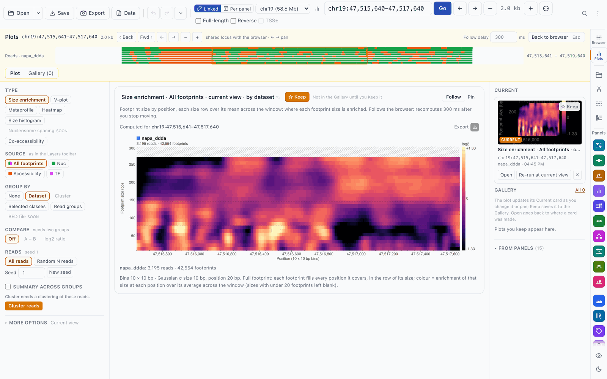

## Opening it

- Press **P**, or click **Plots** at the top of the icon strip on the right
  edge. **P**, **Esc** or **Back to browser** returns to the reads.
- ⌘K → **Open Plots** or **New plot from current view**.
- **Open in Plots** in a panel opens the matching plot: the cluster profiles
  and **Footprint sizes → Plots** (Clusters), a peak rule's card, Read Stats
  distributions, a saved class's V-plot and the Footprints **Sizes** tab. The
  read menu's **Footprint size enrichment here** and ⌘K (*size enrichment*,
  *V-plot*) open the size plots too.

The reads stay loaded underneath. The band at the top of Plots has the locus
with Back, Forward, pan and zoom, and a strip of reads: drag the reads to pan,
drag the box or its edges to move or zoom, click to jump. The top bar's locus
box works too, and ← / → pan. Click a position in a plot to centre the
browser there.

## Building a plot

Each plot is chosen from a few rows of buttons:

| Row | Choices |
|---|---|
| **Type** | Size enrichment, V-plot, Metaprofile, Heatmap, Size histogram, Co-accessibility |
| **Source** | **All footprints** (the default: nucleosome and TF footprints together), or one layer, with the names and colours of the Layers toolbar |
| **Group by** | None (datasets pooled), Dataset, Cluster, Selected classes, Read groups (the panels of a split) |
| **Reads** | All reads, or **Random N reads** per dataset, with a **Seed** and **New seed** |
| **Compare** | Off, **A − B**, **log2 ratio**: each group against the rest, against all, or two groups you pick. Disabled, with the reason, while the plot has fewer than two groups |
| **More options › Where** | **Current view**, **Selected features** (the selected peaks, each centred in a window), **Random reads (whole file)** (size histogram), **BED region sets** |
| **More options › Display** | The type's own settings: bins, smoothing, normalisation, minimum reads, colormap |

The header names what the plot shows, for example *Metaprofile · All
footprints · current view · by dataset*. Below the plot, a line gives the reads
used, how many were dropped and the seed. Every random step (read sampling,
region sampling, k-means, bootstrap) uses the plot's seed, so the same seed
gives the same plot.

If a plot needs something that isn't there yet, it says so and offers a button
that does it: **Cluster reads**, **Scan peaks**, **Find classes** or **Find
geometries**. The plot picks up the result.

### Follow and Pin

A **Follow** plot redraws for the new view 300 ms after you stop moving (change
**Follow delay** in the band). While it waits it says **Updating…** and greys
the old numbers. **Pin** keeps the plot on its locus. Every plot shows
**Computed for** with the locus its numbers come from. Plots grouped by cluster
and plots of BED regions or selected features are always pinned.

## Plot types

### Metaprofile

The share of reads with the source at each position, one line per group.
**Signal** chooses fraction of reads, counts or relative to the window.
**Size band** splits the source's footprints by size (bands < 90, 90–200 and
≥ 200 bp by default; change **Band edges**): draw one band, or **One line per
band**. **Split by state at the anchor** splits each group by the read's state at the
centre: covered by a nucleosome-sized footprint, by a TF-sized one, or open.
**Anchor ±** sets the window the state is read in (10 bp by default) and
**Nucleosome ≥** the size that counts as a nucleosome (90 bp).

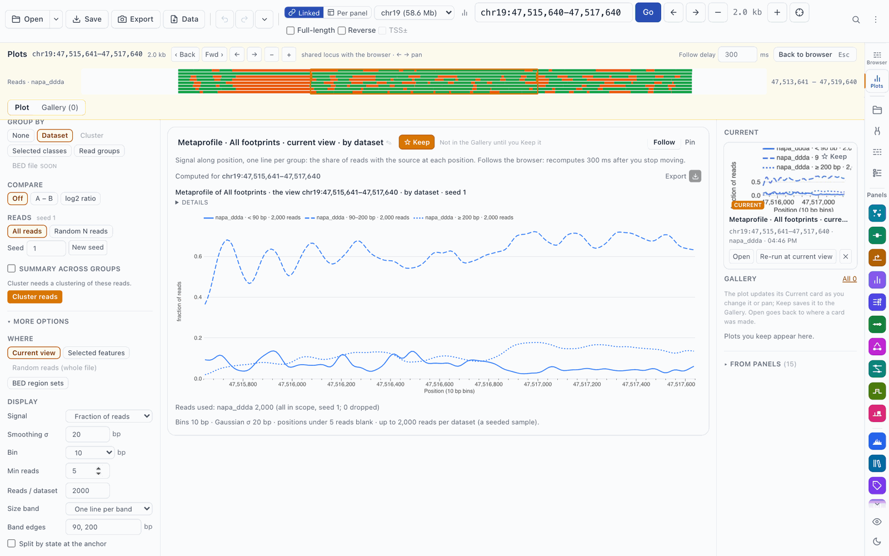

**Several sources.** A metaprofile can show up to eight sources at once:
click more **Source** chips. Besides the layers and MA-tag groups, the chips
list each footprint class from **Find classes** and each NFR family from an
Accessibility run in view. When there are none, the group is greyed out and
has a button for the step that makes them. A family's line is the share of
the reads scored on it that are members, drawn over the family's span. Each
line takes its source's layer colour. By default each group gets its own
panel with every source overlaid on a shared y range; **Sources as** and
**Panel y** change that. m6A is marks per bp, so it is never mixed with the
other sources.

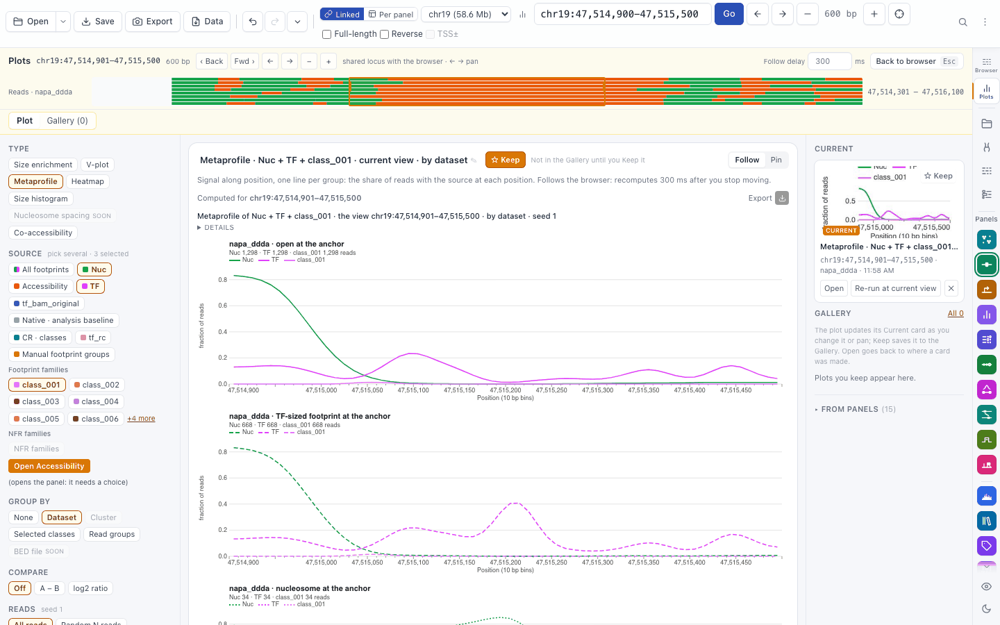

**x-axis** labels a view metaprofile by distance from an anchor instead of by
genome position: a gene's start or end, the view centre or a typed position.
Upstream is negative on either strand. It works with one source or several.

### Size enrichment and V-plot

Footprint size by position. **Size enrichment** fills every position a
footprint covers and divides each size row by its mean across the window, so
colour shows where each size is enriched. **V-plot** counts each footprint once
at its midpoint. The Clusters panel's **Footprint sizes → Plots** opens them
one per cluster ([guide](../guide.md#footprint-size-enrichment-plots)).

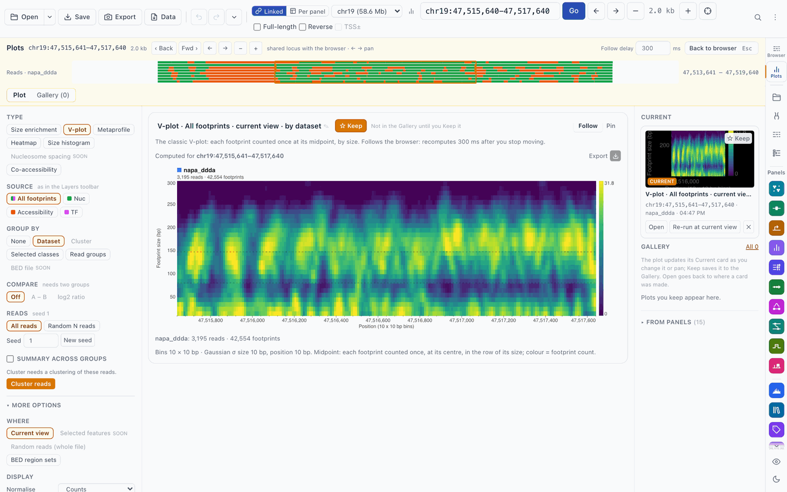

### Size histogram

The footprint size distribution, one line per group: counts or bp covered,
counted by midpoint, by any overlap or clipped to the region, as raw counts, a
fraction or per read. **Where → Random reads (whole file)** draws N reads at
random from the whole BAM, whatever the locus, for a genome-wide size
distribution.

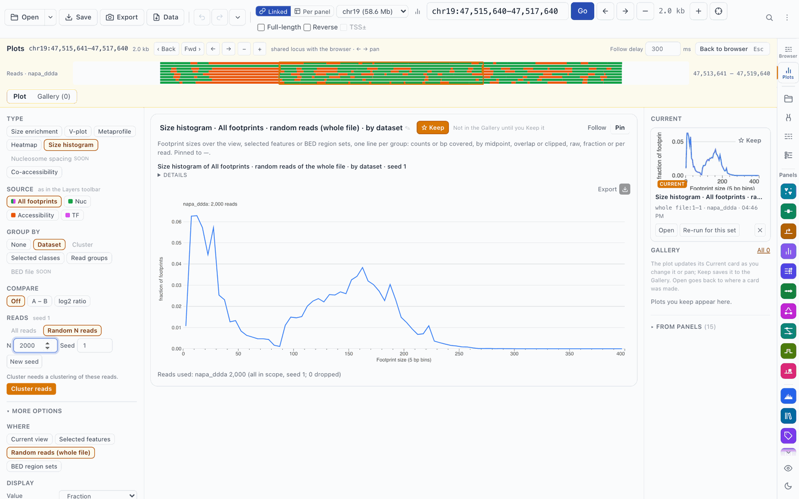

### Heatmap

One row per region, with its metaprofile on top on the same axis. Use it with
**Selected features** or **BED region sets**. Sort the rows by the mean
signal, the signal at the centre, **Clusters (k-means)**, BED order or a BED
column such as the score. **Save C1 as BED set** (one button per k-means row cluster) or
**Save all** turns row clusters into region sets that other plots can use as groups.

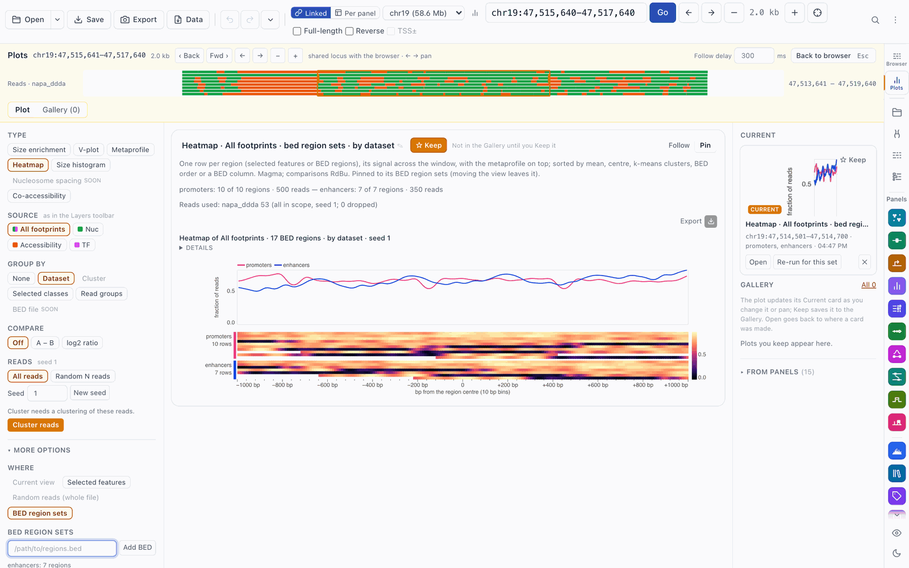

### Co-accessibility

Which positions are open together on the same molecules, as a square matrix
per dataset or pooled, with **A − B** between datasets. Choose the signal and
layer, the normalisation (correlation, co-accessibility, observed / expected,
O / E by distance), scaling, bin size and minimum reads. The plot also sets the
co-accessibility track under the reads (heatmap strip, arcs or virtual 4C).
**JSON**, **TSV** and **Python** export the matrix and its settings. This
replaces the Co-accessibility panel of 3.0.

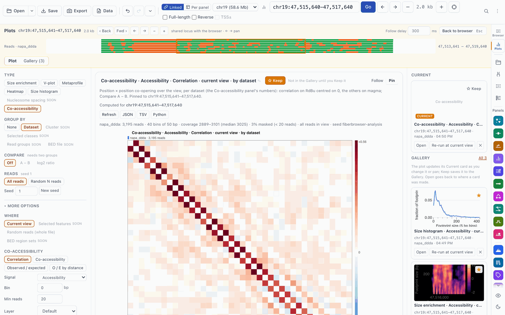

## BED region sets

With **Where → BED region sets**, type the path of a BED file (gzip is fine)
and click **Add BED**. Each file is a group. Then choose:

- **Anchor**: centre, **Start (TSS)** or end. Start and end follow the strand,
  and minus-strand regions are flipped so downstream is always to the right.
- **Window**: **Anchor ± flank**, or **Scale regions** to one length.
- **Regions**: all, **Random N (seeded)** or **Equal N per set**.
- **Not occluded by a nucleosome**: drop reads with a nucleosome over the
  centre, or keep only regions whose centre is covered in at most X% of reads.
  The plot reports how many reads and regions were dropped.

Large BED files are read in chunks with a progress bar and **Cancel**.
Metaprofiles, heatmaps, size histograms, size enrichment and V-plots take BED
region sets.

To browse the reads of many sites together, open the BED as a
[meta-locus](meta-locus.md) instead.

## Summary across groups

Tick **Summary across groups** to reduce each group to one number, drawn as
bars or a line in panel order (datasets as ordered conditions, or clusters).
For a metaprofile, **Value** is the mean of the drawn curve over the window
by default, so each bar equals the curve beside it, smoothing and blank bins
included. **Pooled** instead divides the window's summed signal by its summed
coverage, as 3.1.0 did.
**Window** limits the positions it averages. **Interval**: **Auto** uses a
seeded bootstrap for means and the exact Wilson interval for a band share;
**Bootstrap 95%**, **Wilson 95%** or none. Set the number of **Resamples** and
the **Boot seed**. For BED region sets the bootstrap resamples regions.

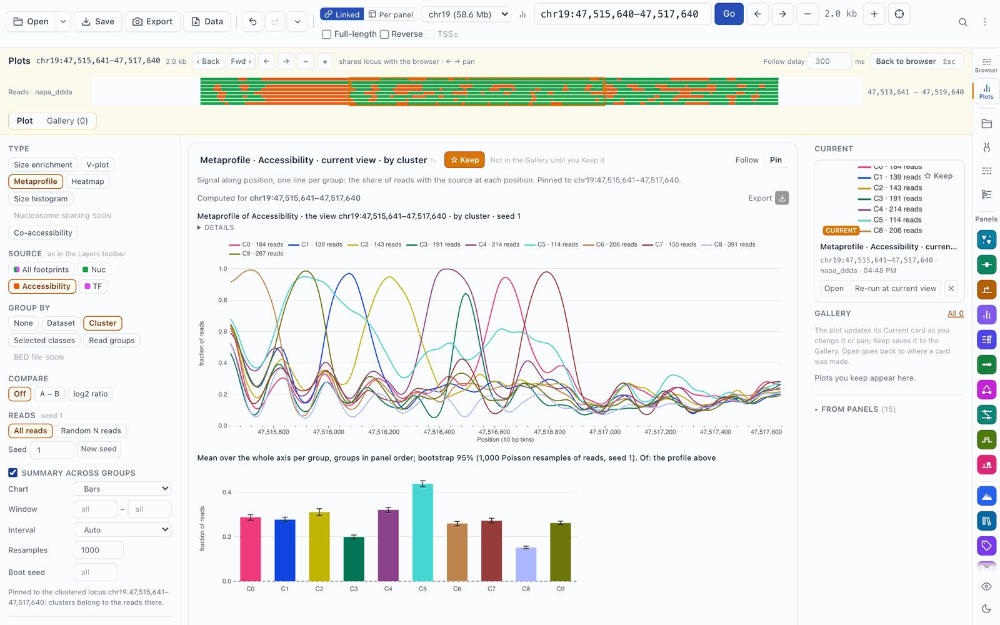

With several sources, the summary draws grouped bars: one cluster of bars
per group, one bar per source in its colour, each with its own interval. The
table and TSV have one block of rows per source.

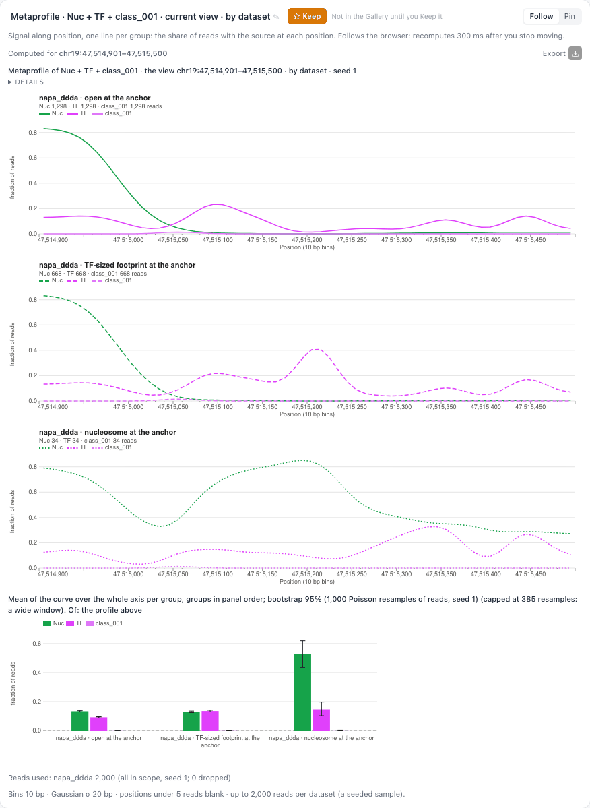

With **Compare** on, the box reads **Summary of the comparison**. For
metaprofiles and size histograms it gives one value per comparison: A − B, or
log2(A / B), of the two sides' summaries, with a bootstrap interval that
resamples both sides together. Wilson gives no interval for a difference. For
size enrichment and V-plots, Summary is off while comparing; turn Compare off
to summarise each group. A line under the compare picker says what is
compared and summarised. With several sources, each comparison has one line
and one summary bar per source.

For size enrichment, **Ratio of** chooses what the log2 ratio compares: the
two sides' **size shares** (the default) or, for A vs B, their
**enrichment** as the two plots show it (per size row, per position or
observed / expected, with Min footprints). Each vs rest and each vs all
always compare size shares.
**Size range** sets any range of sizes beside the presets.

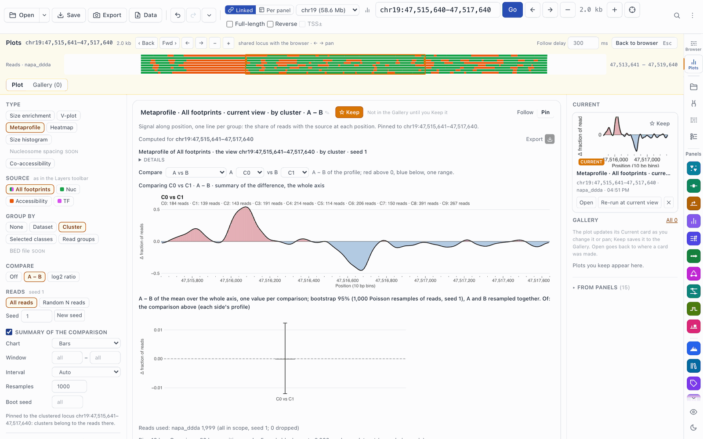

## Current card, Keep and the Gallery

Each open plot has one **Current** card on the right, updated as you change
the plot or pan. Nothing goes into the Gallery until you click **Keep**. A kept
card stores the plot's data, the browser state it was made in and its seed.

- **Open** a kept card to go back to where it was made: the locus, the
  clusters and the plot. Change it and **Keep** again for a new version under
  the original.
- **Re-run at current view** (**Re-run for this set** for BED plots) makes the
  same plot at the current locus.
- **Duplicate**, rename (the pencil beside the title) or delete (×).
- In the **Gallery** tab, select 2–4 cards for **Compare side by side** (one
  colour scale when the plots are the same kind), or **Export selected (PDF)**.

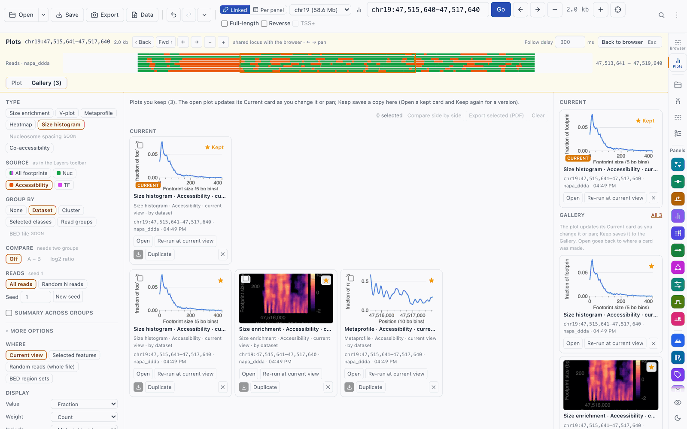

The Gallery is saved with the session. **Export** on a plot saves PNG, SVG,
PDF or TSV.

**From panels** lists plots that stay in their own panels because the panel's
run computes them (class prevalence, NFR widths, nucleosome regularity, Read
Stats, cluster composition). Click one to open its panel.

## Experimental: Feature hub workspace and differential features

A full-window Feature hub workspace and the **Differential features**
plot type are behind **Settings › Read Display › Experimental: Feature hub
workspace**, off by default, while they are reworked. The docked
[Feature hub](feature-hub.md) panel works as before.
