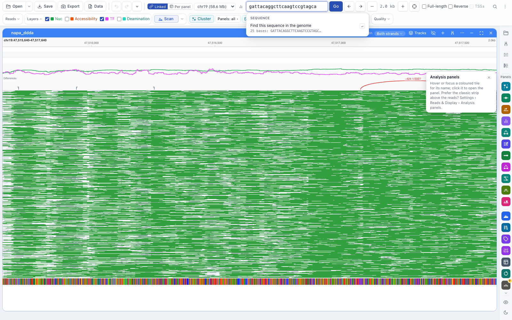
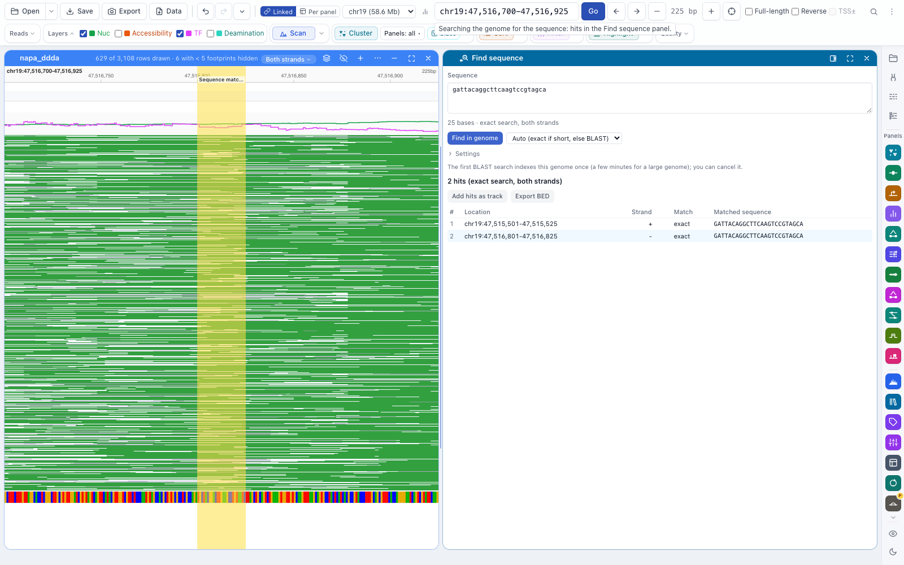

# Workflow: find a sequence in the genome

[← Docs index](../index.md) · [← README](../../README.md)

**Find sequence** shows where a DNA sequence is in the loaded genome: a primer, an
oligo, a guide or a stretch copied from another file. Paste it and FiberBrowser lists
every place it matches, on both strands. Click a hit to go there.

## Opening it

- **Paste the sequence into the locus box.** For pure DNA of 12 or more bases (A, C,
  G, T and IUPAC codes such as N or R), the suggestions offer **Find this sequence in
  the genome**. Press Enter. The panel opens and starts the search.
- **Tools → Find sequence** in the panel rail, **Find sequence in genome…** in the
  command palette (⌘/Ctrl+K), or **View → Find Sequence in Genome…** in the Mac app.

The box also takes a FASTA record, spaces, line breaks and GenBank-style numbers.
RNA (U) is read as T.

## Two searches, chosen for you

| Search | Used for | What it finds |
|---|---|---|
| **Exact / IUPAC** | Queries shorter than 30 bp, and any query with IUPAC codes | Every place the query matches, on both strands, overlapping hits included. An IUPAC code matches each base it stands for. An N in the genome never matches. Up to **Max mismatches** differences are allowed (default 0). Loaded plasmid maps are searched as well. |
| **BLAST** | Longer queries, or **BLAST (approximate)** in the mode menu | Approximate matches, with identity and e-value, from `blastn`: blastn-short under 50 bp; above that, megablast in Auto mode and blastn when you choose **BLAST (approximate)**. |

BLAST uses the genome's BLAST database, the same one the Primers panel and Identify
use. If none exists yet, the first BLAST search builds it once in the background,
with progress and **Cancel**. That takes a few minutes for a large genome. The panel
says whether the database is ready.

Without BLAST+ (outside the Mac app, when `blastn` is not installed), searches
use the exact scan, and the result says so. The exact scan takes queries up to
10,000 bases; a longer query needs BLAST+ and is refused without it. The install hint is the same as for
primer design.

## Settings

Under **Settings** in the panel. Each one has a default, and **Reset to defaults**
restores them.

| Setting | Default | Meaning |
|---|---|---|
| Exact search below (bp) | 30 | In Auto mode, shorter queries use the exact scan. |
| Max mismatches (exact) | 0 | Differences allowed per exact hit (up to 5). |
| E-value (BLAST) | 0.01 | BLAST hits at or below this value. |
| Max hits | 500 | Hits listed. The exact scan counts every hit. BLAST keeps at most this many hits per contig, so when a contig reaches it the total reads "at least". |
| Shortest query (bp) | 12 | Shorter queries are refused, because they match too many places. |
| BLAST task | Auto | megablast, blastn or blastn-short. |

## Results

- Each row shows the location (1-based, as the locus box shows it), the strand (± for
  a query that is its own reverse complement), the match (exact, *n* mismatches, or
  identity for BLAST), the e-value for BLAST, and the matched genome bases. The bases
  read like the query, so a minus-strand hit is shown reverse-complemented. In exact
  hits, mismatched bases are in red.
- **Click a hit** to move the view there with some context on either side. The match
  is highlighted. The highlight moves to each hit you click, and Back (Alt+←) returns
  to where you were.
- **Add hits as track** shows every hit as an annotation track for this session.
  Sessions do not save its hits; after the server restarts, its row in the track
  cart shows as unavailable (search again to show them).
- **Export BED** saves the hits as BED6 (score = identity × 10).
- With more hits than **Max hits**, the result shows the first ones (fewest mismatches
  or best e-value first) and the total.

## Where it runs

The search runs on the computer or server that FiberBrowser runs on. It searches the
genome loaded there (Settings → Reference & Tracks); with none loaded, the panel says
so. A genome opened from the online picker is searched once its download has
finished. On a lab server, members can search the server's genome; the request
carries only the sequence and the settings, never a file path. A public server does
not offer it.
