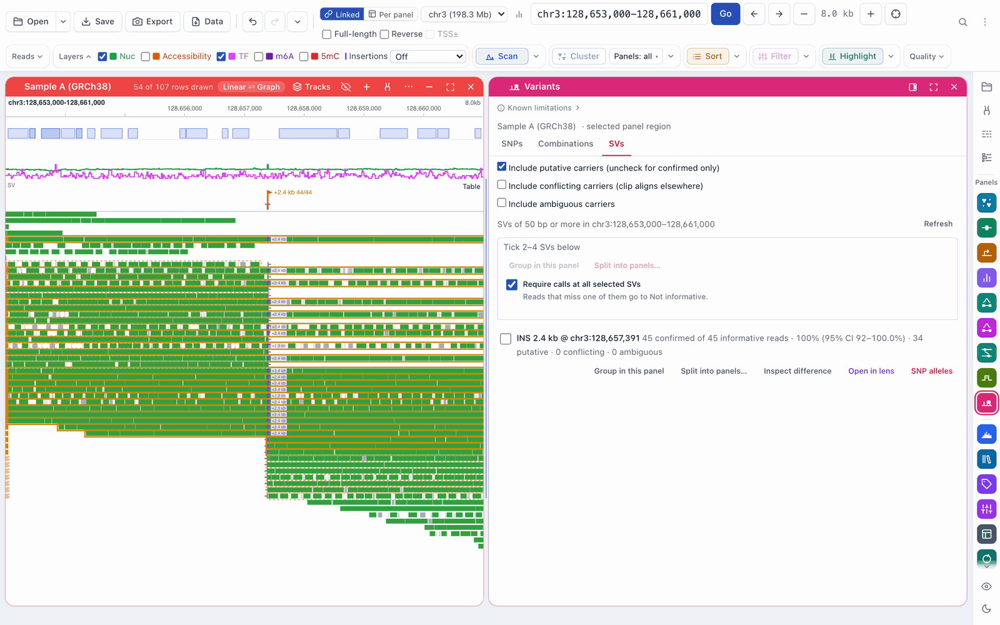
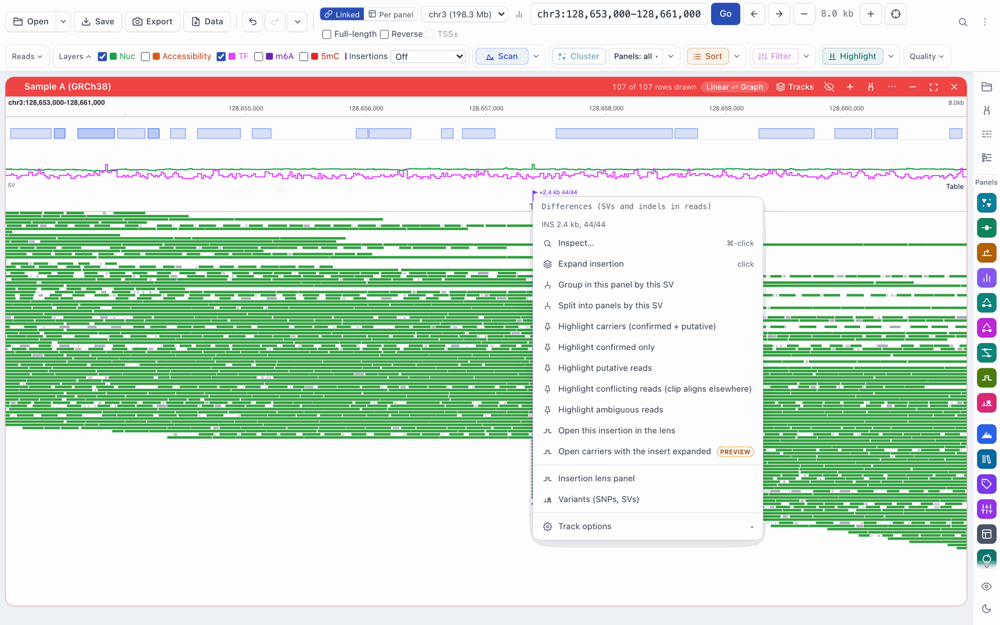
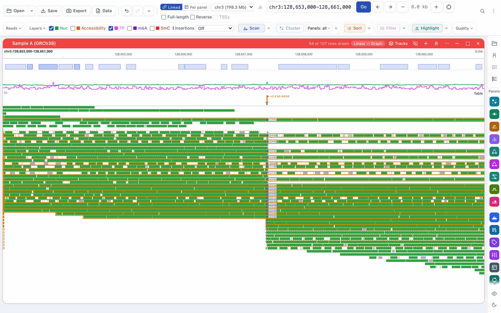
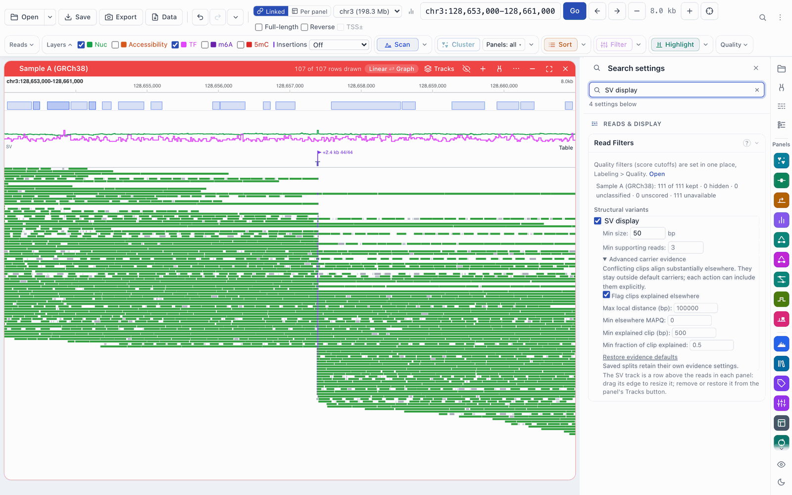

# Workflow: structural variants and their carriers

[← Docs index](../index.md) · [← README](../../README.md)

FiberBrowser finds insertions and deletions in the reads in view from their
own alignments (CIGAR indels, clipped ends and split alignments), with no
population prior. For each one it decides, molecule by molecule, how strong the
evidence is that the molecule carries it. Those **evidence levels** decide
which reads count as carriers when you highlight, group or split reads by a
variant.

The [user guide](../guide.md#variants) walks through an example: a 7.5 kb
insertion on one haplotype, with a CTCF site inside it.

## Evidence levels

| Level | What it means | Counted as a carrier |
|---|---|---|
| **Confirmed** | The read's alignment has the event itself (an insertion or deletion in its CIGAR), or two pieces of the read are joined directly across it. | always |
| **Putative** | The read is clipped where the variant is, consistent with it, but it does not span it. | by default |
| **Conflicting** | As putative, but much of the clipped part aligns well somewhere else (another chromosome, or more than 100 kb away). The clip may come from a different event. | only when you include it |
| **Ambiguous** | The clip fits more than one nearby variant. | only when you include it |

Molecules are counted once per variant, however many alignments they have,
with the same rules everywhere: the Differences row, the Variants panel, the
split dialog, highlights and the insertion lens. The numbers can still differ
between them when they count different reads: the Differences row counts the
reads loaded for the view (which may be a sample of a deep view; its tooltip
says so), while the SVs tab, splits and the lens count every read in the
region. Different carrier choices (putative, conflicting, ambiguous) also give
different counts. The technical definitions are
in [SV evidence](../reference/sv-evidence.md).

## The SVs tab

**Variants → SVs** lists the deletions and insertions in view. Each row gives
the number of confirmed carriers out of the informative reads (*N confirmed of
M informative reads*, with the share and its confidence interval), then the
number of putative, conflicting and ambiguous reads.

Three checkboxes above the list choose who counts as a carrier when you group or
split reads from the tab:

- **Include putative carriers (uncheck for confirmed only)**: on;
- **Include conflicting carriers (clip aligns elsewhere)**: off;
- **Include ambiguous carriers**: off.

Each row's buttons group or split the reads by the variant, open it in the
insertion lens, list the SNP alleles that travel with it, and **Inspect
difference** (the inspector; see [Differences](differences.md#the-inspector)).
A saved split keeps the evidence choices it was made with.

## The Differences row on a native BAM

On a BAM aligned to this genome, the **Differences** row (called the SV row in
FiberBrowser 3.0) flags each insertion with its size and draws each deletion as
a bar. A flag's label gives its confirmed carriers and informative reads (for
example *INS 7.5 kb, 71/108*). A variant is drawn when its confirmed plus
putative carriers reach the minimum; a weak variant next to a much stronger one
is drawn faint.

- **Click** a variant: its carriers (confirmed and putative) are highlighted,
  and an insertion of 50 bp to 50 kb is also expanded in place (see
  [Differences](differences.md#expanding-an-insertion)).
- **⌘/Ctrl-click** opens the inspector; **Shift-click** selects it.
- **Hover** for its counts at each level.
- **Right-click** for its actions (the menu is headed *Differences (SVs and
  indels in reads)*):

| Item | What it does |
|---|---|
| **Inspect…** | The inspector. |
| **Expand insertion** / **Collapse insertion** | As a click. |
| **Group in this panel by this SV** | Colours the reads by allele (carriers, reference, not informative). |
| **Split into panels by this SV** | One panel per allele. |
| **Highlight carriers (confirmed + putative)** | The default carriers. |
| **Highlight confirmed only** | Only confirmed carriers. |
| **Highlight putative reads** | Only putative ones. |
| **Highlight conflicting reads (clip aligns elsewhere)** | Only conflicting ones. |
| **Highlight ambiguous reads** | Only ambiguous ones. |
| **Open carriers with the insert expanded** | Re-aligns the carriers onto the insertion's own sequence (a preview feature; see the [guide](../guide.md#50-the-insert-expanded)). |
| **Open this insertion in the lens** | The [insertion lens](differences.md#the-insertion-lens). |

The row also works from the keyboard: the arrow keys move between variants,
Enter highlights the reads, Shift+Enter selects, `i` inspects, and Shift+F10
opens the menu.

When a lifted dataset is open, the inspector compares the variant with that
dataset's assembly (**Confirmed by assembly**, **assembly-supported
(approximate)**, ...); see [Differences](differences.md#assembly-comparison).
It uses the first lifted dataset that was opened, whatever its sample: with
several samples open, keep only the sample you mean to compare with.

## Highlighted carriers

Highlighted confirmed carriers have a solid amber outline and an amber bar at
the left edge. Putative, conflicting and ambiguous reads, when included, have a
dashed outline and a dashed violet line at the left edge, so they are never
mistaken for confirmed ones. In the insertion lens they are hatched.

## When a clip counts as conflicting

**Settings › Reads & Display › Read Filters › Structural variants › Advanced
carrier evidence** sets the rule (shown when **SV display** is on and a BAM is
loaded):

| Setting | Default |
|---|---|
| Flag clips explained elsewhere | on |
| Max local distance (bp) | 100,000 |
| Min elsewhere MAPQ | 0 (no MAPQ filter) |
| Min explained clip (bp) | 500 |
| Min fraction of clip explained | 0.5 |

A clip is conflicting when another alignment of the same molecule (with at
least the minimum mapping quality, if you set one) explains at least that many of its bases and that
fraction of it, on another chromosome or farther away than the local distance.
**Restore evidence defaults** puts the values back. Splits you saved keep their
own settings.

## Lifted datasets

Read-based SV analyses (the SVs tab, SV splits and the lens) work on BAMs
aligned to the genome in view. A [lifted dataset](live-lift.md) has its own
Differences row, which shows the sample's assembly differences; its inspector
sorts lifted reads into carriers with the same evidence levels (see
[Differences](differences.md#the-inspector)).
